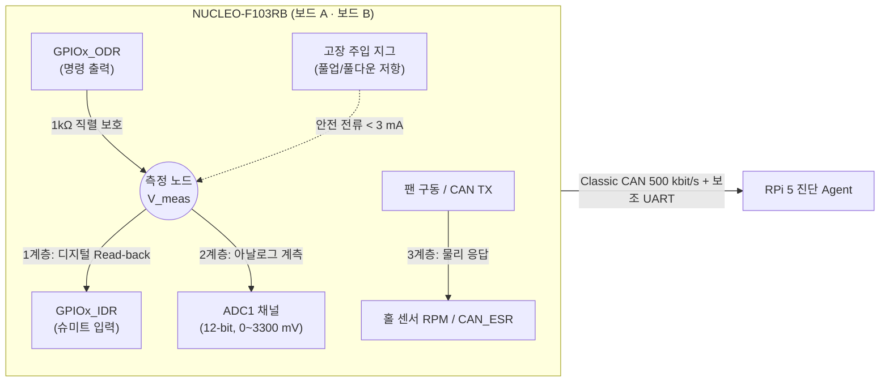

# ECU GPIO 출력 열화 및 자가진단(BIST) 시나리오 설계

> **작성일**: 2026-11-18 · **연계 이슈**: `PJT-17` (실사례 근거), `PJT-16` · `PJT-20` (Phase 2 규약 협의), `PJT-27` (RPi 5 Agent 연동)
>
> **상태: Phase 2 확장 제안 시나리오 초안 (`v0.1`).** 아래 CAN ID, 바이트 배치, 임계 전압(`mV`), 판정 코드(`ECU_GPIO_*`)는 `PJT-16`/`PJT-20` 합의 전까지 확정 규약이 아니며, 현재 `RPI5_Agent_Docker` Phase 1(`hw_test` `0x100`)에는 아직 구현되지 않았습니다.

---

## 1. 배경 및 동기 (`PJT-17` 실사례 기반)

2026-11-16 `PJT-17` 하드웨어 분리 점검 과정에서, 기존 RPi 5 본체의 **SPI SCLK·CS 핀(`GPIO8`, `GPIO11`, `GPIO21`)이 소프트웨어상 LOW를 출력해도 물리 전압이 `0V`까지 내려가지 않고 `0.7~1.0V`에 머무는 출력단 결함**을 멀티미터 대조 측정으로 규명한 바 있습니다([`RPi5_CAN_40핀_종합_점검_결과.md`](RPi5_CAN_40핀_종합_점검_결과.md)).

이 실사례를 차량용 분산 ECU(`NUCLEO-F103RB` 보드 A·B) 진단 시나리오에 역으로 적용할 때, 두 가지 문제가 발생합니다.

1. **출력 레지스터(`ODR`)만으로는 물리 결함 감지 불가**: MCU 펌웨어는 자신이 `0`을 썼다고 판단하지만 실제 핀은 외부 누설·단락·싱크 드라이버 열화로 떠 있을 수 있습니다.
2. **디지털 입력(`IDR`) 임계 전압 사각지대**: STM32 디지털 입력의 `V_IL` 임계치(약 `0.8~1.0V` 부근 슈미트 트리거) 바로 아래인 **`0.4~0.9V` 구간**에 핀이 머물 경우, 디지털 `IDR`은 여전히 `0`(정상)으로 읽혀 초기 출력단 열화를 놓치기 쉽습니다.

따라서 본 시나리오는 사람이 멀티미터로 매번 핀을 찍기 전에 **대상 ECU가 내장 디지털 Read-back(`ODR`/`IDR`) + 12-bit ADC 아날로그 루프백 + 구동/통신 피드백 교차 검증으로 GPIO 출력 열화를 스스로 감지하고 CAN으로 RPi 5 진단 Agent에 보고**하도록 설계합니다.

---

## 2. 3계층 ECU 자가진단(BIST) 구조 (`NUCLEO-F103RB`)



| 계층 | 검사 수단 | 감지 대상 결함 | 정상 판정 기준 (초안) | 이상 판정 기준 (초안) |
| :--- | :--- | :--- | :--- | :--- |
| **1계층** | `GPIOx_ODR` vs `GPIOx_IDR` | 완전 고착(`Stuck-at-High` / `Stuck-at-Low`), 강한 외부 단락 | `ODR == IDR` | 명령 후 안정화 대기(`1 ms`) 뒤 `ODR != IDR` |
| **2계층** | `ADC1` 루프백 전압(`mV`) | **`0.7~1.0V` 부유 등 아출력 열화**(`IDR`은 정상일 수 있는 초기 누설 포함) | `LOW`: `0~150 mV`<br>`HIGH`: `3,100~3,300 mV` | `LOW` 시 `400~1,200 mV` (열화 `warning`)<br>`LOW` 시 `> 1,200 mV` 또는 `HIGH` 시 `< 2,000 mV` (고착 `error`) |
| **3계층** | 구동·통신 피드백 대조 | 팬 PWM 핀 누설 오동작 / 무응답, `CAN_TX` 핀 드라이버 불량 | 보드 B: `PWM=0%` 시 `RPM=0`, 구동 시 목표 범위 내<br>CAN: `errcb_delta=0`, `LEC=0` | `PWM=0%`인데 미세 회전 또는 구동 시 무응답<br>`CAN_ESR.LEC` (Bit Error) 및 `errcb_delta` 급증 |

---

## 3. 안전한 고장 주입(Fault Injection) 회로

실습·검증 중 STM32 GPIO 출력 핀을 `3.3V` 또는 `GND`에 직결(단락)하면 핀 출력 트랜지스터가 영구 파손될 수 있습니다. 반드시 아래 **직렬 보호 저항(`1 kΩ`)** 기반 분압 회로를 사용해 핀 전류를 **`3.3 mA` 이하**(STM32F103 허용 싱크/소스 범위 내)로 제한한 상태에서 결함을 모사합니다.

```text
STM32 GPIO 출력 핀 ──[ 1 kΩ 보호 저항 ]──┬──▶ STM32 ADC1 입력 핀 (V_meas)
                                        │
                                  [고장 주입 단자]
                     (스위치/점퍼로 아래 저항 중 택1 연결)
                     • Case 1 (LOW 열화 0.77V): 3.3 kΩ ─▶ 3.3V
                     • Case 2 (Stuck-High 2.48V): 330 Ω ─▶ 3.3V
                     • Case 3 (Stuck-Low  0.60V): 220 Ω ─▶ GND (HIGH 출력 시)
```

| 주입 모드 | 명령 출력(`ODR`) | 주입 연결 | 이론 측정 전압(`V_meas`) | 핀 전류 | 모사하는 실물 결함 |
| :--- | :---: | :--- | :--- | :---: | :--- |
| **열화 `LOW`** | `0` (`LOW`) | `3.3 kΩ` → `3.3V` | $3.3 \times \frac{1.0}{1.0 + 3.3} \approx$ **`767 mV`** | `0.77 mA` | **`PJT-17` RPi5 결함과 동일한 `0.7~1.0V` LOW 누설·드라이버 열화** |
| **`Stuck-High`** | `0` (`LOW`) | `330 Ω` → `3.3V` | $3.3 \times \frac{1.0}{1.0 + 0.33} \approx$ **`2,481 mV`** | `2.48 mA` | 외부 전원/풀업 단락으로 LOW 전환 불가 (`IDR=1`) |
| **`Stuck-Low`** | `1` (`HIGH`) | `220 Ω` → `GND` | $3.3 \times \frac{0.22}{1.0 + 0.22} \approx$ **`595 mV`** | `2.70 mA` | 외부 GND 단락 또는 하이사이드 드라이버 단선 (`IDR=0`) |

> **안전 수칙**: 전원을 인가한 상태에서 배선을 변경하지 않으며, 테스트용 출력 핀은 반드시 `Push-Pull`(Low/Medium speed)로 설정하고 위 직렬 보호 저항을 거친 후에만 주입 단자를 연결합니다.

---

## 4. 시나리오 케이스 카탈로그 (`GPIO-BIST-00` \~ `GPIO-BIST-04`)

| 케이스 ID | 고장 주입 조건 | STM32 관측값 (`ODR` / `IDR` / `ADC` / `RPM`) | RPi 5 Agent 기대 Finding (`severity`) | Agent 권장 추가 확인 (`next_check`) |
| :--- | :--- | :--- | :--- | :--- |
| **`GPIO-BIST-00`** | 주입 없음 (정상 기준선) | `ODR=0`, `IDR=0`, `ADC=0~150 mV` (`LOW`)<br>`ODR=1`, `IDR=1`, `ADC=3,150~3,300 mV` (`HIGH`) | `ECU_GPIO_HEALTHY` (`info`) | 추가 조치 없이 정상 템플릿 응답 반환 (`deterministic_template`) |
| **`GPIO-BIST-01`** | `LOW` 명령 중 `3.3 kΩ` 풀업 주입 | `ODR=0`, **`IDR=0`**, **`ADC=750~950 mV`** | **`ECU_GPIO_LOW_VOLTAGE_DEGRADED`** (`warning`) | 해당 GPIO 핀의 무부하 단품 LOW 전압 및 외부 풀업/부하 누설을 멀티미터로 확인 |
| **`GPIO-BIST-02`** | `LOW` 명령 중 `330 Ω` 풀업 주입 | `ODR=0`, **`IDR=1`**, **`ADC >= 2,400 mV`** | **`ECU_GPIO_STUCK_HIGH`** (`error`) | `3.3V`/외부 풀업 단락 여부 및 구동 회로 배선 분리 점검 |
| **`GPIO-BIST-03`** | `HIGH` 명령 중 `220 Ω` 풀다운 주입 | `ODR=1`, **`IDR=0`**, **`ADC <= 800 mV`** | **`ECU_GPIO_STUCK_LOW`** (`error`) | GND 단락·부하 과전류 및 해당 핀 소스 구동 단선 점검 |
| **`GPIO-BIST-04`** | 보드 B 팬 제어 핀 열화 + `PWM` vs 홀 센서 불일치 | 예: `PWM=0%`인데 `ADC=850 mV` & `RPM > 0`<br>또는 `PWM=80%`인데 `ADC < 800 mV` & `RPM=0` | **`FAN_ACTUATOR_FEEDBACK_MISMATCH`** (`error`) | 팬 구동 `MOSFET`(`IRLZ44NPBF`) 게이트 전압·배선 및 홀 센서(`A3144E`) 신호 확인 |

---

## 5. CAN 진단 프레임 · 보조 UART 연동 규약 초안 (`PJT-16` · `PJT-27` 연계)

Phase 2 본 규약 합의(`PJT-16`, `PJT-20`) 시 보드 A·B의 상태/진단 프레임(또는 전용 BIST 진단 ID, 예: `TBD` 11-bit Standard ID, `100~500 ms` 주기 또는 요청 응답)에 아래 `8 Byte` 페이로드를 반영하는 안을 제안합니다.

### 5-1. CAN 8-Byte 페이로드 레이아웃 (제안 초안)

| Byte | 필드명 | 자료형 | 단위 / 의미 |
| :---: | :--- | :--- | :--- |
| `0` | `node_id` | `uint8` | `1`: 보드 A(열관리 제어기), `2`: 보드 B(스마트 냉각팬 ECU) |
| `1` | `gpio_fault_flags` | `uint8` | `bit0`: ODR/IDR 불일치, `bit1`: LOW 전압 열화, `bit2`: HIGH 전압 부족, `bit3`: 액추에이터 피드백 불일치, `bit4~7`: 예약 `0` |
| `2` | `gpio_cmd_idr` | `uint8` | `bit0`: `ODR` 명령 레벨, `bit1`: `IDR` 실측 레벨, `bit2`: `ADC` 유효 여부 (`1=valid`) |
| `3` | `pin_channel_id` | `uint8` | 자가진단 대상 핀/채널 식별 번호 (예: `0`=PWM 게이트, `1`=진단 출력 핀) |
| `4~5` | `measured_mv` | `uint16` (LE) | `ADC1` 실측 핀 전압 (`0~3,300 mV`, `0xFFFF`=미측정/오류) |
| `6~7` | `actuator_rpm` | `uint16` (LE) | 보드 B 홀 센서 측정 `RPM` (`0xFFFF`=해당 없음/미측정) |

### 5-2. 보조 UART 진단 로그 필드 (선택 확장)
기존 ST-LINK VCP (`115200 8N1`) 진단 라인에 아래 스칼라 키-값을 병기하면 CAN 버스가 끊긴 상태에서도 RPi 5 수집기(`hw_collector.py`)가 GPIO 이상을 함께 수집할 수 있습니다.

```text
t=125000 ms ... | gpio_ch=0 gpio_odr=0 gpio_idr=0 gpio_mv=780 gpio_flags=0x02 rpm=0
```

### 5-3. RPi 5 Agent 처리 흐름 (결정적 판정 + LLM 가드레일)
1. **호스트 수집기(`hw_collector.py`)**: `can0` 진단 프레임 및 보조 UART 스냅샷에서 `measured_mv`, `gpio_cmd_idr`, `gpio_fault_flags`, `actuator_rpm` 스칼라 필드만 추출합니다.
2. **결정적 규칙 판정(`assessment.py`)**: `gpio_fault_flags`와 `measured_mv` 임계치(`400~1,200 mV` 등)는 `SpecificationRegistry` Phase 2 명세에 버전 고정하고, 코드가 `ECU_GPIO_LOW_VOLTAGE_DEGRADED` 등의 finding을 확정합니다.
3. **하이브리드 LLM 설명(`llm.py`, `PJT-14`)**: `warning`/`error` finding만 외부 API 또는 `local-qwen`에 전달해 배선·멀티미터 확인 방법을 설명하며, `validate_explanation_semantics` 가드레일이 SWD 보호 해제·강제 리셋·플래싱 같은 금지 제안을 차단합니다.
