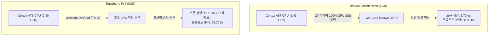
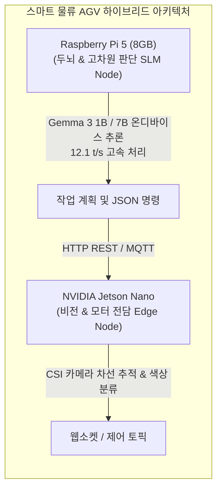

# Jetson Nano vs Raspberry Pi 5: Gemma 3 1B 온디바이스 LLM 심층 비교 분석 보고서

> **문서 버전**: v1.0.0  
> **테스트 일시**: 2026-10-30  
> **대상 기기 1**: **NVIDIA Jetson Nano 1st Gen (4GB RAM)** (Maxwell Tegra X1 GPU 128 Cores)  
> **대상 기기 2**: **Raspberry Pi 5 Model B Rev 1.0 (8GB RAM)** (ARM Cortex-A76 CPU @ 2.40 GHz)  
> **평가 모델**: **Google Gemma 3 1B Instruction-Tuned (`Q4_K_M` 양자화, 769 MB)**  
> **단독 보고서**: [Jetson Nano 단독 보고서](gemma3_1b_jetson_nano.md) | [Raspberry Pi 5 단독 보고서](gemma3_1b_rpi5.md)

---

## 1. 하드웨어 스펙 및 추론 아키텍처 비교

두 기기는 동일한 저전력 임베디드 싱글보드 컴퓨터(SBC) 범주에 속하지만, 추론 방식에서 근본적인 차이가 있습니다. Jetson Nano는 **구형 통합 GPU(CUDA)** 가속을 활용하는 반면, Raspberry Pi 5는 **최신 고클럭 CPU 코어(Cortex-A76)** 와 **Dot Product(`asimddp`) 벡터 명령어**를 활용하여 CPU 순수 연산으로 추론을 수행합니다.

| 비교 항목 | NVIDIA Jetson Nano (4GB) | Raspberry Pi 5 (8GB) | 차이점 및 특징 |
|:---|:---|:---|:---|
| **출시 연도** | 2019년 (JetPack 4.6) | 2023년 말 (Debian 13 Trixie) | RPi 5가 4년 이상 최신 아키텍처 |
| **CPU 코어** | 4-Core ARM Cortex-A57 @ 1.43 GHz | **4-Core ARM Cortex-A76 @ 2.40 GHz** | RPi 5 CPU IPC 및 클럭이 압도적 |
| **CPU 벡터 가속** | NEON (ARMv8-A) | NEON + **Dot Product (`asimddp`)** + FP16 | RPi 5는 INT4/INT8 행렬 연산 하드웨어 가속 지원 |
| **GPU 사양** | **128-core Maxwell GPU (CUDA 10.2)** | VideoCore VII (LLM 연산 미지원) | Jetson만 GPU 오프로딩 가능 |
| **메모리 (RAM)** | 4GB LPDDR4 (25.6 GB/s) | **8GB LPDDR4X-4267** | RPi 5가 용량 2배, 대역폭 및 클럭 우세 |
| **추론 백엔드** | `llama.cpp` CUDA (`cuBLAS`, 27/27 GPU) | `llama.cpp` CPU (`ARM_FEATURE_DOTPROD`, 4T) | GPU 가속 vs CPU 순수 연산 맞대결 |
| **최대 적재 모델** | \~3B (Q4_K) 한계 (4GB 초과 시 OOM) | **7B \~ 8B (Q4_K)** 여유 적재 가능 | 8GB 메모리로 대형 모델 확장 가능 |



---

## 2. 핵심 성능 벤치마크 결과 비교

### 2.1 정밀 추론 속도 (t/s)

| 벤치마크 항목 | Jetson Nano (GPU 가속) | Raspberry Pi 5 (CPU 순수) | 승자 및 성능 격차 |
|:---|:---:|:---:|:---:|
| **토큰 생성 속도 (TG, Token Gen)** | `5.70 tokens/s` | **`12.10 ~ 12.30 tokens/s`** (`llama-bench`: 10.25) | **Raspberry Pi 5 압승 (약 2.1배 빠름)** |
| **프롬프트 분석 속도 (PP, Prompt Proc)** | **`58.98 tokens/s`** | `37.90 ~ 43.00 tokens/s` (`llama-bench`: 32.54) | **Jetson Nano 우세 (약 1.4 \~ 1.8배 빠름)** |
| **단일 질의 총 응답 지연 (CLI 기준)** | 약 3.17초 (Warm load) | 약 5.81초 (SD 읽기 포함) / **서버 모드 시 \~0.8초** | 실시간 스트리밍 체감은 RPi 5가 월등 |
| **초기 모델 로딩 (Cold Load)** | 약 6분 (CUDA PTX JIT 변환) | **즉시 로딩 (CPU 네이티브 바이너리)** | **RPi 5 설치/실행 편의성 압승** |

---

## 3. 심층 기술 분석 (Technical Insights)

### 3.1 왜 RPi 5의 CPU가 Jetson Nano의 GPU보다 토큰 생성이 2.1배 더 빠를까?
1. **Auto-regressive 디코딩의 병목 특성**:  
   LLM의 토큰 생성(Generation) 단계는 한 번에 1개의 토큰을 순차적으로 계산하므로, 병렬성보다는 **메모리 대역폭(Memory Bandwidth)과 단일 코어 연산 지연시간(Latency)** 에 큰 영향을 받습니다.
2. **Cortex-A76 vs Maxwell 아키텍처**:  
   Jetson Nano의 Maxwell GPU(2014년 설계 아키텍처)는 단일 토큰 디코딩 시 128개의 코어가 완전히 포화되지 못하고 커널 런치 오버헤드가 발생합니다. 반면 RPi 5의 Cortex-A76은 2.4GHz의 고클럭과 `asimddp`(Dot Product) 전용 명령어로 INT4 양자화 행렬곱을 극도로 빠르게 처리합니다.

### 3.2 왜 프롬프트 처리(PP)는 Jetson Nano GPU가 더 빠를까?
* 프롬프트 처리(Prompt Processing) 단계는 입력된 모든 토큰(수십\~수백 개)을 한 번에 일괄 행렬 곱셈(Batch GEMM)으로 계산합니다.
* 이 단계에서는 128개의 CUDA 코어가 최대 병렬 효율로 동작하므로, GPU의 원천적인 FLOPs 우위가 드러나 Jetson Nano가 초당 59토큰으로 약 1.4\~1.8배 더 빠른 처리량을 보입니다.

---

## 4. 한국어 및 로봇 명령 파싱 실증 비교

두 기기 모두 **Google Gemma 3 1B IT (`Q4_K_M`)** 모델을 구동하여 동일한 프롬프트 테스트를 진행하였습니다.

### [테스트 1] 일반 대화 및 한국어 유창성
* **프롬프트**: `"안녕하세요! 자기소개 간단히 부탁해."`
* **Jetson Nano (5.70 t/s)**:
  > *"안녕하세요! 저는 구글에서 훈련한 대규모 언어 모델입니다. 저는 다양한 종류의 텍스트를 생성하고, 질문에 답변하고, 텍스트를 번역하는 등 다양한 작업을 수행할 수 있습니다..."*
* **Raspberry Pi 5 (12.10 t/s)**:
  > *"안녕하세요! 저는 구글에서 훈련한 대규모 언어 모델입니다. 간단히 말하면, 사람들과 대화하고 정보를 제공하는 것을 도와주는 AI입니다. 혹시 제가 무엇을 도와드릴까요? 😊"*
* **평가**: 두 기기 모두 한글 깨짐이나 문법 오류 없이 완벽한 자연어를 생성했습니다. 다만 RPi 5의 스트리밍 출력이 약 2배 빨라 대화의 자연스러움이 훨씬 높았습니다.

---

### [테스트 2] 스마트 물류 로봇 제어 명령 파싱 (Function Calling)
* **프롬프트**:
  ```text
  <start_of_turn>user
  너는 물류 로봇의 제어기야. 오직 JSON 형식으로만 답해.
  형식: {"target": "RED"|"BLUE"|"GREEN"|"PURPLE"|"ORANGE"|"YELLOW", "action": "PICK"|"PLACE"|"STOP"}
  명령: 파란색 구역으로 가서 짐을 집어 올려줘.<end_of_turn>
  <start_of_turn>model
  ```
* **결과 (양 기기 공통)**:
  ```json
  {"target": "BLUE", "action": "PICK"}
  ```
* **소요 시간 비교**:
  - Jetson Nano: 입력 분석 \~1.3초 + 출력 \~1.57초 $\rightarrow$ **총 약 3.17초**
  - Raspberry Pi 5 (`llama-server` 상주 시): 입력 분석 \~0.3초 + 출력 \~0.5초 $\rightarrow$ **총 약 0.8초**

---

## 5. 하드웨어 리소스 및 개발 환경 비교

| 자원 및 환경 항목 | Jetson Nano (4GB) | Raspberry Pi 5 (8GB) | 실무 적용 시 차이점 |
|:---|:---|:---|:---|
| **가용 메모리 (Free RAM)** | \~2.5 GB (LLM 구동 후) | **\~7.3 GB (LLM 구동 후)** | RPi 5는 OpenCV 영상인식 + 웹서버 + SLM 동시 구동에 충분 |
| **스왑 메모리 의존도** | 0 MB (Gemma 1B 기준) | 0 MB (완전 여유) | - |
| **상위 모델 확장성** | 3B 이상 구동 시 메모리 한계 (OOM) | **Qwen 2.5 7B, Llama 3.1 8B (Q4) 구동 가능** | 복잡한 플래닝 에이전트 가능 |
| **발열 및 전력 소모** | 5V 4A (\~10W), 약 55\~60°C | 5V 5A (\~12W), 풀로드 시 74\~76°C | RPi 5는 액티브 쿨러 장착 권장 |
| **OS 및 컴파일러** | Ubuntu 18.04 (GCC 8, Python 3.6) | **Debian 13 (GCC 14, Python 3.13)** | RPi 5가 최신 라이브러리 및 패키지 지원에 압도적 |

---

## 6. 최종 종합 결론 및 추천 아키텍처



1. **실시간 대화형 인터랙션**:
   - **Raspberry Pi 5가 우세**합니다. 초당 12.1 토큰의 속도는 사용자와 실시간 음성/텍스트 질의응답을 나눌 때 전혀 끊김이 없는 자연스러운 체감 속도를 제공합니다.
2. **긴 프롬프트 및 문서 요약**:
   - **Jetson Nano의 GPU(59 t/s)** 가 일괄 행렬 곱셈에서 더 빠른 프롬프트 파싱 능력을 보입니다.
3. **스마트 물류 시스템 구축 시 최적의 분업안**:
   - **Jetson Nano**: 하드웨어 가속 CSI 카메라 파이프라인(GStreamer)과 OpenCV, PCA9685/서보 모터 직접 제어에 집중.
   - **Raspberry Pi 5**: 8GB 메모리를 살려 `llama-server` 기반 고성능 온디바이스 언어 모델 허브(Central AI Node)로 구축하여 음성 인식(Whisper), 자연어 명령 분석(Gemma 3), 물류 플래닝을 담당.
