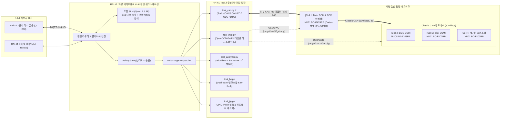
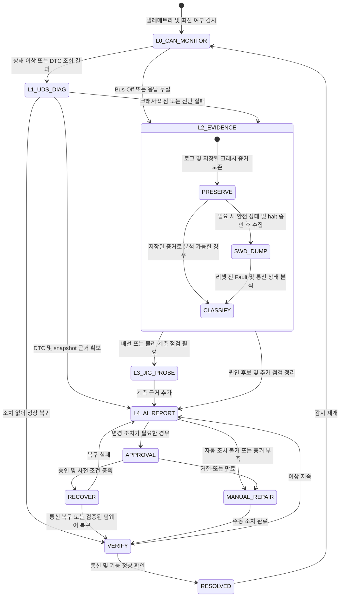

# [설계 v3.1] 차량용 도메인 컨트롤러(G474RE) & CAN FD 분산 ECU 진단 벤치 및 Agent Tool 인터페이스

> **버전**: v3.1 (2026-11-03 기술 검토 반영)
>
> **기준 문서**: [CAN 아키텍처 설계](차량용_CAN_통신_도입_및_아키텍처_설계.md), [(OLD) 진단 Agent 아키텍처](%28OLD%29아키텍처_v2_RPi-STM32_진단Agent.md)
>
> **문서 상태**: 구현 전 설계. Tool 이름은 인터페이스 제안이며 구현 완료를 의미하지 않는다. 통신 신호·주기·진단 주소는 양 파트 합의 후 확정한다.
>
> **핵심 개정 사항**:
>
> 1. **NUCLEO-G474RE (Cortex-M4F @ 170MHz)** 도입을 통한 **차량 Main DCU / VCU & FOC 모터 인버터** 승격.
> 2. **CAN FD 백본 ↔ Classic CAN 500 kbps 필드버스** 구축. 백본 중재 500 kbps·데이터 2 Mbps는 초기 제안, 데이터 5 Mbps는 검증 후 확장 목표.
> 3. **CAN/ISO-TP/UDS 도구**, **Dual-Bank 재부팅 기반 복구**, **CMSIS-DSP FFT 분석** 설계 및 진단·승인 흐름 정리.

---

## 0. 설계 원칙 및 아키텍처

1. **이종 E/E 아키텍처의 도메인 게이트웨이를 실습 벤치로 구현한다.**
   G474RE가 상위 CAN FD와 하위 Classic CAN을 매개하고 RPi 5는 진단 호스트 역할을 수행한다. 특정 완성차의 실제 사양이나 차량용 인증을 재현한다는 의미는 아니다. Nucleo 보드는 제어 보드이며 모터 전력단·계측·보호 회로는 별도 필요하다.
2. **듀얼 채널(CAN Bus + SWD) 하이브리드 진단을 수행한다.**
   - **1차 런타임 진단 (CAN FD / CAN)**: UDS(ISO 14229) 표준 질의, DTC(고장코드) 감시, Freeze Frame 수집.
   - **2차 심층 진단 (SWD 백채널)**: 통신 상태·크래시 증거를 수집한다. 코어 정지가 필요하면 안전 상태와 승인을 확인하고 리셋 전에 덤프한다. Bus-Off만으로 펌웨어 손상이나 롤백 필요성을 단정하지 않는다.
3. **LLM은 하드웨어 레지스터를 직접 조작하지 않는다.**  
   모든 제어는 `진단 Agent / 플레이북 → Tool 호출(JSON) → Safety Gate (검증 및 승인) → CAN FD / SWD / GPIO 지그`를 거친다.
4. **NUCLEO-G474RE의 하드웨어 가속기를 적극 활용한다.**  
   CORDIC은 FOC의 삼각함수 연산, FMAC은 필터 연산에 활용한다. FFT는 Cortex-M4F에서 CMSIS-DSP로 수행한다. Dual-Bank는 다른 뱅크 실행 중 기록을 지원하지만 이미지 적용에는 재부팅 및 부트로더 검증이 필요하며, 무중단·1초 복구를 보장하지 않는다. [ST 기능 설명](https://www.st.com/en/microcontrollers-microprocessors/stm32g474re.html), [ST RM0440](https://www.st.com/resource/en/reference_manual/dm00355726-stm32g4-series-advanced-armbased-32bit-mcus-stmicroelectronics.pdf)

---

## 1. 시스템 구성 및 장치 식별 ID

| device_id       | 하드웨어 / 차량 역할                   | 코어 스펙 및 주요 인터페이스                                                                                                                                                                                     | 담당 파트                |
| :-------------- | :------------------------------------- | :--------------------------------------------------------------------------------------------------------------------------------------------------------------------------------------------------------------- | :----------------------- |
| **`bench01`**   | **RPi5 #1 (중앙 게이트웨이 & 진단기)** | Quad A76 @ 2.4GHz, 외부 CAN FD 어댑터를 SocketCAN `can0`로 사용, 4x USB, 40핀 GPIO                                                                                                                               | AI 파트 (Member A, B)    |
| **`console01`** | **RPi5 #2 (현장 운영자 터치 콘솔)**    | 7인치 터치 LCD, Qt GUI, 실시간 4채널 텔레메트리, 승인 모달                                                                                                                                                       | AI 파트 (Member B)       |
| **`cell1`** ⭐  | **NUCLEO-G474RE (Main DCU / VCU)**     | Cortex-M4F @ 최대 170MHz, 512KB Flash(DBANK 설정 확인), 128KB SRAM(96KB + CCM 32KB) • FDCAN1: CAN FD 백본 • FDCAN2: Classic CAN 500 kbps 필드버스 • CORDIC: PMSM/BLDC FOC 연산, 외부 3상 전력단 제어 | 임베디드 파트 (Member C) |
| **`cell2`**     | **NUCLEO-F103RB (섀시 / BMS ECU)**     | Cortex-M3 @ 72MHz, Classic CAN (500k) • 배터리 팩 전압/전류 계측, MPU6050 진동, BMP280 온도                                                                                                                  | 임베디드 파트 (Member C) |
| **`cell3`**     | **NUCLEO-F103RB (바디 BCM ECU)**       | Cortex-M3 @ 72MHz, Classic CAN (500k) • RFID 스마트키 인증(Immobilizer), 도어락, 비상등, 키패드                                                                                                              | 임베디드 파트 (Member D) |
| **`cell4`**     | **NUCLEO-F103RB (클러스터 ECU)**       | Cortex-M3 @ 72MHz, Classic CAN (500k) • 전자식 계기판(FND/OLED) 속도 표출, DTC 체크 엔진 경고등                                                                                                              | 임베디드 파트 (Member D) |

---

## 2. 셀별 세부 기능 명세 및 고의 고장 주입 시나리오

### 2-1. Cell 1: NUCLEO-G474RE (Main DCU & FOC 인버터)

- **주요 기능**:
  1. **CORDIC 기반 FOC 연산**: 삼각함수 계산을 가속한다. 전류 제어·위치 추정·PWM·보호 로직은 별도 구현하며 저소음·고토크 성능은 실측한다.
  2. **CAN FD ↔ Classic CAN 게이트웨이**: 3개 셀의 상태와 최신 여부를 64B FD 프레임으로 취합한다. 이는 압축 알고리즘이 아닌 집계이며, FD 프레임을 F103으로 그대로 전달하지 않는다.
  3. **CMSIS-DSP 1024-pt FFT**: 진동 이상 징후를 분석한다. FMAC은 필터 전처리 후보이다. Cell 2 센서의 원시 샘플 전달 경로·샘플링 주파수·대역폭은 미확정이며 RMS만으로 FFT를 복원할 수 없다.
  4. **Dual-Bank 다운로드·복구**: DBANK 설정과 메모리 배치를 확인하고 비활성 슬롯에 기록한다. 검증된 부트로더가 안전 상태에서 재부팅·시험 부팅·확정/복구를 관리한다. BFB2 토글만으로 OTA와 롤백이 완성되지 않는다.

* **고의 고장 주입 (Fault Injection)**:
  - 위상각 스케일·범위·피드백 오류를 모의 입력으로 주입하고 제어기·보호 로직 대응 확인 (각도 래핑 자체는 정상 동작일 수 있음)
  - CAN FD 버스오프(Bus-Off) 에러 주입
  - OTA 이미지 무결성 오류 시 활성화 거부, 시험 부팅 실패 시 정상 이미지 복구
  - 데드타임 설정 오류를 시뮬레이션하여 PWM·보호 상태 확인. 실제 상하단 FET 동시 도통은 하드웨어 손상으로 이어질 수 있으며 CPU HardFault와 동일한 사건이 아님
  - CPU HardFault는 잘못된 메모리 접근 등 별도 소프트웨어 시나리오로 재현

### 2-2. Cell 2: NUCLEO-F103RB (섀시 & BMS ECU)

- **주요 기능**: 가변저항 ADC 입력으로 배터리 전압을 모의하고, MPU6050 진동 가속도의 RMS를 계산한다. 실제 배터리 전압·전류 계측에는 별도 계측 회로와 측정 범위 검토가 필요하다.

* **고의 고장**: 배터리 저전압 컷오프(Under-Voltage Cutoff) 시뮬레이션, I2C 버스 Stuck-Low.

### 2-3. Cell 3: NUCLEO-F103RB (바디 BCM ECU)

- **주요 기능**: RC522 RFID 스마트키 리더기 연동, 인가되지 않은 키 태그 시 시동 차단(Immobilizer).

* **고의 고장**: 미인가 키 인증 실패, 키패드 버퍼 오버플로우. 고장 코드는 프로젝트 DTC 목록에서 배정한다. `P1602`를 이모빌라이저의 보편적 표준 코드로 가정하지 않는다.

### 2-4. Cell 4: NUCLEO-F103RB (계기판 클러스터 ECU)

- **주요 기능**: CAN 버스에서 수신한 속도/RPM을 FND/OLED에 실시간 표출, DTC 발생 시 경고등 점등.

* **고의 고장**: CAN 수신 FIFO 오버런, 표시 데이터 타임아웃. 실제 레지스터 플래그 명칭은 MCU별로 확인한다.

---

## 3. 공통 Agent Tool 인터페이스 (차량 전장 특화)

아래는 `can`, `swd`, `analyze`, `fw` 4개 모듈의 인터페이스 초안입니다. `jig`, `serial`은 확장 예정이며 상세 API는 아직 정의하지 않았습니다. 공통 응답에는 `target`, `timestamp`, `status`, `data`, `error`를 포함하고 미지원·데이터 만료·시간 초과를 정상값 0과 구분합니다. 모든 HIGH 도구는 공통 호출 계층에서 대상·명령·파라미터에 연결된 `approval_id`와 만료 여부를 검증합니다.

**SLM 입력**: 프레임 파싱·DBC 디코딩은 Tool에서 수행하고 SLM에는 요약 증거와 관련 매뉴얼을 전달합니다. 현재 `scripts/run_qwen3b_server.sh`의 컨텍스트 설정은 2048 토큰이므로 전체 매뉴얼·DBC 일괄 주입을 전제로 하지 않습니다.

### 3-1. 차량 CAN / CAN FD 도구 (`tool_can.py`) ⭐

| Tool                | 파라미터                                                                |     위험도      | 승인 | 설명                                                                                        |
| :------------------ | :---------------------------------------------------------------------- | :-------------: | :--: | :------------------------------------------------------------------------------------------ |
| **`can.sniff`**     | `interface`, `duration_sec=3`, `can_id=None`                            |      READ       |  –   | SocketCAN/candump로 캡처하고 Classic/FD 구분 및 DBC 디코딩                                  |
| **`can.check_dtc`** | `target_ecu`, `source="uds"`                                            | LOW / 캐시 READ |  –   | 허용된 UDS 읽기 요청으로 DTC·상태 조회. 캐시 조회는 수집 시각·유효 여부 포함                |
| **`can.uds_query`** | `target_ecu`, `service_id`, `subfunction=None`, `payload`, `timeout_ms` | LOW (읽기 제한) |  –   | 주소표와 ISO-TP를 사용. 읽기 허용 목록(0x19/0x22 및 파라미터)을 검증하고 NRC·시간 초과 처리 |
| **`can.send_cmd`**  | `target_ecu`, `command`, `params`, `approval_id`                        |      HIGH       |  ✅  | 승인된 명령을 규약에 따라 인코딩. 임의 CAN ID·hex 바이트를 LLM이 직접 지정하지 않음         |
| **`can.bus_state`** | `interface="can0"`                                                      |      READ       |  –   | RPi 어댑터의 로컬 상태·제공되는 오류 카운터 조회. 원격 ECU 상태는 별도 수집                 |

UDS는 본래 DTC를 주기적으로 브로드캐스트하는 규약이 아닙니다. 이 설계는 `ReadDTCInformation (0x19)`과 snapshot 조회를 사용하고, 사용자 정의 고장 알림은 별도 규약으로 정의합니다. `0x7DF/0x7E0/0x7E8`은 주소 후보이며 UDS가 모든 ECU에 강제하는 고정 ID가 아닙니다. 서비스 ID만으로 위험도를 판단하지 않고 ECU·세션·서브기능·파라미터를 검증합니다. 쓰기·리셋·루틴 실행 등은 별도 HIGH 도구로 정의해야 합니다. [udsoncan 서비스 설명](https://udsoncan.readthedocs.io/en/latest/udsoncan/client.html), [Linux ISO-TP](https://kernel.org/doc/html/latest/networking/iso15765-2.html)

`can.bus_state`의 TEC/REC는 어댑터·드라이버가 지원할 때만 반환합니다. G474/F103의 상태로 해석하지 않습니다. `0x010`은 벤치 정지 요청이며 CAN 단절 시 전달이 보장되지 않으므로 필수 출력 차단은 LLM·승인 UI와 독립된 보호 경로가 담당해야 합니다.

### 3-2. SWD 하드웨어 디버그 도구 (`tool_swd.py`)

| Tool                 | 파라미터                       |      위험도      | 승인 | 설명                                                                                               |
| :------------------- | :----------------------------- | :--------------: | :--: | :------------------------------------------------------------------------------------------------- |
| **`swd.read_fault`** | `target_cell`                  |       READ       |  –   | 저장된 크래시 덤프 또는 정지된 코어의 Fault 레지스터·예외 프레임 수집. 자동 halt/reset은 하지 않음 |
| **`swd.read_sfr`**   | `target_cell`, `register_name` | READ (허용 목록) |  –   | MCU별 주소표에서 부작용 없는 레지스터만 선택. 임의 주소·FIFO pop·read-to-clear 읽기는 제외         |
| **`swd.halt`**       | `target_cell`                  |       HIGH       |  ✅  | 디버깅을 위해 해당 ECU 코어 일시 정지                                                              |
| **`swd.reset_halt`** | `target_cell`                  |       HIGH       |  ✅  | 구성된 reset 방식으로 초기화 후 정지. 증거 수집 이후 별도 복구 절차에서 사용                       |
| **`swd.resume`**     | `target_cell`                  |       HIGH       |  ✅  | 출력·제어 상태를 확인한 뒤 코어 실행 재개. 실행 재개가 정상 복구를 의미하지는 않음                 |

코어 정지가 필요한 경우 `swd.halt`를 별도로 승인받습니다. **리셋 전** CFSR/HFSR·BFAR/MMFAR(주소 유효 비트 확인)·MSP/PSP·예외 문맥을 저장합니다. 현재 PC가 Fault 핸들러 내부이면 원인 주소는 stacked PC에서 확인하며 실제 이미지와 일치하는 ELF/build ID를 사용합니다. [OpenOCD halt/reset 명령](https://www.openocd.org/doc/html/General-Commands.html)

비정밀 BusFault나 예외 진입 중 스택 저장 오류에서는 stacked PC가 원인 명령을 특정하지 못할 수 있습니다. 분석 결과에 프레임·주소의 유효 여부와 불확실성을 포함합니다. [ST PM0214](https://www.st.com/resource/en/programming_manual/pm0214-stm32-cortexm4-mcus-and-mpus-programming-manual-stmicroelectronics.pdf)

### 3-3. 펌웨어 다운로드 및 재부팅 복구 도구 (`tool_fw.py`)

| Tool                   | 파라미터                                                     | 위험도 | 승인 | 설명                                                                                                      |
| :--------------------- | :----------------------------------------------------------- | :----: | :--: | :-------------------------------------------------------------------------------------------------------- |
| **`fw.dualbank_swap`** | `target_cell="cell1"`, `image_id`, `approval_id`             |  HIGH  |  ✅  | 부트로더가 검증한 이미지로 재부팅 적용/복구. 옵션 비트 직접 토글 API가 아니며 실제 부팅 방식 확정 후 구현 |
| **`fw.ota_stream`**    | `target_cell="cell1"`, `bin_file`, `manifest`, `approval_id` |  HIGH  |  ✅  | 비활성 슬롯에 전송·검증. 순서·재전송·완료 확인 필요. 적용은 별도 승인된 재부팅 단계                       |
| **`fw.st_flash`**      | `target_cell`, `bin_file`                                    |  HIGH  |  ✅  | F103 셀용 전통적 SWD 플래싱 (`st-flash`)                                                                  |

정상 이미지·메타데이터·부팅 확정·전원 차단 복구가 갖춰지기 전에는 자동 롤백을 지원한다고 표시하지 않습니다. CRC는 우발적 손상 검출이며 이미지 인증을 대신하지 않습니다. 다운로드 경로가 Bus-Off이면 CAN 복구 또는 승인된 SWD 복구가 먼저 필요합니다.

### 3-4. 진단 분석 도구 (`tool_analyzer.py`)

| Tool                      | 파라미터                                | 위험도 | 승인 | 설명                                                                                                                     |
| :------------------------ | :-------------------------------------- | :----: | :--: | :----------------------------------------------------------------------------------------------------------------------- |
| **`analyze.addr2line`**   | `target_cell`, `pc_address`, `build_id` |  READ  |  –   | 실행 이미지와 일치하는 ELF·주소 매핑으로 소스 위치 후보 조회. 최적화·심볼 부재 시 한계 표시                              |
| **`analyze.fft_peaks`**   | `target_cell="cell1"`                   |  READ  |  –   | G474가 보낸 피크 요약의 주파수·진폭·샘플링 정보·회전수를 비교해 이상 후보 분석. 전체 스펙트럼 수신은 별도 전송 규약 필요 |
| **`analyze.decode_cfsr`** | `cfsr_hex`                              |  READ  |  –   | SCB CFSR 레지스터 비트(MemManage, BusFault, UsageFault) 자연어 디코딩                                                    |

---

## 4. 차량 진단 및 복구 생명주기 (L0 ➡️ L4)

L2는 G474/F103 모두에 대해 증거 수집을 우선합니다. G474 펌웨어 복구는 검증된 정상 이미지·부트로더·승인·출력 안전 상태가 있을 때만 수행합니다. Bus-Off는 배선·비트 타이밍·상대 노드 등 통신 원인을 먼저 확인합니다. L3의 PWM은 계측 가능한 지그로 측정하고, 종단저항은 전원을 분리한 뒤 계측기로 확인합니다. GPIO만으로 버스 저항을 직접 측정하지 않습니다.

---

## 5. 차량 통신 매트릭스 & 신호 스키마

### 5-1. CAN FD 백본 버스 (RPi 5 ↔ NUCLEO-G474RE)

| ID      | 메시지명                  | 송신자 | 프레임 / 데이터 길이 | 용도                                                         |
| :------ | :------------------------ | :----- | :------------------- | :----------------------------------------------------------- |
| `0x010` | `EMERGENCY_STOP`          | RPi    | Classic / 8B         | 벤치 정지 요청. 독립 보호 경로를 대체하지 않음               |
| `0x050` | `DCU_FAST_TELEMETRY`      | G474   | FD / 64B             | 3상 전류·각도·토크·CORDIC 상태·FFT 피크 4개·전압 요약        |
| `0x060` | `GATEWAY_AGGREGATED`      | G474   | FD / 64B             | 하위 셀 상태·유효 여부·원본 Sequence·수신 후 경과시간        |
| `0x070` | `OTA_FIRMWARE_BLOCK`      | RPi    | FD / 64B             | 프로젝트 전용 이미지 전송안. 전송 헤더·재전송·응답 규약 필요 |
| `0x7E0` | `UDS_PHYSICAL_REQUEST`    | RPi    | Classic / 8B 전송안  | G474 대상 요청 주소 후보                                     |
| `0x7E8` | `UDS_PHYSICAL_RESPONSE`   | G474   | Classic / 8B 전송안  | G474 ISO-TP 응답 주소 후보                                   |
| `0x7DF` | `DIAG_FUNCTIONAL_REQUEST` | RPi    | Classic / 8B 전송안  | 기능 요청 주소 후보로 예약. 지원 서비스·응답 정책 미정       |

**데이터 길이와 DLC를 구분**합니다. 8B는 DLC 코드 8, FD 64B는 DLC 코드 15입니다. UDS 응답이 한 프레임을 넘으면 ISO-TP로 분할합니다. `0x070`은 UDS 표준 다운로드 서비스와 별개인 프로젝트 전용 전송안입니다. [Linux CAN FD 문서](https://docs.kernel.org/networking/can.html)

### 5-2. Classic CAN 필드버스 (G474RE ↔ NUCLEO-F103RB x3, 500 kbps)

- **`0x200` (BMS_STATUS)**: 데이터 8B, 배터리 전압·충방전 전류·SOC·셀 최고온도

* **`0x300` (BODY_STATUS)**: 데이터 8B, 스마트키 인증 상태, 도어락 플래그, 비상등 점멸
* **`0x400` (CLUSTER_FEEDBACK)**: 데이터 8B, 현재 표시 중인 속도값, 경고등 래치 상태

원본 `0x200/0x300/0x400`은 필드버스에 있고 RPi는 `0x060`으로 취합된 상태를 받습니다. 게이트웨이가 정상 송신 중이어도 하위 셀 데이터는 만료될 수 있으므로 셀별 최신 여부를 검사합니다. 클러스터에 공급할 속도/RPM·경고등 메시지와 BCM 명령은 아직 ID·스키마가 없습니다.

### 5-3. 상세 규약 확정 범위

회의 진행과 상세 명세·결정·담당자 기록은 [CAN 통신 규약 합의 회의 템플릿](CAN_통신규약_합의_회의_템플릿.md)을 사용합니다.

현재 표는 ID와 용도 초안이며, 실제 인코더·디코더를 만들 수 있는 최종 신호 명세는 아닙니다. 아래 항목을 임베디드/AI 파트가 함께 확정해야 합니다.

- 신호별 시작 비트·길이·엔디언·부호·배율·오프셋·단위·정상 범위·측정 불가 값
- 주기·타임아웃·Sequence·재부팅 식별·UNKNOWN/STALE 처리·집계 데이터의 최신 여부
- ECU별 진단 요청/응답 주소·게이트웨이 중계 또는 대리 응답 정책·ISO-TP/UDS 시간 제한
- DTC 전송 코드와 표시 이름·발생/해제 조건·snapshot·보존/삭제 정책
- 제어 명령과 응답·중복 처리·OTA 헤더/ACK·프로토콜 버전과 호환 정책
- DBC·진단 설정·정답 프레임을 통한 C/Python 교차 검증

합의 전 바이트 배치·주기·시간 제한을 시뮬레이터에 사용한다면 임시 설정으로 표시합니다. 상세 체크리스트와 물리 계층 사양은 [CAN 아키텍처 3·5절](차량용_CAN_통신_도입_및_아키텍처_설계.md)을 기준으로 함께 갱신합니다.

---

## 6. 팀 분업 체계 및 역할 분담 (2 AI vs 2 임베디드)

| 파트            | 팀원            | 담당 도메인                         | 핵심 개발 산출물                                                                                                                                                       |
| :-------------- | :-------------- | :---------------------------------- | :--------------------------------------------------------------------------------------------------------------------------------------------------------------------- |
| **임베디드**    | **Member C** ⭐ | **Main DCU (G474RE) & FOC 제어**    | • G474 펌웨어 (CORDIC 기반 FOC, FDCAN1/2 게이트웨이) • Dual-Bank 부트로더·다운로드 검증·재부팅 복구 • CMSIS-DSP FFT 및 필요 시 FMAC 필터 전처리                |
| **임베디드**    | **Member D**    | **분산 ECU 3종 (F103) & CAN 버스**  | • NUCLEO-F103RB 3대 펌웨어 (BMS, BCM, 계기판) • Classic CAN 500kbps 통신 드라이버 및 DTC 발행 로직 • 공통 규약 `diag_core.c` 및 고의 고장 주입 회로            |
| **AI / 시스템** | **Member A**    | **AI Agent 코어 & 진단·추론 엔진**  | • L0~L4 차량 진단 플레이북 엔진 (`playbook_runner.py`) • `tool_can.py` (SocketCAN / UDS / DTC 파서) 개발 • Qwen 2.5 3B 기반 차량 고장 분석 프롬프트 엔지니어링 |
| **AI / 시스템** | **Member B**    | **다중 타깃 매니저 & 현장 관제 UI** | • OpenOCD G4/F1 타깃 분리 제어 데몬 (`target_manager.py`) • RPi #2 (7인치 LCD) Qt GUI 차량 대시보드 화면 연동 • Firebase 실시간 텔레메트리 연동                |
