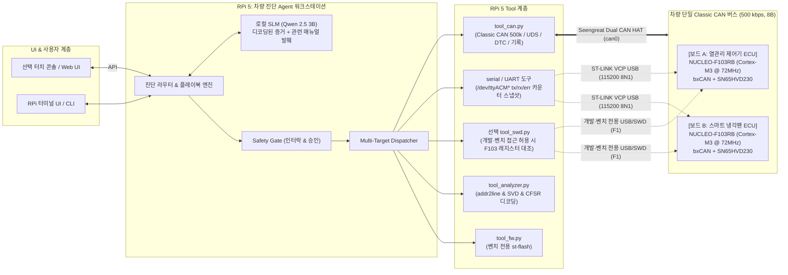
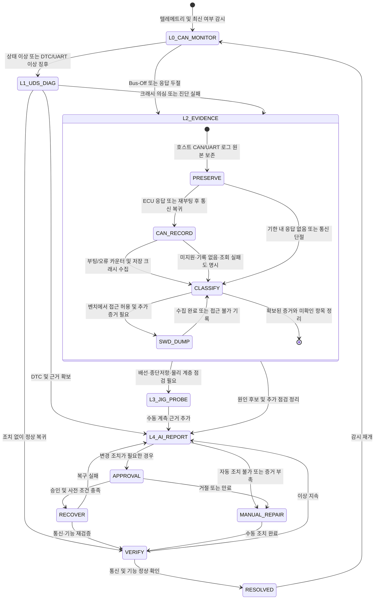

# [설계 v3.4] 차량용 Classic CAN 분산 ECU(NUCLEO-F103RB) 진단 벤치 및 Agent Tool 인터페이스

> **버전**: v3.4 (2026-11-17 NUCLEO-G474RE 배제 및 NUCLEO-F103RB 단일 Classic CAN 직접 연결 반영)
>
> **[2026-11-17 프로젝트 적용 범위]** 2026-11-16\~17 결정(`PJT-15`, `PJT-16`)에 따라 `NUCLEO-G474RE` 도메인 게이트웨이 및 CAN FD·FOC·Dual-Bank·FFT 확장은 제외됐다. 현재 구성은 **보드 A(열관리 제어기, NUCLEO-F103RB) + 보드 B(스마트 냉각팬 ECU, NUCLEO-F103RB) + RPi 5(`can0`)** 단일 Classic CAN(`500 kbps`) 버스 및 보조 UART(`/dev/ttyACM*`) 구조다. RPi 5 실측(`can0` `500 kbit/s` + `/dev/ttyACM0`)에 맞춘 Agent 연동 구현 설계는 `RPI5_Agent_Docker/docs/실측_CAN_UART_연동_설계.md`에 정리했다.
>
> **기준 문서**: [CAN 아키텍처 설계](차량용_CAN_통신_도입_및_아키텍처_설계.md), [(OLD) 진단 Agent 아키텍처](%28OLD%29아키텍처_v2_RPi-STM32_진단Agent.md)
>
> **문서 상태**: 인터페이스 제안 및 미구현 설계 범위 포함 (`tool_can`, `tool_swd`, `tool_analyzer`, `serial.*` 등). 통신 신호·메시지 ID·임계치 확정은 임베디드 파트 합의(`PJT-16`) 대기.
>
> **핵심 방향**:
>
> 1. **NUCLEO-F103RB 단일 Classic CAN (`500 kbps`) 직접 버스**: RPi 5 (`Seengreat Dual CAN I HAT`, `can0`)와 보드 A/B가 게이트웨이 없이 직접 연결.
> 2. **CAN + 보조 UART 교차 관측**: SocketCAN(`candump`/오류 카운터)과 ST-LINK VCP(`/dev/ttyACM*`, `115200 8N1`)를 결합해 물리 단절·과거 누적 오류·실제 송수신 상태를 분리 판별.
> 3. **SWD 선택 운용 경로**: CAN(및 벤치 UART) 조회를 주 경로로 두고, SWD(`tool_swd`)는 접근 허용된 개발·벤치에서만 선택적으로 사용.

---

## 0. 설계 원칙 및 아키텍처

**회의 결정에 따른 우선 범위**: 장비 정보·펌웨어·통신 명세·정상 기준을 고정한 뒤 진단 결과를 검증한다.
초기에는 정상·원본 갱신 지연·로컬 Bus-Off의 관측과 판정부터 연결한다. 고장 정답은 별도 검증 실행기가
관리하며, LLM에는 관측 증거와 확정 정상 기준을 전달한다. 판정 한도는 수집 데이터나 모델이 변경하지 않는다.
상세는 [장비 정보 기반 검증 계획](장비_정보_기반_검증_계획.md)을 따른다.

미확인 장비 탐색·미지 로그/규약 추정은 후속 범위이며, 첫 검증에서 필요하지 않은 확장 기능의 완성을 전제하지 않는다.
자료 불일치는 검증 준비 보류로 처리하고 실행 중 조회 실패·미지원·손상은 장비 고장과 구분한다.
SWD 선택 정책과 실제 제어 도구의 미구현 상태는 유지한다.

1. **단일 Classic CAN (`500 kbps`) 직접 버스 구조를 기준으로 삼는다.**
   RPi 5(`can0`)와 `NUCLEO-F103RB` ECU들(보드 A, 보드 B)이 공통 버스로 직접 프레임을 주고받는다. 특정 완성차의 실제 사양이나 차량용 인증을 재현한다는 의미는 아니다.
2. **CAN을 제품 운용 진단의 주 경로로, SWD를 개발·벤치의 선택 경로로 둔다.**
   - **운용·벤치 관측 경로**: heartbeat·Sequence·부팅 식별값으로 이상을 감시하고, (구현 시) UDS 읽기 서비스 또는 벤치 UART 카운터로 DTC·버전·리셋 원인·상태를 수집한다. Classic CAN(`8B`) 위에서 동작한다.
   - **ECU 내부 기록**: 고장 검출기, 스냅샷/이벤트 저장, 최소 Fault 문맥 보관, 부팅 시 기록 복구와 진단 응답을 공통 기능으로 설계한다. 저장·전송 계약은 [CAN 아키텍처 6절](차량용_CAN_통신_도입_및_아키텍처_설계.md#6-swd-없이-진단하는-제품-운용-설계)을 따른다.
   - **선택 SWD 경로**: 허용된 개발·벤치에서만 레지스터를 대조하거나 정지 분석한다. 접근 불가를 MCU 고장으로 간주하지 않고 `debug_access_unavailable`로 기록하여 확보된 증거로 분석을 계속한다. 자동 보호 해제·대량 삭제·옵션 바이트 변경은 도구 범위에서 제외한다.
   - ECU가 멈추거나 CAN 경로가 끊기면 CAN으로 즉시 조회할 수 없다. 기존 호스트 로그(및 살아 있는 경우 보조 UART)를 보존하고 재부팅/통신 복귀 후 기록을 수집하거나 외부 계측·개발 장비 재현으로 이어간다. Bus-Off만으로 펌웨어 손상이나 롤백 필요성을 단정하지 않는다.
3. **LLM은 하드웨어 레지스터를 직접 조작하지 않는다.**
   모든 동작은 `진단 Agent / 플레이북 → Tool 호출(JSON) → Safety Gate (검증 및 승인) → CAN / UART / 선택 SWD / 수동 계측`을 거친다.

---

## 1. 시스템 구성 및 장치 식별 ID

| device_id | 하드웨어 / 역할 | 코어 스펙 및 주요 인터페이스 | 담당 파트 |
| :--- | :--- | :--- | :--- |
| **`bench01`** | **RPi 5 (중앙 진단 워크스테이션)** | Quad A76 @ 2.4GHz, Seengreat RS485 Dual CAN I HAT (`can0`/`can1` SocketCAN 500 kbps), USB UART(`/dev/ttyACM*`) | AI 파트 (Member A, B) |
| **`console01`** | **현장 관제 UI (선택)** | 상태·텔레메트리·승인 모달 시각화 | AI 파트 (Member B) |
| **`board_a`** | **NUCLEO-F103RB (보드 A: 열관리 제어기 ECU)** | Cortex-M3 @ 72MHz, 128KB Flash, 20KB SRAM • `bxCAN` (Classic CAN 500 kbps + `SN65HVD230`) • `USART2` ST-LINK V2-1 VCP | 임베디드 파트 (Member C) |
| **`board_b`** | **NUCLEO-F103RB (보드 B: 스마트 냉각팬 ECU)** | Cortex-M3 @ 72MHz, 128KB Flash, 20KB SRAM • `bxCAN` (Classic CAN 500 kbps + `SN65HVD230`) • `USART2` ST-LINK V2-1 VCP | 임베디드 파트 (Member D) |

> **참고**: 기존 Agent 소프트웨어 테스트 fixture(`fixture-bench-v1`)의 `cell2`\~`cell4` ID는 가상 시뮬레이션 호환용으로 유지됩니다.

---

## 2. 보드별 세부 기능 명세 및 고장 시나리오

**ECU 공통 진단 기능**: 펌웨어 버전·Build ID·프로토콜/기록 스키마 버전·진단 지원 기능, heartbeat·Sequence·부팅 식별값, DTC와 고장 순간 스냅샷, 부팅/리셋 이력, 최소 크래시 요약을 제공한다. 기능별 지원 여부를 명시하고 미구현 항목을 0이나 빈 정상 기록으로 응답하지 않는다. 개발 PC는 배포 Build ID별 ELF·맵 파일·소스 커밋을 보관한다. 아래 도메인 기능과 공통 진단 기능은 합의·구현 전 요구사항(초안 포함)을 포함한다.

### 2-1. 보드 A: NUCLEO-F103RB (열관리 제어기 ECU)

- **역할 (`PJT-19`, `PJT-20`, `aide-ecu/board_a`)**: `I2C1(PB8/PB9)` `BMP280`(주변 온도 `0x76`)과 `MPU6050` 호환 칩(진동 RMS `0x68`)을 계측하고, Classic CAN(`PA11/PA12`, `500 kbps`)으로 `A_FAN_CMD(0x080)`·`A_THERMAL_STATUS(0x180)`를 100 ms 주기로 송신하며 `B_FAN_STATUS(0x1C0)`를 감시한다.
- **상태·고장 모델**: 제어 모드(`a_state`: `0=INIT`, `1=NORMAL`, `2=FAILSAFE` 팬 `100%`, `3=TEST`)와 냉각팬 감시(`COMM_LOST`, `RESP_FAULT`)를 분리하고, `fault_flags`(`0x01 TEMP_SENSOR` \~ `0x07 TASK_OVERRUN`) 및 열관리 상태(`정상`/`경고`/`과온`/`불명`)를 보고한다.
- **고의 고장 / 시험 대상**:
  - `BMP280` SDA 분리 시 무효값(`0x7FFF`)·`a_state=2(FAILSAFE)`·목표 듀티 `100%` 전환 및 I2C 버스 잠김 자동 복구(실측 `3.1 s`)
  - 진동 센서(`MPU6050`) 통신 이상(`0xFFFF` 무효 처리, 냉각 제어 영향 없음), `B_FAN_STATUS` 타임아웃(`500 ms`)·`alive_cnt` 정지, 과온(`55 °C` 이상, 고장과 구분) 시나리오

### 2-2. 보드 B: NUCLEO-F103RB (스마트 냉각팬 ECU)

- **역할 (`PJT-15`, `PJT-16`)**: 열관리 제어 명령을 수신해 냉각팬(PWM 등)을 구동하고 팬 동작 상태·오류를 CAN/UART로 보고한다.
- **고의 고장 / 시험 대상**:
  - 팬 이상/구속 모의, 명령 수신 타임아웃(제어기 응답 두절 시 안전 팬 구동 등 — 임계치 확정 `TBD`)
  - CAN 수신 FIFO 오버런, 물리 계층 오류(`errcb`, `errcode`) 관측

### 2-3. 기존 가상 벤치 시나리오 (F103RB BMS / BCM / 클러스터 모의)

`RPI5_Agent_Docker`의 `fixture-bench-v1` 소프트웨어 테스트 스위트 검증용으로 `cell2`(BMS: 전압·온도), `cell3`(BCM: 인증·도어락), `cell4`(클러스터: 표시·수신 타임아웃) 가상 F103RB 시나리오를 유지합니다. 물리 실물 검증은 2-1/2-2절의 보드 A/B 구성을 우선으로 전환합니다.

---

## 3. 공통 Agent Tool 인터페이스 (Classic CAN 특화)

아래는 `can`, `swd`, `analyze`, `fw` 및 `serial`/`measurement` 제안 인터페이스입니다. 공통 응답에는 `target`, `timestamp`, `status`, `data`, `error`를 포함하고 미지원·데이터 만료·시간 초과를 정상값 0과 구분합니다. 모든 HIGH 도구는 공통 호출 계층에서 대상·명령·파라미터에 연결된 `approval_id`와 만료 여부를 검증합니다.

증거에는 `origin_ecu`, `source`(직접 CAN/보조 UART/CAN 저장 기록/벤치 SWD), `collected_at`, `boot_id`, `schema_version`, 필드별 유효 여부를 포함한다. 기록에는 추가로 `record_id`, `capture_boot_id`, `capture_uptime_ms`, `record_build_id`를 보존한다. 현재 실행 중인 `running_build_id`와 과거 기록의 Build ID를 구분하며 서로 다른 부팅의 uptime을 직접 빼지 않는다.

| 결과 | Tool 응답 계약 |
| --- | --- |
| 정상 기록 조회 | `status=ok`, 원본·수집 시각과 유효성 포함 |
| 조회 성공, 저장 기록 없음 | `status=ok`, `data.record_present=false`. 전체 수명 동안 고장이 없었다는 의미는 아님 |
| 미지원 / 시간 초과 / 손상 | 각각 `status=unsupported` / `timeout` / `invalid`. 오류 상세에 서비스·NRC·무결성 실패 등을 보존 |
| SWD 접근 불가 | `status=unavailable`, `error.code=debug_access_unavailable`, 이유는 `denied` / `probe_missing` / `unknown` 등으로 기록. 연결 실패만으로 RDP 잠금을 확정하지 않음 |
| 심벌 없음 / 빌드 불일치 | 주소는 보존하고 소스 위치는 미확인. 다른 빌드의 ELF로 대체하지 않음 |

**SLM 입력**: 프레임 파싱·디코딩·UART 차분 계산은 Tool에서 수행하고 SLM에는 요약 증거와 관련 매뉴얼을 전달합니다. 현재 로컬 서버(`Qwen 2.5 3B`) 컨텍스트 제한(예: 2048 토큰)을 고려해 전체 원시 로그 일괄 주입을 전제로 하지 않습니다.

### 3-1. 차량 Classic CAN 도구 (`tool_can.py`)

| Tool | 파라미터 | 위험도 | 승인 | 설명 |
| :------------------ | :---------------------------------------------------------------------- | :-------------: | :--: | :------------------------------------------------------------------------------------------ |
| **`can.sniff`** | `interface="can0"`, `duration_sec=3`, `can_id=None` | READ | – | SocketCAN/`candump`로 Classic CAN(`500 kbps`) 프레임 캡처 및 규약 디코딩 |
| **`can.check_dtc`** | `target_ecu`, `source="uds"` | LOW / READ | – | 허용된 UDS 읽기 요청으로 DTC·상태 조회 (ECU 구현 시) |
| **`can.uds_query`** | `target_ecu`, `service_id`, `subfunction=None`, `payload`, `timeout_ms` | LOW (읽기 제한) | – | 주소표와 ISO-TP를 사용. 읽기 허용 목록(`0x19`/`0x22` 및 파라미터) 검증 및 NRC·시간 초과 처리 |
| **`can.send_cmd`** | `target_ecu`, `command`, `params`, `approval_id` | HIGH | ✅ | 승인된 제어/테스트 명령을 규약에 따라 인코딩. 임의 CAN ID·hex 바이트를 LLM이 직접 지정하지 않음 |
| **`can.bus_state`** | `interface="can0"` | READ | – | RPi 어댑터(`ip -details -statistics link show`) 로컬 상태·오류 카운터 조회. 원격 ECU 상태는 별도 수집 |
| **`can.get_identity`** | `target_ecu` | LOW (읽기 제한) | – | 허용된 DID로 펌웨어 버전·현재 Build ID·스키마 버전·지원 기능 조회 |
| **`can.read_boot_record`** | `target_ecu` | LOW (읽기 제한) | – | 부팅 식별값·부팅 횟수·리셋 원시 플래그·해석·마지막 진행 기록 조회 |
| **`can.read_crash_record`** | `target_ecu`, `record_id=None` | LOW (읽기 제한) | – | 저장된 최소 크래시 요약 조회 |

UDS는 `ReadDTCInformation (0x19)`과 `ReadDataByIdentifier (0x22)` 읽기 중심으로 설계하며, `0x7DF/0x7E0/0x7E8`은 주소 후보다. 서비스 지원은 ECU 펌웨어 구현이 필요하다. [udsoncan 서비스 설명](https://udsoncan.readthedocs.io/en/latest/udsoncan/client.html), [Linux ISO-TP](https://kernel.org/doc/html/latest/networking/iso15765-2.html)

`can.bus_state`의 TEC/REC·`bus-errors`는 RPi 어댑터의 로컬 관측치이며 원격 F103RB의 `CAN_ESR` 상태로 직접 치환하지 않습니다.

### 3-2. 선택 SWD 하드웨어 디버그 도구 (`tool_swd.py`, 개발·벤치 전용)

| Tool | 파라미터 | 위험도 | 승인 | 설명 |
| :------------------- | :----------------------------- | :--------------: | :--: | :------------------------------------------------------------------------------------------------- |
| **`swd.read_fault`** | `target_ecu` | READ | – | 접근 가능한 벤치의 정지된 F103RB 코어에서 Fault·예외 프레임 수집. 자동 halt/reset은 하지 않음 |
| **`swd.read_sfr`** | `target_ecu`, `register_name` | READ (허용 목록) | – | F103RB 주소표에서 부작용 없는 레지스터(`CAN_ESR`, `CAN_MSR`, `RCC_CSR` 등)만 선택 |
| **`swd.halt`** | `target_ecu` | HIGH | ✅ | 디버깅을 위해 해당 ECU 코어 일시 정지 |
| **`swd.reset_halt`** | `target_ecu` | HIGH | ✅ | 구성된 reset 방식으로 초기화 후 정지 |
| **`swd.resume`** | `target_ecu` | HIGH | ✅ | 출력·제어 상태를 확인한 뒤 코어 실행 재개 |

코어 정지가 필요한 경우 `swd.halt`를 별도로 승인받습니다. 제품 운용 프로필에서는 호출하지 않아도 전체 진단 흐름이 완료되어야 하며, `debug_access_unavailable` 이후 halt/reset/플래싱을 연쇄 실행하지 않습니다. [OpenOCD halt/reset 명령](https://www.openocd.org/doc/html/General-Commands.html), [ST RDP 설명](https://wiki.st.com/stm32mcu/wiki/Security:RDP)

### 3-3. 벤치 전용 펌웨어 플래싱 도구 (`tool_fw.py`)

| Tool | 파라미터 | 위험도 | 승인 | 설명 |
| :--------------------- | :----------------------------------------------------------- | :----: | :--: | :-------------------------------------------------------------------------------------------------------- |
| **`fw.st_flash`** | `target_ecu`, `bin_file`, `approval_id` | HIGH | ✅ | 접근 허용된 개발·벤치 `NUCLEO-F103RB`용 SWD 플래싱 (`st-flash`). 제품 운용의 자동 복구 경로가 아님 |

### 3-4. 진단 분석 도구 (`tool_analyzer.py`)

| Tool | 파라미터 | 위험도 | 승인 | 설명 |
| :------------------------ | :-------------------------------------- | :----: | :--: | :----------------------------------------------------------------------------------------------------------------------- |
| **`analyze.addr2line`** | `target_ecu`, `pc_address`, `build_id` | READ | – | 실행 이미지와 일치하는 ELF·주소 매핑으로 소스 위치 후보 조회. 최적화·심볼 부재 시 한계 표시 |
| **`analyze.decode_cfsr`** | `cfsr_hex` | READ | – | SCB CFSR 레지스터 비트(MemManage, BusFault, UsageFault) 자연어 디코딩 |

크래시 분석은 `record_build_id`에 대응하는 ELF를 사용합니다. 심벌이 없거나 프레임이 손상되면 함수·소스 줄을 추정해서 채우지 않습니다.

### 3-5. 현장 통신 불량 진단을 위한 UART·수동 측정 제안

[CAN 현장 진단 시나리오](CAN_현장_통신불량_진단_시나리오_설계.md)에 임베디드 제공 필드·UART 규약 초안·종단 검사·고장 주입·원복 기준을 정의한다.
2026-11-17 실측으로 `/dev/ttyACM0` (`115200 8N1`)의 `txreq`, `txok`, `errcb`, `errcode`, `rx`, `last`, `dlc` 로그 수집 가능성이 확인됐다.
`serial.get_identity`, `serial.read_can_diagnostics`는 CAN 응답을 전제로 하지 않는 읽기 제안이다.
`measurement.record`는 사람이 전원 분리·측정 지점·연결 구성과 함께 입력한 값이며 하드웨어 자동 계측이 아니다.
`serial.run_can_selftest`는 통신 모드를 바꾸는 상태 변경 도구로, 별도 벤치 허용·기한·원복 확인이 필요하다.

내부 루프백 통과로 외부 설정·배선 정상, ACK로 특정 ECU의 응용 처리 성공, 약 60Ω으로 통신 전체 정상을 단정하지 않는다.

---

## 4. 차량 진단 및 복구 생명주기 (L0 ➡️ L4)

L2는 `NUCLEO-F103RB` 대상 증거 수집을 우선하며 SWD 없이 종료할 수 있습니다. CAN 기록 조회의 대기·재시도에는 전체 기한을 두고, SWD 선택 분기는 조사 건별 허용 횟수를 제한합니다. halt가 필요하면 별도 승인받습니다. 무응답만으로 ECU 크래시나 원격 Bus-Off를 확정하지 않습니다. L3의 종단저항은 전원을 분리한 뒤 계측기로 확인하며, GPIO만으로 버스 저항을 직접 측정하지 않습니다.

**수용 조건**: SWD 도구를 비활성화한 프로필에서 정상·샘플 정체·ECU 무응답·재부팅·저장 크래시 조회(또는 미지원 구분) 시나리오를 검증한다. 보호 해제나 플래싱을 자동 호출하지 않아야 한다.

---

## 5. 차량 통신 매트릭스 & 신호 스키마 (Classic CAN 500 kbps)

- **1차 실측 프레임 (2026-11-17)**:
  - `0x100` (DLC `4`, `hw_test CAN normal v1` 100 ms 송신): `candump can0` 10초 99프레임 수신 확인.
  - `0x123` (DLC `4`, RPi `cansend`): STM32 `/dev/ttyACM0`에서 `rx=1 last=0x123 dlc=4` 확인.
- **보드 A / 보드 B 주기 메시지 (`PJT-19`·`PJT-20` 반영, `RPI5_Agent_Docker` `aide-ecu-v1` 디코더 구현)**:
  - `0x080` (`A_FAN_CMD`, 100 ms, `duty_target` `0~100%` + `alive_cnt`)
  - `0x180` (`A_THERMAL_STATUS`, 100 ms, `temp_ambient`/`vib_rms`/`a_state`·`thermal_state`/`fault_flags`/`alive_cnt`)
  - `0x1C0` (`B_FAN_STATUS`, 100 ms, `fan_rpm`/`duty_actual`/`fan_state`/`fault_code`/`alive_cnt`; 최종 ID 및 `fault_code`/비트 통일은 협의 확인 대상)
- **능동 진단 메시지 (`TBD`)**: `0x380`/`0x300` (`UDS + ISO-TP`) vs 8B 단일 프레임(`DIAG_REQ`/`B_DIAG_RESP`), DID 번호·엔디안은 팀 합의 대기.
- **가상 벤치 호환 프레임**: `0x200` (`BMS_STATUS`), `0x300` (`BODY_STATUS`), `0x400` (`CLUSTER_FEEDBACK`)은 `RPI5_Agent_Docker` 가상 fixture 검증용.

회의 진행과 상세 명세·결정·담당자 기록은 [CAN 통신 규약 합의 회의 템플릿](CAN_통신규약_합의_회의_템플릿.md)을 사용합니다.

---

## 6. 팀 분업 체계 및 역할 분담 (2 AI vs 2 임베디드)

| 파트 | 팀원 | 담당 도메인 | 핵심 개발 산출물 |
| :-------------- | :-------------- | :---------------------------------- | :--------------------------------------------------------------------------------------------------------------------------------------------------------------------- |
| **임베디드** | **Member C** | **보드 A (NUCLEO-F103RB, 열관리 제어기) & CAN 통신** | 보드 A 제어/측정 펌웨어, Classic CAN 메시지 송수신·오류 처리, 배포 Build ID·ELF 관리 |
| **임베디드** | **Member D** | **보드 B (NUCLEO-F103RB, 스마트 냉각팬 ECU) & 진단 기록** | 보드 B 팬 제어·피드백 펌웨어, UART/CAN 상태 카운터·부팅/Fault 기록, 메모리 예산 관리 |
| **AI / 시스템** | **Member A** | **Agent 코어 & 진단·추론 엔진** | SWD 없는 L0\~L4 플레이북, `can0`/UART 파서·규칙 판정, 빌드별 심벌 분석 및 근거 기반 설명 |
| **AI / 시스템** | **Member B** | **다중 타깃 매니저 & 현장 관제 UI** | 진단 지원 기능·접근 상태 관리, 원본 로그·시각 표시, UI·텔레메트리, 선택 벤치 SWD 제어 |
