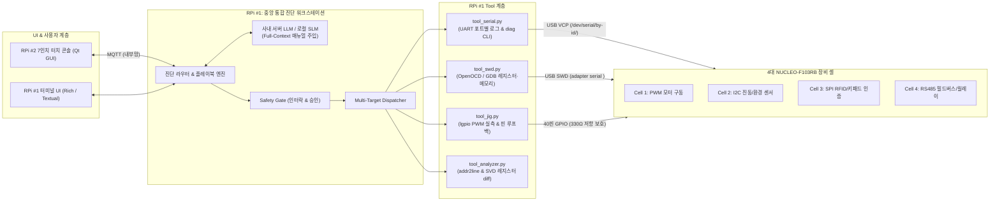
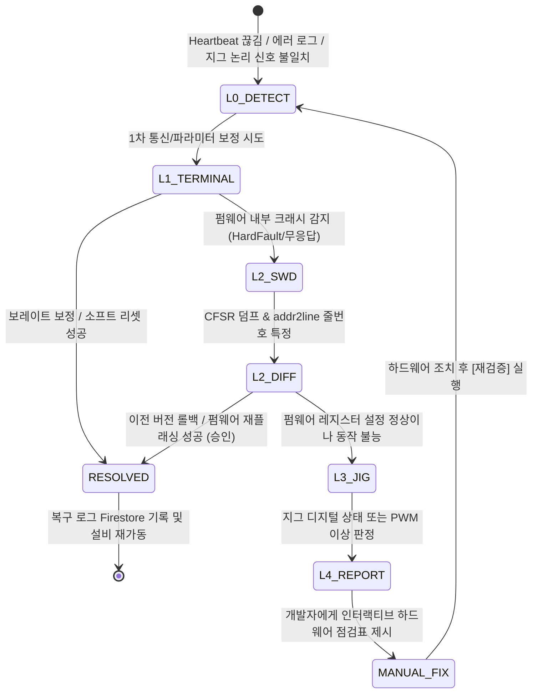

# [설계 v2.2] STM32 4개 셀 통합 진단·복구 벤치 & Agent Tool 인터페이스

> **기준 문서**: `아키텍처_v2_RPi-STM32_진단Agent.md`  
> **핵심 변경**: Jetson Nano AGV 배제 ➡️ **RPi5 중앙 진단 벤치 (USB 4포트 + 40핀 GPIO 지그 직결) ↔ 4개 NUCLEO-F103RB 셀** 구성 반영.
> **팀 분업**: AI/시스템 파트 2명 + 임베디드 펌웨어/HW 파트 2명.

---

## 0. 설계 원칙

1. **LLM은 하드웨어 레지스터를 직접 조작하지 않는다.**  
   모든 제어는 `진단 Agent / 플레이북 → Tool 호출(JSON) → Safety Gate (검증 및 승인) → SWD / UART / GPIO 지그`를 거친다.
2. **소프트웨어 조치(터미널 내부)를 우선 시도하고, 불가할 때만 하드웨어 가이드를 제공한다.**  
   L0(상태 수집) ➡️ L1(시리얼/파라미터 보정) ➡️ L2(SWD 고장 레지스터 분석 및 자동 롤백) ➡️ L3(GPIO 지그 실측) ➡️ L4(개발자용 점검 리포트).
3. **STM32 펌웨어는 "진단 가능하게 설계(Design for Diagnosability)"된다.**  
   4개 셀 모두 공통 모듈 `diag_core`를 탑재하여 Heartbeat, 리셋 원인 판독, No-Init RAM 고장 덤프, UART 진단 CLI를 지원한다.
4. **RPi5 1대가 4개 보드를 직결 총괄한다.**  
   네트워크 복잡도(Wi-Fi, 다중 브로커 동기화)를 제거하고, RPi5 본체의 4개 USB 포트와 40핀 GPIO 헤더를 활용해 4대 보드를 동시에 모니터링/디버깅한다.
5. **매뉴얼은 Full-Context로 시스템 프롬프트에 직접 주입한다.**  
   수천 토큰 규모의 `docs/manuals/*.md`를 통째로 주입하여 Vector DB 오버엔지니어링과 검색 누락을 방지한다.



---

## 1. 시스템 구성 및 장치 ID

| device_id   | 하드웨어 / 역할                                                                                  | 인터페이스 및 연결                      | 담당 파트           |
| :---------- | :----------------------------------------------------------------------------------------------- | :-------------------------------------- | :------------------ |
| `bench01`   | **RPi5 #1 (중앙 통합 진단 벤치)**<br/>- Agent Core, Safety Gate, Tool 계층, Multi-Target Manager | 4x USB 3.0/2.0, 40핀 GPIO 헤더          | AI (Member A, B)    |
| `console01` | **RPi5 #2 (현장 운영자 터치 콘솔)**<br/>- 7인치 LCD 전용 Qt GUI, 실시간 4채널 상태판, 승인 모달  | Wi-Fi / 이더넷 (MQTT)                   | AI (Member B)       |
| `cell1`     | **NUCLEO-F103RB #1 (구동 셀)**<br/>- DC모터(2N2222A), 스텝모터+드라이버, TIM PWM 제어            | USB 1 + RPi GPIO 17 (PWM 실측 지그)     | 임베디드 (Member C) |
| `cell2`     | **NUCLEO-F103RB #2 (센서 셀)**<br/>- MPU6050 진동 센서(I2C1), BMP280 기압/온도, 가변저항         | USB 2 + RPi GPIO 27 (I2C SCL 관찰 지그) | 임베디드 (Member C) |
| `cell3`     | **NUCLEO-F103RB #3 (인증/입력 셀)**<br/>- RFID(RC522, SPI), 4x4 키패드, 상태 OLED                | USB 3 + RPi GPIO 22 (SPI CS 관찰 지그)  | 임베디드 (Member D) |
| `cell4`     | **NUCLEO-F103RB #4 (통신/출력 셀)**<br/>- RS485 필드버스 마스터/슬레이브, 릴레이, FND, 상태 LED  | USB 4 + GPIO 23 (DE) / 24 (LD2)         | 임베디드 (Member D) |

- **셀 간 통신**: `cell1` ~ `cell4`는 **RS485 버스(A/B 차동 라인)**로 상호 연결되어 공정 연동 시퀀스를 수행한다.
- **보드 및 공통 핀**: 각 셀은 STM32F103RB (Cortex-M3 최대 72MHz, Flash 128KB, SRAM 20KB)를 사용한다. 온보드 ST-LINK/V2-1 VCP의 기본 USART2 PA2(TX)/PA3(RX), SWD PA13/PA14는 진단용으로 예약한다. Mini-USB 데이터 케이블 및 보드 점퍼/솔더 브리지의 기본 상태를 확인한다.
- **물량 및 전원**: 4셀은 동일 보드 4대 확보를 전제한다. 부품 목록의 STM32 수량은 미기재이며 TTL-to-RS485 2개만 기재되어 있어 4노드에는 호환 모듈 2개 이상이 추가로 필요하다. 모터·릴레이는 별도 드라이버와 전원을 사용하고 USB 전류 예산과 역전류를 검증한다.
- **GND 공통 연결**: RPi5의 GND와 4개 STM32 보드의 GND는 필수로 공통 결선한다.

---

## 2. 셀별 세부 기능 명세 및 FSM

### 2-1. 공통 펌웨어 규약 (`diag_core`) — 모든 STM32에 내장

모든 셀은 부팅 시 및 동작 중에 RPi5 진단 벤치가 상태를 즉시 파악할 수 있도록 표준 규약을 준수한다.

- **상태 머신 (FSM)**:

  ```mermaid
  stateDiagram-v2
      [*] --> INIT: 전원 투입 / 리셋
      INIT --> RUNNING: selftest 통과
      RUNNING --> WARNING: 센서/통신 경고 임계치 초과
      WARNING --> RUNNING: 정상 수치 복귀
      RUNNING --> FAULT_LOCK: 하드웨어 고장 / 인터럽트 차단
      WARNING --> FAULT_LOCK: 위험 임계치 초과
      RUNNING --> MAINTENANCE: diag maint 명령 수신
      FAULT_LOCK --> MAINTENANCE: diag maint 명령 수신
      MAINTENANCE --> RUNNING: diag exit 명령 + selftest 통과
  ```

- **구조화 로그 포맷 (UART 115200bps, 1초 주기)**:
  - Heartbeat: `HB t=<ms> state=<RUN|WARN|FAULT|MAINT> err=<0x코드>`
  - 이상 이벤트: `LOG lvl=<W|E|F> mod=<PWM|I2C|SPI|RS485> code=<0x코드> msg="<메시지>"`
  - 고장 덤프: `FAULT cfsr=<hex> hfsr=<hex> pc=<hex> lr=<hex>`
- **대화형 CLI 명령 (RPi5 ➡️ STM32)**:
  - `diag status`: 현재 FSM 상태, 센서값, 에러 플래그 출력
  - `diag selftest`: 주변장치 레지스터 및 버스 응답 무결성 자체 검사
  - `diag param get/set <key> <val>`: 런타임 임계치/보레이트 조회 및 변경
  - `diag reset`: 소프트웨어 리셋 트리거 (`NVIC_SystemReset()`)

---

### 2-2. 셀별 전담 기능 명세

| 셀 ID       | 기능 그룹 | 세부 기능 및 역할                                                                                                                                                       | 관찰 핀 (Jig)                    | 담당     |
| :---------- | :-------- | :---------------------------------------------------------------------------------------------------------------------------------------------------------------------- | :------------------------------- | :------- |
| **`cell1`** | 모터 구동 | - DC모터 0~100% PWM 가속/감속 제어 (TIM1_CH1)<br/>- 스텝모터 정밀 이송 각도/스텝 제어<br/>- 고의 고장: 널 포인터 역참조 (HardFault), 트랜지스터 베이스 저항 단선        | STM32 `PA8`<br/>(PWM 출력)       | Member C |
| **`cell2`** | 센서 감시 | - MPU6050 진동 윈도우 RMS/Peak 실시간 계산 (I2C1)<br/>- BMP280 온도/기압 이상 챔버 감시<br/>- 고의 고장: I2C 클럭 활성화 누락, SDA 점퍼선 단선                          | STM32 `PB8`<br/>(I2C1 SCL)       | Member C |
| **`cell3`** | 인증/입력 | - RFID(RC522) 제품 태그 UID 판독 (SPI1)<br/>- 4x4 키패드 작업자 인증 PIN 입력 및 OLED 표시<br/>- 고의 고장: SPI 워치독(IWDG) 타임아웃 무한 루프                         | STM32 `PA4`<br/>(SPI CS GPIO)    | Member D |
| **`cell4`** | 통신/출력 | - TTL-to-RS485 기반 4개 셀 다자간 패킷 중계 (CRC16 검증)<br/>- 비상 전원 차단 릴레이 및 에러 상태 3색 LED 표시<br/>- 고의 고장: RS485 A/B 극성 반전, UART 보레이트 오타 | STM32 `PB12`<br/>(RS485 DE GPIO) | Member D |

---

## 3. 공통 Agent Tool 인터페이스

Agent가 실행할 수 있는 Tool은 5대 도메인(`serial`, `swd`, `jig`, `analyze`, `fw`)으로 철저히 모듈화된다.

### 3-1. Tool 명세 스키마

```json
{
  "name": "swd.read_fault_register",
  "category": "swd",
  "description": "지정된 STM32 셀의 ARM Cortex-M HardFault 관련 레지스터(CFSR, HFSR, PC, LR)를 SWD로 덤프한다.",
  "parameters": {
    "type": "object",
    "properties": {
      "target_cell": {
        "type": "string",
        "enum": ["cell1", "cell2", "cell3", "cell4"]
      }
    },
    "required": ["target_cell"]
  },
  "risk_level": "READ",
  "requires_approval": false,
  "timeout_ms": 3000
}
```

---

### 3-2. Tool 전체 목록

#### ① 시리얼 & 로그 도구 (`tool_serial.py`)

| Tool                | 파라미터                  |  위험도  |  승인  | 설명                                                                                 |
| :------------------ | :------------------------ | :------: | :----: | :----------------------------------------------------------------------------------- |
| `serial.list_ports` | –                         |   READ   |   –    | 현재 연결된 4개 STM32의 `/dev/serial/by-id/` 포트 목록 반환                          |
| `serial.read_log`   | `target_cell`, `lines=50` |   READ   |   –    | 해당 보드의 최근 런타임 로그 버퍼 반환                                               |
| `serial.cmd`        | `target_cell`, `command`  | LOW/HIGH | 조건부 | `diag status`, `diag selftest` 등 안전 명령은 자동, `param set`, `reset`은 승인 필요 |
| `serial.baud_scan`  | `target_cell`             |   LOW    |   –    | 9600~115200bps를 순차 스캔하여 깨진 통신 속도를 자동 탐색                            |

#### ② SWD 하드웨어 디버그 도구 (`tool_swd.py`)

| Tool                      | 파라미터                  | 위험도 | 승인 | 설명                                                        |
| :------------------------ | :------------------------ | :----: | :--: | :---------------------------------------------------------- |
| `swd.read_fault_register` | `target_cell`             |  READ  |  –   | 고장 레지스터(CFSR, HFSR, MMFAR, BFAR, PC, LR) 덤프         |
| `swd.read_registers`      | `target_cell`, `reg_list` |  READ  |  –   | RCC, GPIO, TIM, I2C 등 주변장치 하드웨어 레지스터 직접 조회 |
| `swd.halt`                | `target_cell`             |  HIGH  |  ✅  | 디버깅을 위해 STM32 CPU 코어 일시 정지                      |
| `swd.resume`              | `target_cell`             |  LOW   |  –   | 정지된 CPU 코어 실행 재개                                   |
| `swd.system_reset`        | `target_cell`             |  HIGH  |  ✅  | 온보드 ST-LINK를 통한 하드웨어 리셋 펄스 주입               |

#### ③ GPIO 계측 지그 도구 (`tool_jig.py`)

| Tool                 | 파라미터                  |  위험도  | 승인 | 설명                                                                      |
| :------------------- | :------------------------ | :------: | :--: | :------------------------------------------------------------------------ |
| `jig.measure_pwm`    | `target_cell`             |   READ   |  –   | RPi5 GPIO(17)로 STM32 PA8 핀의 PWM 주파수 및 듀티비 실측                  |
| `jig.check_bus_idle` | `target_cell`, `bus_type` |   READ   |  –   | 배선된 I2C/SPI 관찰 핀의 디지털 유휴 상태 검사 (전압값 측정 불가)         |
| `jig.read_pin_level` | `target_cell`, `pin_name` |   READ   |  –   | 배선된 STM32 출력 핀의 디지털 High/Low 확인                               |
| `jig.assert_estop`   | –                         | CRITICAL |  –   | 별도 비상정지 회로 설계·검증 전 미구현; 실제 안전 차단 수단으로 취급 금지 |

#### ④ 코드 & 레지스터 분석 도구 (`tool_analyzer.py`)

| Tool                     | 파라미터                    | 위험도 | 승인 | 설명                                                                              |
| :----------------------- | :-------------------------- | :----: | :--: | :-------------------------------------------------------------------------------- |
| `analyze.addr2line`      | `target_cell`, `pc_address` |  READ  |  –   | PC 주소를 심볼 파일(`firmware.elf`)과 대조하여 **"C 소스 파일명:줄 번호"** 역추적 |
| `analyze.diff_registers` | `target_cell`, `peripheral` |  READ  |  –   | 현재 물리 레지스터 값과 `cellN_spec.md`의 정상 기대값 간 Bit Diff 분석            |
| `analyze.decode_cfsr`    | `cfsr_hex`                  |  READ  |  –   | CFSR 비트를 디코딩하여 고장 원인(UsageFault, BusFault, MemManage) 문자열 출력     |

#### ⑤ 펌웨어 관리 도구 (`tool_fw.py`)

| Tool                 | 파라미터                        | 위험도 | 승인 | 설명                                                                |
| :------------------- | :------------------------------ | :----: | :--: | :------------------------------------------------------------------ |
| `fw.rollback`        | `target_cell`, `backup_version` |  HIGH  |  ✅  | 정상 검증된 이전 펌웨어 바이너리를 ST-LINK로 재플래싱 (`st-flash`)  |
| `fw.patch_and_build` | `target_cell`, `patch_id`       |  HIGH  |  ✅  | 레지스터 비트 오타 등 소프트웨어 패치 적용 후 `make` 빌드 및 플래싱 |

---

## 4. 진단 및 복구 생명주기 (L0 ➡️ L4)



### 상태 전이 및 commandTable 기록

- Agent가 발행하는 모든 Tool 호출은 `commandTable`에 `PENDING_APPROVAL` ➡️ `DISPATCHED` ➡️ `RUNNING` ➡️ `DONE / REJECTED` 상태로 기록된다.
- `HIGH` 및 `CRITICAL` 위험도 명령(펌웨어 롤백, CPU 정지, 파라미터 수정)은 반드시 RPi #2 터치 콘솔(Qt GUI)에서 사용자의 명시적 **[승인(Approve)]** 타임스탬프를 획득해야 실행된다.

---

## 5. 통신 및 데이터 스키마

### 5-1. MQTT 토픽 구조 (RPi #1 ↔ RPi #2 터치 콘솔 간)

접두어: `bench01/`

| 토픽                          |      방향      | 내용                                             |
| :---------------------------- | :------------: | :----------------------------------------------- |
| `bench01/{cell_id}/telemetry` | RPi#1 ➡️ RPi#2 | 센서값, 모터 RPM, FSM 상태 주기 보고 (1Hz)       |
| `bench01/{cell_id}/alert`     | RPi#1 ➡️ RPi#2 | 임계치 초과 및 비정상 리셋 경고 발생             |
| `bench01/diagnosis/step`      | RPi#1 ➡️ RPi#2 | L0~L4 단계별 진단 진행 상태 및 분석 결과 브리핑  |
| `bench01/approval/request`    | RPi#1 ➡️ RPi#2 | 펌웨어 롤백, 파라미터 변경 승인 요청 모달 데이터 |
| `bench01/approval/response`   | RPi#2 ➡️ RPi#1 | 운영자의 [승인] 또는 [거부] 응답                 |

### 5-2. Firebase Firestore 스키마

#### ① `sensingTable` (장비 상태 및 진단 이벤트)

```json
{
  "bench_id": "bench01",
  "cell_id": "cell2",
  "ts": "<serverTimestamp>",
  "fsm_state": "WARNING",
  "metrics": {
    "vib_rms": 0.82,
    "temp_c": 48.5,
    "jig_scl_level": "HIGH"
  },
  "diagnosis": {
    "active": true,
    "level": "L2_SWD",
    "fault_type": "I2C_BUS_TIMEOUT"
  }
}
```

#### ② `commandTable` (진단 Tool 호출 및 승인 감사 로그)

```json
{
  "cmd_id": "CMD-20261102-0012",
  "cell_id": "cell1",
  "created_at": "<serverTimestamp>",
  "tool": "fw.rollback",
  "args": { "backup_version": "v1.2.0" },
  "risk_level": "HIGH",
  "reason": "HardFault detected at motor.c:84 (Null pointer dereference)",
  "approval": {
    "required": true,
    "status": "APPROVED",
    "by": "operator_console",
    "at": "<timestamp>"
  },
  "status": "DONE",
  "result_detail": "Firmware image flashed and verified. Board restarted."
}
```

---

## 6. 하드웨어 지그(Test Jig) 물리 핀맵

RPi5(3.3V 로직) 40핀 헤더와 각 NUCLEO-F103RB 헤더의 배선 계획. 관찰 신호선에 330Ω 직렬 저항을 넣고 공통 GND를 연결한다. 저항만으로 5V 보호가 보장되지 않으므로 모든 입력을 3.3V 범위로 제한한다.

|   RPi5 물리 핀   | RPi5 BCM GPIO | 방향 | 연결 대상 STM32 보드 및 핀         | 측정 목적                                    |
| :--------------: | :-----------: | :--: | :--------------------------------- | :------------------------------------------- |
|    **Pin 11**    |   `GPIO 17`   | 입력 | **Cell 1**: `PA8` (TIM1_CH1)       | 모터 PWM 출력 주파수 및 듀티비 실측          |
|    **Pin 13**    |   `GPIO 27`   | 입력 | **Cell 2**: `PB8` (I2C1_SCL)       | I2C 클럭 라인 정지(Stuck-Low) 여부 감지      |
|    **Pin 15**    |   `GPIO 22`   | 입력 | **Cell 3**: `PA4` (SPI CS GPIO)    | RFID 모듈 통신 활성화(Chip Select) 신호 감지 |
|    **Pin 16**    |   `GPIO 23`   | 입력 | **Cell 4**: `PB12` (RS485 DE GPIO) | RS485 송수신 방향 전환 제어핀 논리 상태 감지 |
|    **Pin 18**    |   `GPIO 24`   | 입력 | **Cell 4**: `PA5` (User LED)       | 보드 에러 상태 LED 물리적 점등 감지          |
| **Pin 6, 9, 14** |     `GND`     | 공통 | **Cell 1~4**: `GND` 핀 전체        | 공통 접지 기준 전위 형성                     |

**핀 설정 및 계측 조건**: Cell 2의 I2C1 PB8/PB9는 리맵이 필요하므로 AFIO 클럭 및 `AFIO_MAPR.I2C1_REMAP`을 설정하고 3.3V 풀업을 확인한다. Cell 3의 PA5는 SPI1 SCK와 온보드 LD2를 공유하며, PA4는 소프트웨어 제어 CS로 사용한다. Cell 4의 USART3는 PB10(TX)/PB11(RX), 방향 전환은 별도 GPIO PB12로 구성한다. 다른 셀의 RS485와 주변장치 핀도 최종 핀맵에서 충돌을 확인한다.

RPi GPIO는 디지털 High/Low만 판정한다. 정확한 전압, 파형 왜곡, 고속 버스 확인에는 ADC 또는 로직 분석기/오실로스코프가 필요하며 PWM 측정 범위는 실제 샘플링 성능으로 검증한다. `jig.assert_estop`은 별도 하드웨어 인터록 설계 전까지 미구현이다.

참고: [ST NUCLEO-F103RB 제품 페이지](https://www.st.com/en/evaluation-tools/nucleo-f103rb.html), [STM32F103RB 데이터시트](https://www.st.com/resource/en/datasheet/stm32f103rb.pdf), [Nucleo-64 사용자 설명서 UM1724](https://www.st.com/resource/en/user_manual/um1724-.pdf).

---

## 7. 팀 분업 체계 및 인터페이스 계약

### 7-1. 역할 분담표 (2 AI vs 2 임베디드)

| 파트            | 팀원              | 담당 도메인                          | 핵심 개발 산출물                                                                                                                                                                                                  |
| :-------------- | :---------------- | :----------------------------------- | :---------------------------------------------------------------------------------------------------------------------------------------------------------------------------------------------------------------- |
| **임베디드**    | **Member C**      | **Cell 1 & Cell 2 제어 + 지그 회로** | - `cell1`(PWM 모터) 및 `cell2`(I2C 진동) 펌웨어<br/>- RPi5 40핀 헤더 ↔ STM32 간 330Ω 지그 회로 브레드보드 결선<br/>- 널 포인터 크래시 및 I2C 단선 고장 주입 코드                                                  |
| **임베디드**    | **Member D**      | **Cell 3 & Cell 4 제어 + RS485 망**  | - `cell3`(SPI RFID) 및 `cell4`(RS485/릴레이) 펌웨어<br/>- 공통 규약 `diag_core.c` (No-Init RAM, HardFault 핸들러)<br/>- 4대 보드 간 RS485 다자간 통신 프로토콜 구현                                               |
| **AI / 시스템** | **Member A**<br/> | **AI Agent 코어 & 진단·추론 엔진**   | - L0~L4 진단 플레이북 엔진 (`playbook_runner.py`)<br/>- SWD 고장 레지스터 파서 & `addr2line` 소스 줄번호 역추적기<br/>- Full-Context 프롬프트 주입 및 L4 인터랙티브 점검 리포트 생성기<br/>- Safety Gate 미들웨어 |
| **AI / 시스템** | **Member B**      | **다중 타겟 매니저 & 현장 관제 UI**  | - 4개 USB 포트 ST-LINK 시리얼 및 UART 1:1 매핑 데몬 (`target_manager.py`)<br/>- OpenOCD, GDB, `pyserial`, `lgpio` 파이썬 Tool 래퍼 작성<br/>- RPi #2 (7인치 LCD) Qt GUI 콘솔 및 Firebase/Web 연동                 |

---

### 7-2. 개발 로드맵 (4주 완성)

```text
[1주차: 인터페이스 계약 & 환경 셋업]
├── 임베디드 파트: diag_core 규약 확정 및 4개 셀 CubeIDE 프로젝트 기본 생성 (C: Cell 1·2, D: Cell 3·4)
└── AI 파트: RPi5에 OpenOCD/GDB/pyocd 환경 구축, 단일 보드 SWD 레지스터 덤프 PoC 검증

[2주차: 개별 모듈 개발 & 1인 1세트 독립 테스트]
├── 임베디드 파트: 4개 셀 주변장치 드라이버 완성, docs/manuals/cellN_spec.md 작성
└── AI 파트: Multi-Target Manager 완성, Tool 화이트리스트 및 LLM 프롬프트 뼈대 구축

[3주차: 결합 및 고장 주입 테스트 (Integration)]
├── 임베디드 파트: 4대 보드를 RPi5 1대에 USB/지그로 전원 결선, 7대 시연용 고장 고의 주입
└── AI 파트: 이상 감지 ➡️ 레지스터 분석 ➡️ 자동 롤백 / 하드웨어 리포트 출력 End-to-End 검증

[4주차: 콘솔 연동 & 최종 시연 리허설]
├── 전체: RPi #2 (7인치 터치 콘솔) Qt GUI 화면 연동 및 승인 워크플로우 실증
└── 전체: 7대 고장 시나리오 무중단 데모 리허설, 발표 지표(자동 해결률, 지연시간) 측정
```
