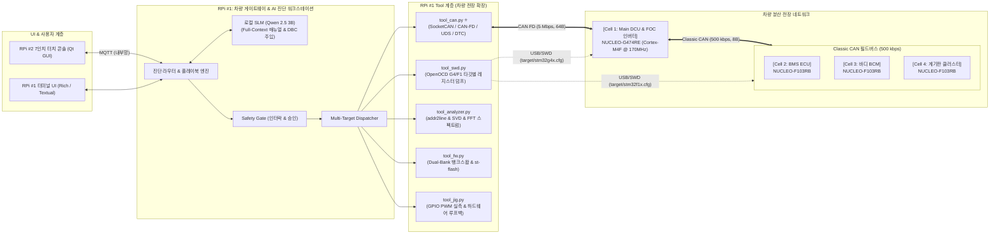
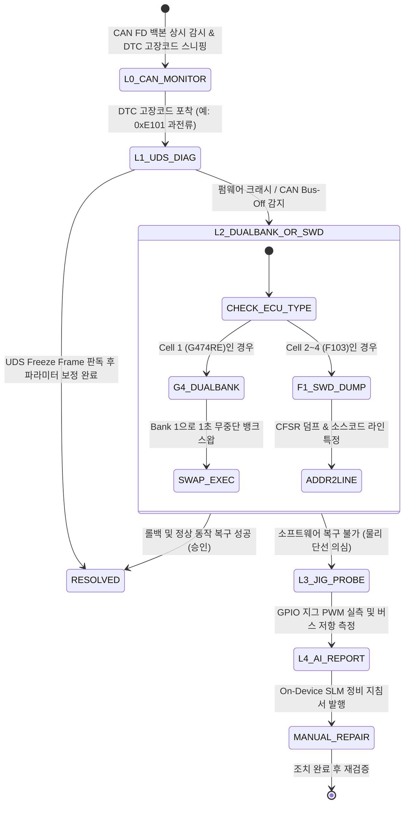

# [설계 v3.0] 차세대 차량용 도메인 컨트롤러(G474RE) & CAN FD 분산 ECU 진단 벤치 설계 및 Agent Tool 인터페이스

> **버전**: v3.0 (최신 개정)  
> **기준 문서**: `아키텍처_v2_RPi-STM32_진단Agent.md`, `차량용_CAN_통신_도입_및_아키텍처_설계.md`  
> **핵심 개정 사항**:  
> 1. **NUCLEO-G474RE (Cortex-M4F @ 170MHz)** 도입을 통한 **차량 Main DCU / VCU & FOC 모터 인버터** 승격.  
> 2. **CAN FD (2~5 Mbps, 64 Byte) 백본 ↔ Classic CAN (500 kbps, 8 Byte) 필드버스** 듀얼 네트워크 구축.  
> 3. 진단 Agent Tool 계층에 **차량용 CAN/CAN-FD 도구(`tool_can.py`)**, **Dual-Bank 무중단 롤백 도구**, **실시간 진동 FFT 분석 도구** 신규 탑재.

---

## 0. 설계 원칙 및 아키텍처

1. **실제 완성차의 이종(Heterogeneous) E/E 아키텍처를 그대로 모사한다.**  
   고성능 도메인 컨트롤러(G474RE)가 상위 백본(CAN FD)과 하위 필드버스(Classic CAN)를 매개하며, RPi 5는 중앙 텔레매틱스/AI 게이트웨이 역할을 수행한다.
2. **듀얼 채널(CAN Bus + SWD) 하이브리드 진단을 수행한다.**  
   - **1차 런타임 진단 (CAN FD / CAN)**: UDS(ISO 14229) 표준 질의, DTC(고장코드) 감시, Freeze Frame 수집.
   - **2차 실리콘 심층 진단 (SWD 백채널)**: Bus-Off 또는 HardFault 크래시 시 OpenOCD로 CPU 레지스터(CFSR/BFAR) 덤프.
3. **LLM은 하드웨어 레지스터를 직접 조작하지 않는다.**  
   모든 제어는 `진단 Agent / 플레이북 → Tool 호출(JSON) → Safety Gate (검증 및 승인) → CAN FD / SWD / GPIO 지그`를 거친다.
4. **NUCLEO-G474RE의 하드웨어 가속기를 적극 활용한다.**  
   CORDIC(삼각함수 FOC 모터 가속), Dual-Bank Flash(무중단 OTA 및 1초 롤백), FMAC/DSP(실시간 1024-pt FFT 진동 분석).

---

## 1. 시스템 구성 및 장치 식별 ID

| device_id | 하드웨어 / 차량 역할 | 코어 스펙 및 주요 인터페이스 | 담당 파트 |
|:---|:---|:---|:---|
| **`bench01`** | **RPi5 #1 (중앙 게이트웨이 & 진단기)** | Quad A76 @ 2.4GHz, SocketCAN (`can0`), 4x USB, 40핀 GPIO | AI 파트 (Member A, B) |
| **`console01`**| **RPi5 #2 (현장 운영자 터치 콘솔)** | 7인치 터치 LCD, Qt GUI, 실시간 4채널 텔레메트리, 승인 모달 | AI 파트 (Member B) |
| **`cell1`** ⭐ | **NUCLEO-G474RE (Main DCU / VCU)** | **Cortex-M4F @ 170MHz, 512KB Dual-Bank Flash, 128KB RAM** • **FDCAN1**: RPi5 백본 (CAN FD 5 Mbps) • **FDCAN2**: 하위 필드버스 게이트웨이 (Classic CAN 500k) • **CORDIC FOC**: DC/BLDC 3상 인버터 고효율 벡터 제어 | 임베디드 파트 (Member C) |
| **`cell2`** | **NUCLEO-F103RB (섀시 / BMS ECU)** | Cortex-M3 @ 72MHz, Classic CAN (500k) • 배터리 팩 전압/전류 계측, MPU6050 진동, BMP280 온도 | 임베디드 파트 (Member C) |
| **`cell3`** | **NUCLEO-F103RB (바디 BCM ECU)** | Cortex-M3 @ 72MHz, Classic CAN (500k) • RFID 스마트키 인증(Immobilizer), 도어락, 비상등, 키패드 | 임베디드 파트 (Member D) |
| **`cell4`** | **NUCLEO-F103RB (클러스터 ECU)** | Cortex-M3 @ 72MHz, Classic CAN (500k) • 전자식 계기판(FND/OLED) 속도 표출, DTC 체크 엔진 경고등 | 임베디드 파트 (Member D) |

---

## 2. 셀별 세부 기능 명세 및 고의 고장 주입 시나리오

### 2-1. Cell 1: NUCLEO-G474RE (Main DCU & FOC 인버터)
* **주요 기능**:
  1. **CORDIC 하드웨어 가속 FOC 모터 제어**: 삼각함수 연산을 하드웨어 파이프라인으로 처리하여 극저소음/고토크 모터 벡터 제어.
  2. **CAN FD ↔ Classic CAN 지능형 라우터**: 하위 3개 셀의 8바이트 CAN 프레임을 취합하여 RPi5에 64바이트 CAN FD 프레임으로 압축 중계.
  3. **FMAC / CMSIS-DSP 실시간 1024-pt 진동 FFT**: 온-보드에서 직접 주파수 영역 해석을 수행하여 베어링 고유 진동 이상 감지.
  4. **Dual-Bank Flash (256KB x 2) 무중단 OTA**: 주행 중 Bank 2에 펌웨어를 쓰고 1초 만에 뱅크 스왑(BFB2) 적용.
* **고의 고장 주입 (Fault Injection)**:
  - CORDIC 위상각(Theta) 오버플로우로 인한 FOC 제어 발산 및 과전류
  - CAN FD 버스오프(Bus-Off) 에러 주입
  - Dual-Bank OTA 무결성(CRC) 오류 유발 후 롤백 테스트
  - 인버터 상하단 FET 데드타임(Dead-time) 침범 HardFault

### 2-2. Cell 2: NUCLEO-F103RB (섀시 & BMS ECU)
* **주요 기능**: 가변저항을 통한 배터리 셀 전압 감시, MPU6050 진동 가속도 RMS 계산.
* **고의 고장**: 배터리 저전압 컷오프(Under-Voltage Cutoff) 시뮬레이션, I2C 버스 Stuck-Low.

### 2-3. Cell 3: NUCLEO-F103RB (바디 BCM ECU)
* **주요 기능**: RC522 RFID 스마트키 리더기 연동, 인가되지 않은 키 태그 시 시동 차단(Immobilizer).
* **고의 고장**: 무단 침입 시도(DTC P1602), 키패드 버퍼 오버플로우.

### 2-4. Cell 4: NUCLEO-F103RB (계기판 클러스터 ECU)
* **주요 기능**: CAN 버스에서 수신한 속도/RPM을 FND/OLED에 실시간 표출, DTC 발생 시 경고등 점등.
* **고의 고장**: 수신 버퍼 오버런(OVR), 표시 주기 타임아웃.

---

## 3. 공통 Agent Tool 인터페이스 (차량 전장 특화)

Agent가 실행할 수 있는 Tool은 6대 모듈(`can`, `swd`, `analyze`, `fw`, `jig`, `serial`)로 구성됩니다.

### 3-1. 차량 CAN / CAN FD 도구 (`tool_can.py`) ⭐

| Tool | 파라미터 | 위험도 | 승인 | 설명 |
|:---|:---|:---:|:---:|:---|
| **`can.sniff`** | `duration_sec=3`, `can_id=None` | READ | – | `candump` 기반 실시간 버스 트래픽 캡처 및 메시지 분석 |
| **`can.check_dtc`** | `target_ecu` | READ | – | 현재 버스에 브로드캐스팅 중인 활성 차량 고장코드(DTC) 조회 |
| **`can.uds_query`** | `target_ecu`, `service_id` | LOW | – | ISO 14229 표준 UDS 요청 (`0x7DF` / `0x7E0`) 및 Freeze Frame 수신 |
| **`can.send_cmd`** | `can_id`, `hex_data` | HIGH | ✅ | 차량 비상 정지(`0x010`) 또는 파라미터 보정 프레임 송신 |
| **`can.bus_state`** | – | READ | – | `can0`의 에러 카운터(TEC, REC), Bus-Off 여부 진단 |

### 3-2. SWD 하드웨어 디버그 도구 (`tool_swd.py`)

| Tool | 파라미터 | 위험도 | 승인 | 설명 |
|:---|:---|:---:|:---:|:---|
| **`swd.read_fault`** | `target_cell` | READ | – | **G474(Cortex-M4)** 및 **F103(Cortex-M3)** 코어 레지스터(CFSR, BFAR, PC, LR) 덤프 |
| **`swd.read_sfr`** | `target_cell`, `reg_addr` | READ | – | 특정 하드웨어 SFR 레지스터(FDCAN, CORDIC, RCC 등) 직접 읽기 |
| **`swd.halt`** | `target_cell` | HIGH | ✅ | 디버깅을 위해 해당 ECU 코어 일시 정지 |
| **`swd.reset_halt`** | `target_cell` | HIGH | ✅ | 하드웨어 리셋 펄스 인가 후 즉각 정지 |
| **`swd.resume`** | `target_cell` | LOW | – | 정지된 CPU 코어 정상 실행 재개 |

### 3-3. 펌웨어 및 무중단 OTA 도구 (`tool_fw.py`)

| Tool | 파라미터 | 위험도 | 승인 | 설명 |
|:---|:---|:---:|:---:|:---|
| **`fw.dualbank_swap`** | `cell1` | HIGH | ✅ | **NUCLEO-G474RE 전용**: BFB2 옵션 비트를 토글하여 1초 만에 안전 무중단 뱅크 스왑 롤백 |
| **`fw.ota_stream`** | `target_cell`, `bin_file` | HIGH | ✅ | CAN FD 64B 블록 스트리밍으로 G474 Bank 2에 백그라운드 펌웨어 다운로드 |
| **`fw.st_flash`** | `target_cell`, `bin_file` | HIGH | ✅ | F103 셀용 전통적 SWD 플래싱 (`st-flash`) |

### 3-4. 진단 분석 도구 (`tool_analyzer.py`)

| Tool | 파라미터 | 위험도 | 승인 | 설명 |
|:---|:---|:---:|:---:|:---|
| **`analyze.addr2line`** | `target_cell`, `pc_address` | READ | – | 크래시 PC 주소를 ELF 심볼과 대조하여 **"C 소스 파일명:줄 번호"** 역추적 |
| **`analyze.fft_peaks`** | `cell1` | READ | – | G474RE가 전송한 1024-pt FFT 주파수 스펙트럼에서 베어링 결함 고조파 감지 |
| **`analyze.decode_cfsr`**| `cfsr_hex` | READ | – | SCB CFSR 레지스터 비트(MemManage, BusFault, UsageFault) 자연어 디코딩 |

---

## 4. 차량 진단 및 복구 생명주기 (L0 ➡️ L4)

---

## 5. 차량 통신 매트릭스 & 신호 스키마

### 5-1. CAN FD 백본 버스 (RPi 5 ↔ NUCLEO-G474RE, 5 Mbps)
* **`0x010` (EMERGENCY_STOP)**: DLC 8B, 긴급 정지 및 모터 차단 플래그
* **`0x050` (G474_FOC_TELEMETRY)**: **DLC 64B (CAN FD 고속)**, 3상 전류(U/V/W), 로터 회전각, 토크, CORDIC 상태, FFT 상위 피크 4개
* **`0x060` (GATEWAY_AGGREGATED)**: **DLC 64B**, 하위 3개 F103 셀(BMS, BCM, Cluster)에서 올라온 센서/상태를 1개 프레임으로 압축 중계
* **`0x7DF` (OBD2_BROADCAST_REQ)**: DLC 8B, ISO 14229 표준 통합 진단 질의
* **`0x7E8` (UDS_DIAG_RESP)**: DLC 8B, DTC 고장 상세 및 Freeze Frame 응답

### 5-2. Classic CAN 필드버스 (G474RE ↔ NUCLEO-F103RB x3, 500 kbps)
* **`0x200` (BMS_STATUS)**: DLC 8B, 배터리 전압(mV), 방전전류(mA), SOC(%), 셀 최고온도
* **`0x300` (BODY_STATUS)**: DLC 8B, 스마트키 인증 상태, 도어락 플래그, 비상등 점멸
* **`0x400` (CLUSTER_FEEDBACK)**: DLC 8B, 현재 표시 중인 속도값, 경고등 래치 상태

---

## 6. 팀 분업 체계 및 역할 분담 (2 AI vs 2 임베디드)

| 파트 | 팀원 | 담당 도메인 | 핵심 개발 산출물 |
|:---|:---|:---|:---|
| **임베디드** | **Member C** ⭐ | **Main DCU (G474RE) & FOC 제어** | • NUCLEO-G474RE 펌웨어 (CORDIC FOC, FDCAN1/2 게이트웨이) • Dual-Bank 무중단 OTA 뱅크 스왑 로직 구현 • FMAC/DSP 1024-pt 진동 FFT 알고리즘 탑재 |
| **임베디드** | **Member D** | **분산 ECU 3종 (F103) & CAN 버스** | • NUCLEO-F103RB 3대 펌웨어 (BMS, BCM, 계기판) • Classic CAN 500kbps 통신 드라이버 및 DTC 발행 로직 • 공통 규약 `diag_core.c` 및 고의 고장 주입 회로 |
| **AI / 시스템** | **Member A** | **AI Agent 코어 & 진단·추론 엔진** | • L0~L4 차량 진단 플레이북 엔진 (`playbook_runner.py`) • `tool_can.py` (SocketCAN / UDS / DTC 파서) 개발 • Qwen 2.5 3B 기반 차량 고장 분석 프롬프트 엔지니어링 |
| **AI / 시스템** | **Member B** | **다중 타깃 매니저 & 현장 관제 UI** | • OpenOCD G4/F1 타깃 분리 제어 데몬 (`target_manager.py`) • RPi #2 (7인치 LCD) Qt GUI 차량 대시보드 화면 연동 • Firebase 실시간 텔레메트리 연동 |
