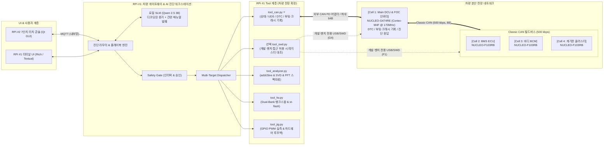
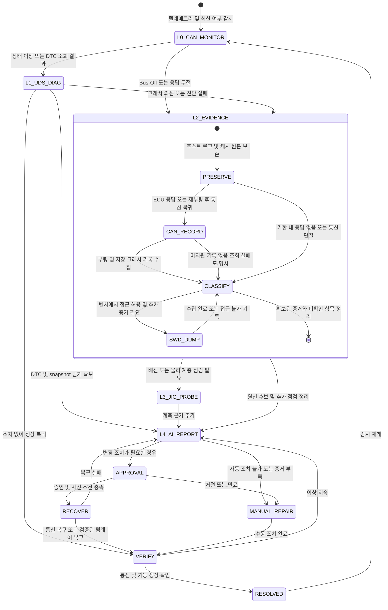

# [설계 v3.3] 차량용 도메인 컨트롤러(G474RE) & CAN FD 분산 ECU 진단 벤치 및 Agent Tool 인터페이스

> **버전**: v3.3 (2026-11-13 장비 정보 기반 검증 우선 결정 반영)
>
> **기준 문서**: [CAN 아키텍처 설계](차량용_CAN_통신_도입_및_아키텍처_설계.md), [(OLD) 진단 Agent 아키텍처](%28OLD%29아키텍처_v2_RPi-STM32_진단Agent.md)
>
> **문서 상태**: 구현 전 설계. Tool 이름은 인터페이스 제안이며 구현 완료를 의미하지 않는다. 통신 신호·주기·진단 주소는 양 파트 합의 후 확정한다.
>
> **핵심 개정 사항**:
>
> 1. **NUCLEO-G474RE (Cortex-M4F @ 170MHz)** 도입을 통한 **차량 Main DCU / VCU & FOC 모터 인버터** 승격.
> 2. **CAN FD 백본 ↔ Classic CAN 500 kbps 필드버스** 구축. 백본 중재 500 kbps·데이터 2 Mbps는 초기 제안, 데이터 5 Mbps는 검증 후 확장 목표.
> 3. **CAN/ISO-TP/UDS 도구**, **Dual-Bank 재부팅 기반 복구**, **CMSIS-DSP FFT 분석** 설계 및 진단·승인 흐름 정리.
> 4. **SWD 없이 진단 가능한 제품 운용 경로**: ECU의 DTC·스냅샷·부팅/크래시 기록을 CAN으로 조회하고, SWD는 접근 가능한 개발·벤치 환경에서만 사용.

---

## 0. 설계 원칙 및 아키텍처

**회의 결정에 따른 우선 범위**: 장비 정보·펌웨어·통신 명세·정상 기준을 고정한 뒤 진단 결과를 검증한다.
초기에는 정상·원본 갱신 지연·로컬 Bus-Off의 관측과 판정부터 연결한다. 고장 정답은 별도 검증 실행기가
관리하며, LLM에는 관측 증거와 확정 정상 기준을 전달한다. 판정 한도는 수집 데이터나 모델이 변경하지 않는다.
상세는 [장비 정보 기반 검증 계획](장비_정보_기반_검증_계획.md)을 따른다.

아래 장비별 FOC·FFT·다중 ECU·복구 도구는 단계별 확장 설계다. 미확인 장비 탐색·미지 로그/규약 추정은
후속 범위이며, 첫 검증에서 필요하지 않은 확장 기능의 완성을 전제하지 않는다.
자료 불일치는 검증 준비 보류로 처리하고 실행 중 조회 실패·미지원·손상은 장비 고장과 구분한다.
SWD 선택 정책과 실제 제어 도구의 미구현 상태는 유지한다.

1. **이종 E/E 아키텍처의 도메인 게이트웨이를 실습 벤치로 구현한다.**
   G474RE가 상위 CAN FD와 하위 Classic CAN을 매개하고 RPi 5는 진단 호스트 역할을 수행한다. 특정 완성차의 실제 사양이나 차량용 인증을 재현한다는 의미는 아니다. Nucleo 보드는 제어 보드이며 모터 전력단·계측·보호 회로는 별도 필요하다.
2. **CAN을 제품 운용 진단의 주 경로로, SWD를 개발·벤치의 선택 경로로 둔다.**
   - **제품 운용 경로**: heartbeat·Sequence·부팅 식별값으로 이상을 감시하고, ECU가 구현한 UDS 읽기 서비스로 DTC·Freeze Frame·버전·리셋 원인·저장된 크래시 기록을 수집한다. CAN 진단은 Classic CAN에서도 가능하며 CAN FD를 필수로 요구하지 않는다.
   - **ECU 내부 기록**: 고장 검출기, 스냅샷/이벤트 저장, 최소 Fault 문맥 보관, 부팅 시 기록 복구와 진단 응답을 공통 기능으로 구현한다. 저장·전송 계약은 [CAN 아키텍처 6절](차량용_CAN_통신_도입_및_아키텍처_설계.md#6-swd-없이-진단하는-제품-운용-설계)을 따른다.
   - **선택 SWD 경로**: 허용된 개발·벤치에서만 레지스터를 대조하거나 정지 분석한다. 접근 불가를 MCU 고장으로 간주하지 않고 `debug_access_unavailable`로 기록하여 확보된 증거로 분석을 계속한다. 자동 보호 해제·대량 삭제·옵션 바이트 변경은 도구 범위에서 제외한다.
   - ECU가 멈추거나 CAN 경로가 끊기면 즉시 조회할 수 없다. 기존 호스트 로그를 보존하고 재부팅/통신 복귀 후 기록을 수집하거나 외부 계측·개발 장비 재현으로 이어간다. Bus-Off만으로 펌웨어 손상이나 롤백 필요성을 단정하지 않는다.
3. **LLM은 하드웨어 레지스터를 직접 조작하지 않는다.**  
   모든 제어는 `진단 Agent / 플레이북 → Tool 호출(JSON) → Safety Gate (검증 및 승인) → CAN FD / SWD / GPIO 지그`를 거친다.
4. **NUCLEO-G474RE의 하드웨어 가속기를 적극 활용한다.**  
   CORDIC은 FOC의 삼각함수 연산, FMAC은 필터 연산에 활용한다. FFT는 Cortex-M4F에서 CMSIS-DSP로 수행한다. Dual-Bank는 다른 뱅크 실행 중 기록을 지원하지만 이미지 적용에는 재부팅 및 부트로더 검증이 필요하며, 무중단·1초 복구를 보장하지 않는다. [ST 기능 설명](https://www.st.com/en/microcontrollers-microprocessors/stm32g474re.html), [ST RM0440](https://www.st.com/resource/en/reference_manual/dm00355726-stm32g4-series-advanced-armbased-32bit-mcus-stmicroelectronics.pdf)

---

## 1. 시스템 구성 및 장치 식별 ID

| device_id       | 하드웨어 / 차량 역할                   | 코어 스펙 및 주요 인터페이스                                                                                                                                                                                     | 담당 파트                |
| :-------------- | :------------------------------------- | :--------------------------------------------------------------------------------------------------------------------------------------------------------------------------------------------------------------- | :----------------------- |
| **`bench01`**   | **RPi5 #1 (중앙 게이트웨이 & 진단기)** | Quad A76 @ 2.4GHz, 외부 CAN FD 어댑터를 SocketCAN `can0`로 사용, 4x USB, 40핀 GPIO                                                                                                                               | AI 파트 (Member A, B)    |
| **`console01`** | **RPi5 #2 (현장 운영자 터치 콘솔)**    | 7인치 터치 LCD, Qt GUI, 실시간 4채널 텔레메트리, 승인 모달                                                                                                                                                       | AI 파트 (Member B)       |
| **`cell1`** ⭐  | **NUCLEO-G474RE (Main DCU / VCU)**     | Cortex-M4F @ 최대 170MHz, 512KB Flash(DBANK 설정 확인), 128KB SRAM(96KB + CCM 32KB) • FDCAN1: CAN FD 백본 • FDCAN2: Classic CAN 500 kbps 필드버스 • CORDIC: PMSM/BLDC FOC 연산, 외부 3상 전력단 제어 | 임베디드 파트 (Member C) |
| **`cell2`**     | **NUCLEO-F103RB (섀시 / BMS ECU)**     | Cortex-M3 @ 72MHz, Classic CAN (500k) • 배터리 팩 전압/전류 계측, MPU6050 진동, BMP280 온도                                                                                                                  | 임베디드 파트 (Member C) |
| **`cell3`**     | **NUCLEO-F103RB (바디 BCM ECU)**       | Cortex-M3 @ 72MHz, Classic CAN (500k) • RFID 스마트키 인증(Immobilizer), 도어락, 비상등, 키패드                                                                                                              | 임베디드 파트 (Member D) |
| **`cell4`**     | **NUCLEO-F103RB (클러스터 ECU)**       | Cortex-M3 @ 72MHz, Classic CAN (500k) • 전자식 계기판(FND/OLED) 속도 표출, DTC 체크 엔진 경고등                                                                                                              | 임베디드 파트 (Member D) |

---

## 2. 셀별 세부 기능 명세 및 고의 고장 주입 시나리오

**Cell 1~4 공통 진단 기능**: 펌웨어 버전·Build ID·프로토콜/기록 스키마 버전·진단 지원 기능, heartbeat·Sequence·부팅 식별값, DTC와 고장 순간 스냅샷, 부팅/리셋 이력, 최소 크래시 요약을 제공한다. 기능별 지원 여부를 명시하고 미구현 항목을 0이나 빈 정상 기록으로 응답하지 않는다. 개발 PC는 배포 Build ID별 ELF·맵 파일·소스 커밋을 보관한다. 아래 도메인 기능과 공통 진단 기능은 모두 구현 전 요구사항이다.

### 2-1. Cell 1: NUCLEO-G474RE (Main DCU & FOC 인버터)

- **주요 기능**:
  1. **CORDIC 기반 FOC 연산**: 삼각함수 계산을 가속한다. 전류 제어·위치 추정·PWM·보호 로직은 별도 구현하며 저소음·고토크 성능은 실측한다.
  2. **CAN FD ↔ Classic CAN 게이트웨이**: 3개 셀의 상태와 최신 여부를 64B FD 프레임으로 취합한다. 이는 압축 알고리즘이 아닌 집계이며, FD 프레임을 F103으로 그대로 전달하지 않는다.
  3. **CMSIS-DSP 1024-pt FFT**: 진동 이상 징후를 분석한다. FMAC은 필터 전처리 후보이다. Cell 2 센서의 원시 샘플 전달 경로·샘플링 주파수·대역폭은 미확정이며 RMS만으로 FFT를 복원할 수 없다.
  4. **Dual-Bank 다운로드·복구**: DBANK 설정과 메모리 배치를 확인하고 비활성 슬롯에 기록한다. 검증된 부트로더가 안전 상태에서 재부팅·시험 부팅·확정/복구를 관리한다. BFB2 토글만으로 OTA와 롤백이 완성되지 않는다.

- **고의 고장 주입 (Fault Injection)**:
  - 위상각 스케일·범위·피드백 오류를 모의 입력으로 주입하고 제어기·보호 로직 대응 확인 (각도 래핑 자체는 정상 동작일 수 있음)
  - CAN FD 버스오프(Bus-Off) 에러 주입
  - OTA 이미지 무결성 오류 시 활성화 거부, 시험 부팅 실패 시 정상 이미지 복구
  - 데드타임 설정 오류를 시뮬레이션하여 PWM·보호 상태 확인. 실제 상하단 FET 동시 도통은 하드웨어 손상으로 이어질 수 있으며 CPU HardFault와 동일한 사건이 아님
  - CPU HardFault는 잘못된 메모리 접근 등 별도 소프트웨어 시나리오로 재현

### 2-2. Cell 2: NUCLEO-F103RB (섀시 & BMS ECU)

- **주요 기능**: 가변저항 ADC 입력으로 배터리 전압을 모의하고, MPU6050 진동 가속도의 RMS를 계산한다. 실제 배터리 전압·전류 계측에는 별도 계측 회로와 측정 범위 검토가 필요하다.

- **고의 고장**: 배터리 저전압 컷오프(Under-Voltage Cutoff) 시뮬레이션, I2C 버스 Stuck-Low.

### 2-3. Cell 3: NUCLEO-F103RB (바디 BCM ECU)

- **주요 기능**: RC522 RFID 스마트키 리더기 연동, 인가되지 않은 키 태그 시 시동 차단(Immobilizer).

- **고의 고장**: 미인가 키 인증 실패, 키패드 버퍼 오버플로우. 고장 코드는 프로젝트 DTC 목록에서 배정한다. `P1602`를 이모빌라이저의 보편적 표준 코드로 가정하지 않는다.

### 2-4. Cell 4: NUCLEO-F103RB (계기판 클러스터 ECU)

- **주요 기능**: CAN 버스에서 수신한 속도/RPM을 FND/OLED에 실시간 표출, DTC 발생 시 경고등 점등.

- **고의 고장**: CAN 수신 FIFO 오버런, 표시 데이터 타임아웃. 실제 레지스터 플래그 명칭은 MCU별로 확인한다.

---

## 3. 공통 Agent Tool 인터페이스 (차량 전장 특화)

아래는 `can`, `swd`, `analyze`, `fw` 4개 모듈의 인터페이스 초안입니다. `jig`, `serial`은 확장 예정이며 UART 관측·자가 시험·수동 측정의 별도 제안은 3-5절을 따릅니다. 공통 응답에는 `target`, `timestamp`, `status`, `data`, `error`를 포함하고 미지원·데이터 만료·시간 초과를 정상값 0과 구분합니다. 모든 HIGH 도구는 공통 호출 계층에서 대상·명령·파라미터에 연결된 `approval_id`와 만료 여부를 검증합니다.

증거에는 `origin_ecu`, `source`(직접/게이트웨이 캐시/CAN 저장 기록/벤치 SWD), `collected_at`, `boot_id`, `schema_version`, 필드별 유효 여부를 포함한다. 기록에는 추가로 `record_id`, `capture_boot_id`, `capture_uptime_ms`, `record_build_id`를 보존한다. 현재 실행 중인 `running_build_id`와 과거 기록의 Build ID를 구분하며 서로 다른 부팅의 uptime을 직접 빼지 않는다. 기록이 과거 사건이라는 사실과 현재 조회 경로의 최신 여부도 구분한다.

| 결과 | Tool 응답 계약 |
| --- | --- |
| 정상 기록 조회 | `status=ok`, 원본·수집 시각과 유효성 포함 |
| 조회 성공, 저장 기록 없음 | `status=ok`, `data.record_present=false`. 전체 수명 동안 고장이 없었다는 의미는 아님 |
| 미지원 / 시간 초과 / 손상 | 각각 `status=unsupported` / `timeout` / `invalid`. 오류 상세에 서비스·NRC·무결성 실패 등을 보존 |
| SWD 접근 불가 | `status=unavailable`, `error.code=debug_access_unavailable`, 이유는 확인된 범위에서 `denied` / `probe_missing` / `unknown` 등으로 기록. 연결 실패만으로 RDP 설정을 확정하지 않음 |
| 심벌 없음 / 빌드 불일치 | 주소는 보존하고 소스 위치는 미확인. 다른 빌드의 ELF로 대체하지 않음 |

**SLM 입력**: 프레임 파싱·DBC 디코딩은 Tool에서 수행하고 SLM에는 요약 증거와 관련 매뉴얼을 전달합니다. 현재 `scripts/run_qwen3b_server.sh`의 컨텍스트 설정은 2048 토큰이므로 전체 매뉴얼·DBC 일괄 주입을 전제로 하지 않습니다.

### 3-1. 차량 CAN / CAN FD 도구 (`tool_can.py`) ⭐

| Tool | 파라미터 | 위험도 | 승인 | 설명 |
| :------------------ | :---------------------------------------------------------------------- | :-------------: | :--: | :------------------------------------------------------------------------------------------ |
| **`can.sniff`** | `interface`, `duration_sec=3`, `can_id=None` | READ | – | SocketCAN/candump로 캡처하고 Classic/FD 구분 및 DBC 디코딩 |
| **`can.check_dtc`** | `target_ecu`, `source="uds"` | LOW / 캐시 READ | – | 허용된 UDS 읽기 요청으로 DTC·상태 조회. 캐시 조회는 수집 시각·유효 여부 포함 |
| **`can.uds_query`** | `target_ecu`, `service_id`, `subfunction=None`, `payload`, `timeout_ms` | LOW (읽기 제한) | – | 주소표와 ISO-TP를 사용. 읽기 허용 목록(0x19/0x22 및 파라미터)을 검증하고 NRC·시간 초과 처리 |
| **`can.send_cmd`** | `target_ecu`, `command`, `params`, `approval_id` | HIGH | ✅ | 승인된 명령을 규약에 따라 인코딩. 임의 CAN ID·hex 바이트를 LLM이 직접 지정하지 않음 |
| **`can.bus_state`** | `interface="can0"` | READ | – | RPi 어댑터의 로컬 상태·제공되는 오류 카운터 조회. 원격 ECU 상태는 별도 수집 |
| **`can.get_identity`** | `target_ecu` | LOW (읽기 제한) | – | 허용된 DID로 펌웨어 버전·현재 Build ID·스키마 버전·진단 지원 기능 조회 |
| **`can.read_boot_record`** | `target_ecu` | LOW (읽기 제한) | – | 부팅 식별값·부팅 횟수·리셋 원시 플래그·해석·마지막 진행 기록 조회. 복수/미확인 원인을 보존 |
| **`can.read_crash_record`** | `target_ecu`, `record_id=None` | LOW (읽기 제한) | – | 저장된 최소 크래시 요약 조회. `None`은 최신 기록 선택 제안이며, 다중 요청에서는 첫 응답의 ID를 고정해 혼합 방지 |

UDS는 본래 DTC를 주기적으로 브로드캐스트하는 규약이 아닙니다. 이 설계는 `ReadDTCInformation (0x19)`과 snapshot 조회를 사용하고, 사용자 정의 고장 알림은 별도 규약으로 정의합니다. `0x7DF/0x7E0/0x7E8`은 주소 후보이며 UDS가 모든 ECU에 강제하는 고정 ID가 아닙니다. 서비스 ID만으로 위험도를 판단하지 않고 ECU·세션·서브기능·파라미터를 검증합니다. 쓰기·리셋·루틴 실행 등은 별도 HIGH 도구로 정의해야 합니다. [udsoncan 서비스 설명](https://udsoncan.readthedocs.io/en/latest/udsoncan/client.html), [Linux ISO-TP](https://kernel.org/doc/html/latest/networking/iso15765-2.html)

`can.bus_state`의 TEC/REC는 어댑터·드라이버가 지원할 때만 반환합니다. G474/F103의 상태로 해석하지 않습니다. `0x010`은 벤치 정지 요청이며 CAN 단절 시 전달이 보장되지 않으므로 필수 출력 차단은 LLM·승인 UI와 독립된 보호 경로가 담당해야 합니다.

새 조회 API는 `0x22`의 프로젝트 정의 DID, DTC·snapshot은 `0x19`의 합의된 서브기능으로 매핑하는 제안이다. DID 번호·레코드 크기·최대 응답·시간 제한은 회의에서 확정한다. 긴 응답은 ISO-TP로 전송하며, 여러 요청으로 나누면 기록 ID·전체 길이·offset·무결성을 검증한다. 임의 메모리 읽기를 노출하지 않고 읽기만으로 기록을 삭제하지 않는다. 세션·접근 권한·요청률·노출할 필드를 검증하며, 접근 거부 시 자동 잠금 해제를 시도하지 않는다.

### 3-2. 선택 SWD 하드웨어 디버그 도구 (`tool_swd.py`, 개발·벤치 전용)

| Tool | 파라미터 | 위험도 | 승인 | 설명 |
| :------------------- | :----------------------------- | :--------------: | :--: | :------------------------------------------------------------------------------------------------- |
| **`swd.read_fault`** | `target_cell` | READ | – | 접근 가능한 벤치의 정지된 코어에서 Fault·예외 프레임 수집. 제품의 저장 기록은 `can.read_crash_record`로 조회. 자동 halt/reset은 하지 않음 |
| **`swd.read_sfr`** | `target_cell`, `register_name` | READ (허용 목록) | – | MCU별 주소표에서 부작용 없는 레지스터만 선택. 임의 주소·FIFO pop·read-to-clear 읽기는 제외 |
| **`swd.halt`** | `target_cell` | HIGH | ✅ | 디버깅을 위해 해당 ECU 코어 일시 정지 |
| **`swd.reset_halt`** | `target_cell` | HIGH | ✅ | 구성된 reset 방식으로 초기화 후 정지. 증거 수집 이후 별도 복구 절차에서 사용 |
| **`swd.resume`** | `target_cell` | HIGH | ✅ | 출력·제어 상태를 확인한 뒤 코어 실행 재개. 실행 재개가 정상 복구를 의미하지는 않음 |

코어 정지가 필요한 경우 `swd.halt`를 별도로 승인받습니다. **리셋 전** CFSR/HFSR·BFAR/MMFAR(주소 유효 비트 확인)·MSP/PSP·예외 문맥을 저장합니다. 현재 PC가 Fault 핸들러 내부이면 원인 주소는 stacked PC에서 확인하며 실제 이미지와 일치하는 ELF/build ID를 사용합니다. [OpenOCD halt/reset 명령](https://www.openocd.org/doc/html/General-Commands.html)

SWD 도구와 `fw.st_flash`는 벤치 정책 및 대상 접근 가능 여부를 먼저 확인한다. 제품 운용 프로필에서는 호출하지 않아도 전체 진단 흐름이 완료되어야 한다. `debug_access_unavailable` 이후 halt/reset/플래싱을 연쇄 실행하지 않으며 제품을 진단하려고 보호를 해제하지 않는다. STM32의 보호 정책·해제 영향은 계열별 공식 문서로 확인한다. [ST RDP 설명](https://wiki.st.com/stm32mcu/wiki/Security:RDP)

비정밀 BusFault나 예외 진입 중 스택 저장 오류에서는 stacked PC가 원인 명령을 특정하지 못할 수 있습니다. 분석 결과에 프레임·주소의 유효 여부와 불확실성을 포함합니다. [ST PM0214](https://www.st.com/resource/en/programming_manual/pm0214-stm32-cortexm4-mcus-and-mpus-programming-manual-stmicroelectronics.pdf)

### 3-3. 펌웨어 다운로드 및 재부팅 복구 도구 (`tool_fw.py`)

| Tool | 파라미터 | 위험도 | 승인 | 설명 |
| :--------------------- | :----------------------------------------------------------- | :----: | :--: | :-------------------------------------------------------------------------------------------------------- |
| **`fw.dualbank_swap`** | `target_cell="cell1"`, `image_id`, `approval_id` | HIGH | ✅ | 부트로더가 검증한 이미지로 재부팅 적용/복구. 옵션 비트 직접 토글 API가 아니며 실제 부팅 방식 확정 후 구현 |
| **`fw.ota_stream`** | `target_cell="cell1"`, `bin_file`, `manifest`, `approval_id` | HIGH | ✅ | 비활성 슬롯에 전송·검증. 순서·재전송·완료 확인 필요. 적용은 별도 승인된 재부팅 단계 |
| **`fw.st_flash`** | `target_cell`, `bin_file`, `approval_id` | HIGH | ✅ | 접근 허용된 개발·벤치 F103 셀용 SWD 플래싱. 제품 운용의 필수 복구 경로가 아님 |

정상 이미지·메타데이터·부팅 확정·전원 차단 복구가 갖춰지기 전에는 자동 롤백을 지원한다고 표시하지 않습니다. CRC는 우발적 손상 검출이며 이미지 인증을 대신하지 않습니다. 다운로드 경로가 Bus-Off이면 통신 경로 복구가 우선입니다. SWD를 사용할 수 없는 제품은 구현·검증된 서비스/부트로더 경로가 있을 때만 복구하며, 경로가 없으면 수동 정비·회수로 종료합니다. SWD 플래싱은 접근 가능한 벤치에서만 별도로 선택합니다.

### 3-4. 진단 분석 도구 (`tool_analyzer.py`)

| Tool                      | 파라미터                                | 위험도 | 승인 | 설명                                                                                                                     |
| :------------------------ | :-------------------------------------- | :----: | :--: | :----------------------------------------------------------------------------------------------------------------------- |
| **`analyze.addr2line`**   | `target_cell`, `pc_address`, `build_id` |  READ  |  –   | 실행 이미지와 일치하는 ELF·주소 매핑으로 소스 위치 후보 조회. 최적화·심볼 부재 시 한계 표시                              |
| **`analyze.fft_peaks`**   | `target_cell="cell1"`                   |  READ  |  –   | G474가 보낸 피크 요약의 주파수·진폭·샘플링 정보·회전수를 비교해 이상 후보 분석. 전체 스펙트럼 수신은 별도 전송 규약 필요 |
| **`analyze.decode_cfsr`** | `cfsr_hex`                              |  READ  |  –   | SCB CFSR 레지스터 비트(MemManage, BusFault, UsageFault) 자연어 디코딩                                                    |

크래시 분석은 `record_build_id`에 대응하는 ELF를 사용한다. Fault 플래그·유효 비트·예외 프레임 검증과 주소 변환은 결정적 도구가 수행하고, SLM은 결과와 불확실성을 설명한다. 심벌이 없거나 프레임이 손상되면 함수·소스 줄을 추정해서 채우지 않는다. 메모리 전체 덤프가 최소 진단 요구사항은 아니다.

---

### 3-5. 현장 통신 불량 진단을 위한 UART·수동 측정 제안

[CAN 현장 진단 시나리오](CAN_현장_통신불량_진단_시나리오_설계.md)에 임베디드 제공 필드·UART 규약 초안·종단 검사·고장 주입·원복 기준을 정의한다.
`serial.get_identity`, `serial.read_can_diagnostics`는 CAN 응답을 전제로 하지 않는 읽기 제안이다.
`measurement.record`는 사람이 전원 분리·측정 지점·연결 구성과 함께 입력한 값이며 하드웨어 자동 계측이 아니다.
`serial.run_can_selftest`는 통신 모드를 바꾸는 상태 변경 도구로, 별도 벤치 허용·기한·원복 확인이 필요하다.
현재 Agent의 허용 목록이나 승인 기능에 이 도구가 구현됐다는 뜻은 아니다.

내부 루프백 통과로 외부 설정·배선 정상, ACK로 특정 ECU의 응용 처리 성공, 약 60Ω으로 통신 전체 정상을 단정하지 않는다.
CAN/UART/사람 측정의 출처·원본·시각·대상을 구분하고, 검사 제안→사람 결과→조치→재검증을 이어가는 세션은 후속 구현한다.

## 4. 차량 진단 및 복구 생명주기 (L0 ➡️ L4)

L2는 G474/F103 모두에 대해 증거 수집을 우선하며 SWD 없이 종료할 수 있습니다. CAN 기록 조회의 대기·재시도에는 전체 기한을 두고, SWD 선택 분기는 조사 건별 허용 횟수를 제한하여 접근 불가 후 반복 진입하지 않습니다. halt가 필요하면 그 작업만 별도 승인받습니다. heartbeat 중단 후 부팅 식별값 변경·워치독 리셋 기록이 확인돼도 특정 함수의 무한루프를 확정하지 않습니다. 무응답만으로 ECU 크래시나 원격 Bus-Off를 확정하지 않습니다.

G474 펌웨어 복구는 검증된 정상 이미지·부트로더·승인·출력 안전 상태가 있을 때만 수행합니다. 복구 수단이 없거나 증거가 부족하면 수동 정비·외부 계측·동일 빌드 개발 장비 재현으로 이어갑니다. L3의 PWM은 계측 가능한 지그로 측정하고, 종단저항은 전원을 분리한 뒤 계측기로 확인합니다. GPIO만으로 버스 저항을 직접 측정하지 않습니다.

**수용 조건**: SWD 도구를 비활성화한 제품 운용 프로필에서 정상·샘플 정체·ECU 무응답·재부팅·저장 크래시 조회 시나리오를 검증한다. 기록 손상/없음/미지원, 심벌 부재/빌드 불일치도 구분해야 하며 보호 해제나 플래싱을 자동 호출하지 않아야 한다. 물리 RDP를 변경하지 않고 도구 비활성화·접근 거부 모의로 먼저 검증한다.

---

## 5. 차량 통신 매트릭스 & 신호 스키마

### 5-1. CAN FD 백본 버스 (RPi 5 ↔ NUCLEO-G474RE)

| ID      | 메시지명                  | 송신자 | 프레임 / 데이터 길이 | 용도                                                         |
| :------ | :------------------------ | :----- | :------------------- | :----------------------------------------------------------- |
| `0x010` | `EMERGENCY_STOP`          | RPi    | Classic / 8B         | 벤치 정지 요청. 독립 보호 경로를 대체하지 않음               |
| `0x050` | `DCU_FAST_TELEMETRY`      | G474   | FD / 64B             | 3상 전류·각도·토크·CORDIC 상태·FFT 피크 4개·전압 요약        |
| `0x060` | `GATEWAY_AGGREGATED`      | G474   | FD / 64B             | 하위 셀 상태·유효 여부·원본 Sequence·수신 후 경과시간        |
| `0x070` | `OTA_FIRMWARE_BLOCK`      | RPi    | FD / 64B             | 프로젝트 전용 이미지 전송안. 전송 헤더·재전송·응답 규약 필요 |
| `0x7E0` | `UDS_PHYSICAL_REQUEST`    | RPi    | Classic / 8B 전송안  | G474 대상 요청 주소 후보                                     |
| `0x7E8` | `UDS_PHYSICAL_RESPONSE`   | G474   | Classic / 8B 전송안  | G474 ISO-TP 응답 주소 후보                                   |
| `0x7DF` | `DIAG_FUNCTIONAL_REQUEST` | RPi    | Classic / 8B 전송안  | 기능 요청 주소 후보로 예약. 지원 서비스·응답 정책 미정       |

**데이터 길이와 DLC를 구분**합니다. 8B는 DLC 코드 8, FD 64B는 DLC 코드 15입니다. UDS 응답이 한 프레임을 넘으면 ISO-TP로 분할합니다. `0x070`은 UDS 표준 다운로드 서비스와 별개인 프로젝트 전용 전송안입니다. [Linux CAN FD 문서](https://docs.kernel.org/networking/can.html)

### 5-2. Classic CAN 필드버스 (G474RE ↔ NUCLEO-F103RB x3, 500 kbps)

- **`0x200` (BMS_STATUS)**: 데이터 8B, 배터리 전압·충방전 전류·SOC·셀 최고온도

- **`0x300` (BODY_STATUS)**: 데이터 8B, 스마트키 인증 상태, 도어락 플래그, 비상등 점멸
- **`0x400` (CLUSTER_FEEDBACK)**: 데이터 8B, 현재 표시 중인 속도값, 경고등 래치 상태

원본 `0x200/0x300/0x400`은 필드버스에 있고 RPi는 `0x060`으로 취합된 상태를 받습니다. 게이트웨이가 정상 송신 중이어도 하위 셀 데이터는 만료될 수 있으므로 셀별 최신 여부를 검사합니다. 클러스터에 공급할 속도/RPM·경고등 메시지와 BCM 명령은 아직 ID·스키마가 없습니다.

### 5-3. 상세 규약 확정 범위

회의 진행과 상세 명세·결정·담당자 기록은 [CAN 통신 규약 합의 회의 템플릿](CAN_통신규약_합의_회의_템플릿.md)을 사용합니다.

현재 표는 ID와 용도 초안이며, 실제 인코더·디코더를 만들 수 있는 최종 신호 명세는 아닙니다. 아래 항목을 임베디드/AI 파트가 함께 확정해야 합니다.

- 신호별 시작 비트·길이·엔디언·부호·배율·오프셋·단위·정상 범위·측정 불가 값
- 주기·타임아웃·Sequence·재부팅 식별·UNKNOWN/STALE 처리·집계 데이터의 최신 여부
- ECU별 진단 요청/응답 주소·게이트웨이 중계 또는 대리 응답 정책·ISO-TP/UDS 시간 제한
- DTC 전송 코드와 표시 이름·발생/해제 조건·snapshot·보존/삭제 정책
- 버전·Build ID·지원 기능·boot ID·리셋 이력·크래시 기록 DID, 원본 시각·기록 유효성·보존/전송 계약
- 제어 명령과 응답·중복 처리·OTA 헤더/ACK·프로토콜 버전과 호환 정책
- DBC·진단 설정·정답 프레임을 통한 C/Python 교차 검증

합의 전 바이트 배치·주기·시간 제한을 시뮬레이터에 사용한다면 임시 설정으로 표시합니다. 상세 체크리스트와 물리 계층 사양은 [CAN 아키텍처 3·5절](차량용_CAN_통신_도입_및_아키텍처_설계.md)을 기준으로 함께 갱신합니다.

---

## 6. 팀 분업 체계 및 역할 분담 (2 AI vs 2 임베디드)

| 파트 | 팀원 | 담당 도메인 | 핵심 개발 산출물 |
| :-------------- | :-------------- | :---------------------------------- | :--------------------------------------------------------------------------------------------------------------------------------------------------------------------- |
| **임베디드** | **Member C** ⭐ | **Main DCU (G474RE) & FOC 제어** | G474 도메인 기능·게이트웨이, 부트로더 검증, 공통 진단 기록의 G4 구현, 배포 Build ID·ELF 대응 관리 |
| **임베디드** | **Member D** | **분산 ECU 3종 (F103) & CAN 버스** | 셀별 기능·CAN/DTC, `diag_core.c`와 부팅/Fault 기록·CAN 조회 응답, 메모리 예산·기록 보존 시험 |
| **AI / 시스템** | **Member A** | **Agent 코어 & 진단·추론 엔진** | SWD 없는 L0~L4 플레이북, CAN/UDS 기록 파서·유효성 처리, 빌드별 심벌 분석 및 근거 기반 설명 |
| **AI / 시스템** | **Member B** | **다중 타깃 매니저 & 현장 관제 UI** | 진단 지원 기능·접근 상태 관리, 기록 ID별 원본 보관·시각 표시, Qt UI·텔레메트리, 선택 벤치 SWD 제어 |
