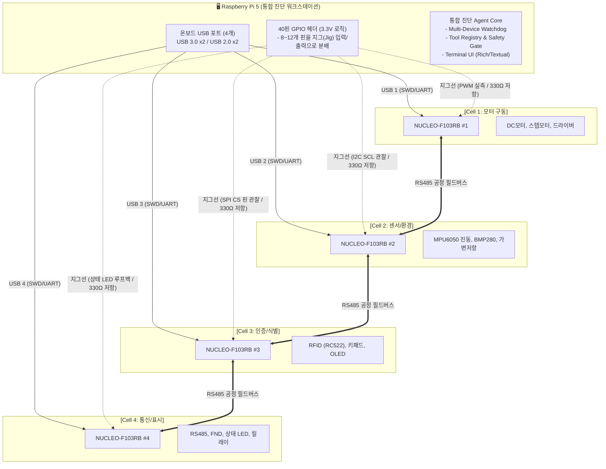
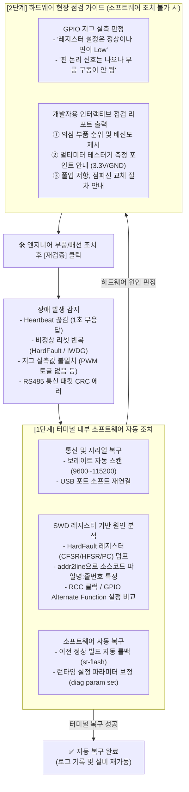

# [아키텍처 v2.2] RPi5 기반 STM32 4개 장비 통합 진단·복구 벤치

> **핵심 방향**:
>
> 1. **Jetson Nano 배제**: AGV 자율주행 대신, **"STM32 산업 장비 고장 진단 및 터미널 자동 복구(SW) / 하드웨어 가이드(HW)"**에 100% 집중.
> 2. **RPi5 토폴로지 최적화**: RPi5를 보드마다 둘 필요 없이, **RPi5 1대가 4개 USB 포트와 40핀 GPIO로 4대의 STM32 Nucleo 보드를 한 번에 직결 진단**하는 '통합 진단 워크스테이션(Central Diagnostic Bench)' 구조 채택.
> 3. **2:2 전문화 분업**: **AI/시스템 파트 2명 + 임베디드 보드/펌웨어 파트 2명**으로 실제 산업체 R&D 협업 구조를 구현하고 명확한 인터페이스 계약(Contract)으로 병목 제거.
> 4. **보유 자원 활용**: 개인당 지급된 RPi5 4대는 개발 시 1인 1독립 환경으로 사용하고, 최종 통합 시 **1대 통합 진단 벤치 + 터치 콘솔 + 경량 AI 노드** 클러스터로 연계.

---

## 1. 하드웨어 연결 및 식별 원리

### 1-1. USB 1케이블 = 3대 통로 (STM32 Nucleo-64)

**NUCLEO-F103RB** 보드는 상단 온보드 ST-LINK/V2-1 덕분에 RPi5와 **Mini-USB 케이블 단 1개**로 모든 통신이 이뤄진다.

| 통로                      | 기능                                                                            | RPi5 도구                           |
| :------------------------ | :------------------------------------------------------------------------------ | :---------------------------------- |
| **SWD (하드웨어 디버그)** | 펌웨어 플래싱, CPU 정지/재개, **레지스터/RAM 읽기 (대상과 디버거 상태에 따름)**, HardFault 정보 덤프 | `openocd`, `gdb-multiarch`, `pyocd` |
| **가상 COM 포트 (UART)**  | 펌웨어 런타임 로그 수신, 대화형 진단 명령 송신                                  | `pyserial` (`/dev/ttyACM*`)         |
| **USB 전원 공급**         | 보드 전원 공급 (리셋은 SWD 경로 사용)                                                     | USB 5V                              |

**보드 기준 사양 및 제약**: 각 셀은 NUCLEO-F103RB의 STM32F103RB(Cortex-M3, 최대 72MHz, Flash 128KB, SRAM 20KB)를 사용한다. 온보드 ST-LINK/V2-1의 VCP는 기본 연결에서 USART2 `PA2`(TX)/`PA3`(RX)를 사용하므로 진단용으로 예약한다. ST-LINK USB는 MCU의 네이티브 USB 포트와 별개다. SWD의 PA13/PA14도 예약한다. 보드의 기본 솔더 브리지 및 점퍼 상태와 USB 케이블의 데이터 지원 여부를 실물에서 확인한다. USB 전원은 리셋 제어 수단이 아니며, 리셋은 ST-LINK/SWD 경로로 수행한다.

4셀 구성은 동일 보드 4대 확보를 전제로 한다. 부품 목록의 STM32 보드에는 수량이 명시되지 않았고 TTL-to-RS485는 2개이므로, 4노드 버스에는 호환 트랜시버 2개 이상을 추가 확보해야 한다. 모터·릴레이 등 부하는 별도 전원과 드라이버를 사용하고 USB 포트 및 보드의 전원 예산, 공통 접지와 역전류 방지를 검증한다.

출처: [ST NUCLEO-F103RB 제품 페이지](https://www.st.com/en/evaluation-tools/nucleo-f103rb.html), [STM32F103RB 데이터시트](https://www.st.com/resource/en/datasheet/stm32f103rb.pdf), [Nucleo-64 사용자 설명서 UM1724](https://www.st.com/resource/en/user_manual/um1724-.pdf).

### 1-2. RPi5 1대에서 4대의 STM32를 혼선 없이 식별하는 방법

RPi5의 4개 USB 포트에 4대의 STM32를 꽂았을 때, 포트 순서가 바뀌어도 고유 식별이 가능하다:

1. **UART 포트 고정**: `/dev/ttyACM0~3` 대신 udev 고유 경로 사용

   ```bash
   /dev/serial/by-id/usb-STMicroelectronics_STM32_STLink_<시리얼번호A>-if02 -> Cell 1
   /dev/serial/by-id/usb-STMicroelectronics_STM32_STLink_<시리얼번호B>-if02 -> Cell 2
   ```

2. **SWD 디버그 타겟 지정**: OpenOCD 실행 시 ST-LINK 하드웨어 시리얼 번호(`adapter serial`) 명시

   ```bash
   openocd -f interface/stlink.cfg -c "adapter serial <시리얼번호A>" -f target/stm32f1x.cfg
   ```

   _각 보드를 독립적으로 중단(Halt), 재부팅(Reset), 메모리 덤프 가능._

---

## 2. 통합 시스템 아키텍처

### 2-1. 하드웨어 배선도 (RPi5 1대 ↔ STM32 4대 직결)



### 2-2. GPIO 지그(Test Jig) 핀 매핑 예시

RPi5의 40핀 헤더에서 각 보드당 2~3핀씩 할당하여 **소프트웨어 레지스터 설정과 실제 디지털 신호를 대조**한다.

| RPi5 GPIO          | 연결 대상 STM32 보드 및 핀      | 용도                    | 진단 검증 포인트                                              |
| :----------------- | :------------------------------ | :---------------------- | :------------------------------------------------------------ |
| **GPIO 17** (입력) | Cell 1: STM32 `PA8` (TIM1_CH1)  | 모터 PWM 출력 실측      | 타이머 레지스터는 도는데 실제 PWM 주파수/듀티가 나오는지      |
| **GPIO 27** (입력) | Cell 2: STM32 `PB8` (I2C1_SCL)  | I2C 클럭 라인 토글 확인 | I2C 버스가 멈췄을 때 클럭 핀이 Low에 묶여(Stuck) 있는지       |
| **GPIO 22** (입력) | Cell 3: STM32 `PA4` (SPI CS, GPIO 출력) | RFID 선택 신호 감지 | SPI 트랜잭션 중 CS 전환 여부 확인 |
| **GPIO 23** (입력) | Cell 4: STM32 `PB12` (RS485 DE GPIO) | 송수신 전환 제어핀 실측 | RS485 송신 시 Driver Enable 신호가 제때 켜지는지              |
| **GPIO 24** (입력) | Cell 4: STM32 `PA5` (LD2) | 보드 상태 LED 신호 감지 | 펌웨어의 LED 출력 논리 상태 확인 |

I2C1의 PB8/PB9는 기본 핀이 아닌 리맵 핀이다. AFIO 클럭과 `AFIO_MAPR.I2C1_REMAP`을 설정하고 3.3V 풀업을 확인한다. Cell 3의 PA5는 SPI1 SCK와 온보드 LD2를 공유한다. Cell 4에서는 USART3 기본 핀 PB10(TX)/PB11(RX)과 별도 GPIO PB12(DE, 필요 시 /RE도 제어)를 사용한다. 각 셀의 RS485 배선과 다른 주변장치 핀 충돌은 펌웨어 핀맵에서 검증한다.

RPi GPIO는 아날로그 전압값을 측정하지 못한다. 3.3V 이내 신호의 High/Low 및 샘플링 가능한 PWM만 판정하며 실제 전압·파형·고속 버스 분석에는 ADC, 로직 분석기 또는 오실로스코프가 필요하다. 330Ω 직렬 저항만으로 5V 신호 보호가 보장되지 않는다. 비상정지는 별도의 하드웨어 인터록 설계와 검증이 필요하며 위 GPIO 표에 구현되어 있지 않다.

_(모든 지그 연결선에는 330Ω 보호 저항 삽입, RPi5 GND와 4개 보드 GND 공통 연결)_

---

### 2-3. 보유 RPi5 4대 최적 분업/협업 전략

| 단계                                        | 운영 방식                                             | 설명                                                                                                        |
| :------------------------------------------ | :---------------------------------------------------- | :---------------------------------------------------------------------------------------------------------- |
| **[개발 단계]**<br/>1인 1세트 독립 개발     | **RPi 1대 : STM32 1대 (x4조)**                        | 팀원 4명이 각자 자기 RPi5에서 담당 셀의 CubeIDE/Makefile 펌웨어 및 센서 드라이버를 병목 없이 개발.          |
| **[통합/시연 단계]**<br/>클러스터 통합 운용 | **RPi #1: 통합 진단 벤치**<br/>(Main Testbed)         | 4개 STM32 보드가 모두 직결되어 SWD 디버그, 시리얼 로그 수집, GPIO 지그를 단독 총괄.                         |
|                                             | **RPi #2: 운영자 터치 콘솔**<br/>(Operator Console)   | 키트의 **7인치 LCD 터치스크린** 장착. 4개 셀 상태판, 진단 진행 상황 시각화, 승인 버튼 전용 Qt GUI 구동.     |
|                                             | **RPi #3: 로컬 경량 SLM 노드**<br/>(Inference Engine) | 네트워크 단절 환경 시연용 로컬 경량 모델(Ollama/llama.cpp) 및 매뉴얼 파일 호스팅. 메인 보드 연산 부하 분리. |
|                                             | **RPi #4: 예비/시뮬레이션 노드**                      | 고장 상황 재현용 가상 트래픽 주입기 또는 예비 개발 보드.                                                    |

---

## 3. 2단계 진단 워크플로우 (Terminal Auto-Fix ➡️ HW Guide)



---

## 4. 진단 Agent의 Multi-Target 모듈 구조

RPi5(메인 진단기) 내부 파이썬 애플리케이션의 소프트웨어 구조:

```text
agent/
├── core/
│   ├── target_manager.py     # 4개 STM32의 연결 상태(포트, 시리얼, 온라인 여부) 관리
│   ├── safety_gate.py        # CPU 정지, 플래시 쓰기, 핀 구동 시 안전 검증
│   └── playbook_runner.py    # 고장 증상별 점검 시퀀스 실행 엔진
├── tools/
│   ├── tool_swd.py           # OpenOCD / GDB 기반 레지스터 덤프 및 플래시 쓰기
│   ├── tool_serial.py        # /dev/serial/by-id/ 포트별 로그 감시 및 diag 명령 송신
│   ├── tool_jig.py           # lgpio 기반 PWM 주파수 측정 및 루프백 판정
│   └── tool_analyzer.py      # addr2line 및 SVD 레지스터 diff 분석
├── profiles/
│   ├── cell1_motor.yaml      # Cell 1 정상 레지스터 스펙 및 점검 체크리스트
│   ├── cell2_sensor.yaml     # Cell 2 정상 레지스터 스펙 및 점검 체크리스트
│   ├── cell3_rfid.yaml       # Cell 3 정상 레지스터 스펙 및 점검 체크리스트
│   └── cell4_comm.yaml       # Cell 4 정상 레지스터 스펙 및 점검 체크리스트
└── ui/
    ├── terminal_dashboard.py # 터미널용 4채널 동시 모니터링 (Rich 기반)
    └── qt_bridge.py          # RPi #2 터치 콘솔(Qt GUI)과 통신하는 브리지
```

---

## 5. 7대 실증 고장 시나리오 (발표 및 시연용)

|   #   | 셀     | 고장 상황 (고의 주입)                              | 1단계: 터미널 자동 해결 (SW)                                                                            | 2단계: 하드웨어 가이드 (HW)                                                                            |
| :---: | :----- | :------------------------------------------------- | :------------------------------------------------------------------------------------------------------ | :----------------------------------------------------------------------------------------------------- |
| **1** | Cell 4 | 펌웨어 수정 중 UART 보레이트 오타 (115200 ➡️ 9600) | **해결**: Agent가 `baud_scan`으로 9600bps 감지 후 통신 복구. 펌웨어 설정 불일치 경고                    | -                                                                                                      |
| **2** | Cell 1 | 널 포인터 참조로 모터 펌웨어 HardFault 정지        | **해결**: SWD로 고장 레지스터 덤프 ➡️ `addr2line`으로 `motor.c:84` 특정 ➡️ 정상 펌웨어 자동 롤백 플래싱 | -                                                                                                      |
| **3** | Cell 2 | I2C1 클럭 활성화 누락 (`RCC->APB1ENR.I2C1EN = 0`)  | **해결**: 레지스터 diff에서 누락 발견 ➡️ 승인 후 패치 빌드 및 배포            | -                                                                                                      |
| **4** | Cell 3 | SPI 워치독(IWDG) 타임아웃 무한 루프                | **해결**: 부팅 리셋 원인이 `IWDG`임을 확인 ➡️ SWD로 PC가 멈춘 `RFID_Read()` 대기 루프 추적 및 리포팅    | -                                                                                                      |
| **5** | Cell 2 | MPU6050 센서의 SDA 점퍼선 단선/탈락                | 시도 후 실패: I2C 주소 응답 없음, 레지스터 설정은 완벽함 확인                                           | **안내**: "SDA(PB9) 배선 및 MPU6050 전원(3.3V)을 멀티미터로 확인" (배선도 출력) |
| **6** | Cell 1 | DC모터 구동 2N2222 트랜지스터 베이스 저항 단선     | 시도 후 실패: 타이머 레지스터 정상, 지그선으로 STM32 PA8 핀 PWM 출력 정상 확인                          | **안내**: "STM32 PA8 신호 정상. 핀 이후 구동단(2N2222 트랜지스터, 모터 외부전원 5V) 점검 필요"         |
| **7** | Cell 4 | RS485 버스의 A선과 B선이 반대로 결선됨             | 시도 후 실패: 양쪽 보드 UART 및 DE 제어핀 정상 확인                                                     | **안내**: "통신 실패 원인 후보: RS485 모듈 A/B 단자 결선 극성 확인"                          |

---

## 6. 기대 효과 및 어필 포인트

1. **Jetson Nano 배제로 인한 완성도 극대화**:
   - 모바일 로봇의 주행 오차, 바닥 마찰, 배터리 방전 등 불확실한 기구적 리스크를 완전히 제거.
   - 프로젝트의 모든 엔지니어링 리소스를 "**펌웨어 디버깅, 레지스터 분석, 하드웨어 계측**"이라는 정통 임베디드 핵심 역량에 100% 집중.
2. **독창적인 HIL(Hardware-in-the-Loop) 진단 컨셉**:
   - 기존의 단순 모니터링 프로젝트와 달리, "**RPi5가 계측 장비(Jig)이자 상위 디버거가 되어 마이크로컨트롤러를 능동적으로 진단하고 치료한다**"는 신선한 패러다임.
3. **취업 면접 킬러 포인트**:
   - ARM Cortex-M 고장 레지스터(CFSR, HFSR, MMFAR) 및 ELF 심볼 분석(addr2line) 경험.
   - 임베디드 통신 프로토콜(UART, I2C, SPI, RS485)의 물리 계층 vs 논리 계층 트러블슈팅 경험 증명.

---

## 7. 팀 분업 체계 (AI 파트 2명 vs 임베디드 파트 2명)

실제 산업 현장의 **"소프트웨어/AI 팀 ↔ 펌웨어/하드웨어 팀"** 분업 구조를 그대로 채택하여, 각 파트가 자기 전문 영역에 100% 몰입하면서도 명확한 인터페이스 계약(Contract)을 통해 병목 없이 결합되도록 설계한다.

```text
┌──────────────────────────────────────────────┐      ┌──────────────────────────────────────────────┐
│        [AI & 시스템 파트 (2명)]              │      │       [임베디드 하드웨어/펌웨어 파트 (2명)]  │
│  - Member A: AI Agent 코어 & 진단 추론 엔진  │      │  - Member C: 구동·센서 제어 & 지그 물리 결선 │
│  - Member B: 다중 타겟 매니저 & Qt 터치 콘솔 │      │  - Member D: 통신·인증 제어 & RS485 버스 망  │
└──────────────────────┬───────────────────────┘      └──────────────────────┬───────────────────────┘
                       │                                                     │
                       └─────────────── [3대 연동 인터페이스 계약] ──────────┘
                                ① USB 계약: SWD 디버그 / UART 구조화 로그 규약
                                ② 물리 계약: RPi5 40핀 GPIO ↔ STM32 지그 배선표
                                ③ 지식 계약: docs/manuals/*.md 장비 매뉴얼
```

### 7-1. 파트 간 3대 인터페이스 계약 (Interface Contracts)

1. **통신 계약 (USB - UART & SWD)**:
   - **UART 로그 포맷**: `diag_core`는 `HB t=<ms> state=<RUN|WARN|FAULT> err=<0x코드>` 및 `FAULT cfsr=<hex> pc=<hex>` 형식의 엄격한 Key-Value 형식으로 RPi5에 출력한다.
   - **UART 제어 명령**: `diag status`, `diag selftest`, `diag param set <k> <v>`, `diag reset` 등 사전 정의된 문자열 명령만 처리한다.
   - **SWD 규약**: 빌드 산출물 폴더에 항상 최신 심볼 파일(`firmware.elf`) 및 SVD 레지스터 파일을 배치한다.
2. **계측 계약 (RPi5 40핀 GPIO Test Jig 배선표)**:
   - 임베디드 팀은 보드별 관찰 핀(PA8, PB8, PA4, PB12, PA5)을 330Ω 보호 저항을 거쳐 지정된 RPi5 GPIO 핀에 브레드보드로 결선해 둔다.
   - AI 팀은 `tool_jig.py`에서 해당 GPIO를 읽기만 하면 샘플링 가능한 PWM 주파수와 디지털 논리 상태를 확인한다.
3. **지식 계약 (`docs/manuals/*.md` 장비 매뉴얼)**:
   - 임베디드 팀은 각 셀 개발 완료 시 `docs/manuals/cellN_spec.md` 파일에 **정상 레지스터 설정값, 임계치(Warn/Fault), 결선도 및 고장 점검 순서**를 마크다운으로 작성해 AI 팀에 전달한다.
   - AI 팀은 이를 시스템 프롬프트에 통째로 주입하여 LLM의 진단 및 리포트 작성용 지식으로 활용한다.

---

### 7-2. 팀원 4인 세부 업무 분장표

| 파트            | 팀원              | 담당 도메인                                  | 상세 개발 업무                                                                                                                                                                                                                                                                                                                                                                                    |
| :-------------- | :---------------- | :------------------------------------------- | :------------------------------------------------------------------------------------------------------------------------------------------------------------------------------------------------------------------------------------------------------------------------------------------------------------------------------------------------------------------------------------------------ |
| **임베디드**    | **Member C**      | **구동 제어, 센서 계측 & 하드웨어 지그**     | - `Cell 1`: DC모터(2N2222A) 및 스텝모터 타이머(PWM) 펌웨어 구현<br/>- `Cell 2`: MPU6050 진동(I2C) 및 BMP280 기압/온도 센서 드라이버 구현<br/>- **하드웨어 지그 배선**: RPi5 40핀 헤더와 4개 STM32 간 보호 저항(330Ω) 지그 회로 결선<br/>- **고장 주입**: 널 포인터 HardFault, I2C 점퍼선 단선, 모터 베이스 저항 단선                                                                              |
| **임베디드**    | **Member D**      | **산업용 통신, 식별 & 공통 펌웨어 규약**     | - `Cell 3`: RFID(RC522, SPI) 태그 인증, 키패드 및 OLED 드라이버 구현<br/>- `Cell 4`: TTL-to-RS485 모듈 기반 4개 셀 간 다자간 필드버스 통신망 구축<br/>- **공통 펌웨어 규약(`diag_core`)**: IWDG 워치독, No-Init RAM 고장 보존, 리셋 원인 판독<br/>- **고장 주입**: RS485 A/B 극성 반전, UART 보레이트 불일치, 워치독 루프                                                                         |
| **AI / 시스템** | **Member A**<br/> | **AI Agent 코어 & 진단·추론 엔진**           | - **진단 플레이북 엔진**: 증상 감지 시 L0~L4 단계별 진단 시퀀스 자동 실행<br/>- **SWD 고장 분석기**: ARM Cortex-M 레지스터(CFSR) 파싱 및 `addr2line` 소스코드 줄번호 역추적<br/>- **Full-Context LLM 연동**: 장비 매뉴얼 프롬프트 주입 및 L4 하드웨어 인터랙티브 리포트 생성<br/>- **Safety Gate**: CPU 정지, 펌웨어 플래시 시 물리적 인터락 검증 미들웨어                                        |
| **AI / 시스템** | **Member B**      | **다중 타겟 디바이스 매니저 & 현장 관제 UI** | - **Multi-Target Manager**: RPi5 4개 USB 포트의 ST-LINK 고유 시리얼 및 UART 포트 1:1 매핑/감시 데몬<br/>- **Tool 계층 구현**: OpenOCD, GDB, `pyserial`, `lgpio` 파이썬 래퍼 스크립트 작성<br/>- **현장 터치 콘솔 (RPi #2 Qt GUI)**: 7인치 LCD 전용 4개 셀 상태판, 진단 터미널 로그, 승인 모달 UI<br/>- **클라우드 연동**: Firebase Firestore(`sensingTable`, `commandTable`) 및 Web 대시보드 구축 |

---

### 7-3. 4주차 협업 로드맵 (병목 없는 마일스톤)

```text
[1주차: 인터페이스 계약 & 환경 셋업]
├── 임베디드 파트: diag_core 규약 정의 및 4개 셀 펌웨어 기본 프로젝트 생성 (Member C: Cell 1·2, Member D: Cell 3·4)
└── AI 파트: RPi5에 OpenOCD/GDB/pyocd 환경 구축, 단일 보드 SWD 레지스터 덤프 PoC 검증

[2주차: 개별 모듈 개발 & 1인 1세트 독립 테스트]
├── 임베디드 파트: Cell 1~4 센서/모터/RFID/RS485 제어 완료, docs/manuals/*.md 작성
└── AI 파트: 4포트 Multi-Target Manager 완성, Tool 화이트리스트 및 LLM 프롬프트 뼈대 구축

[3주차: 결합 및 고장 주입 테스트 (Integration)]
├── 임베디드 파트: 4대 보드를 RPi5 1대에 USB/지그로 전원 결선, 7대 시연용 고장 고의 주입
└── AI 파트: 이상 감지 ➡️ 레지스터 분석 ➡️ 자동 롤백 / 하드웨어 리포트 출력 End-to-End 파이프라인 검증

[4주차: 콘솔 연동 & 최종 시연 리허설]
├── 전체: RPi #2 (7인치 터치 콘솔) Qt GUI 화면 연동 및 승인 워크플로우 실증
└── 전체: 7대 고장 시나리오 무중단 데모 리허설, 발표 지표(자동 해결률, 지연시간) 측정
```
