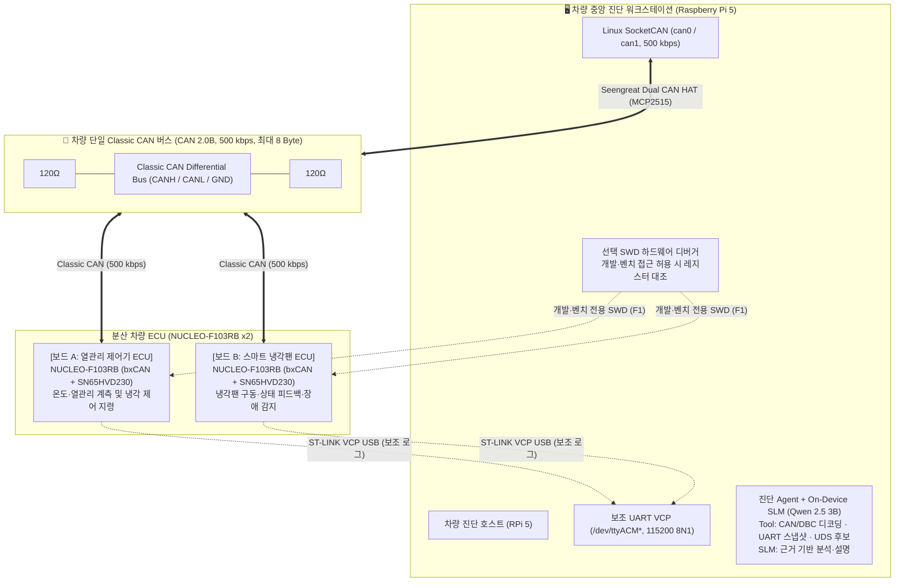
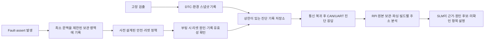

# [아키텍처/설계 v3.4] 차량용 Classic CAN 분산 ECU 진단 벤치 아키텍처 (NUCLEO-F103RB & RPi 5)

> **버전**: v3.4 (2026-11-17 NUCLEO-G474RE 배제 및 NUCLEO-F103RB 단일 Classic CAN 직접 연결 반영)
>
> **[2026-11-17 구조 확정]** 2026-11-16\~17 결정(`PJT-15`, `PJT-16`)에 따라 `NUCLEO-G474RE` 도메인 게이트웨이 및 CAN FD 백본·FOC·Dual-Bank·FFT 구성을 프로젝트 범위에서 **제외**했다. 현재 벤치는 **RPi 5(`can0`, Seengreat RS485 Dual CAN I HAT) + 다중 `NUCLEO-F103RB`(보드 A 열관리 제어기, 보드 B 스마트 냉각팬 ECU)** 를 단일 **Classic CAN (`500 kbps`, 최대 `8B`)** 버스로 직접 연결하고 보조 UART(`/dev/ttyACM*`)를 병행하는 구조다. RPi 5 실측(`can0` `500 kbit/s` + `/dev/ttyACM0`) 기반의 Agent 연동 상세는 `RPI5_Agent_Docker/docs/실측_CAN_UART_연동_설계.md`에 정리되어 있다(정식 CAN ID·임계치는 `PJT-16` 합의 대기).
>
> **문서 상태**: RPi 5 `can0`/`can1` (`500 kbit/s` `ERROR-ACTIVE`) 및 STM32F103 양방향 첫 통신(`0x100` TX / `0x123` RX)과 `/dev/ttyACM0` 보조 UART 수집은 2026-11-17 실측 확인됐다. 보드 A/B 통합 메시지 ID·바이트 배치·주기·진단 DID·임계치 등 미확정 항목은 5-3절에서 관리하며 실측 전까지 실시간 성능·복구 시간을 보장하지 않는다.
>
> **진단 원칙**: CAN을 통한 상태·DTC·부팅/크래시 기록 조회(및 벤치 보조 UART 교차 검증)가 운용의 주 경로다. SWD는 접근 허용된 개발·벤치의 선택 수단이며, 접근 불가 상황에서도 분석 흐름이 완료되어야 한다.

---

## 1. 차량 분산 ECU 시스템 아키텍처 개요

**우선 목표**: 장비·펌웨어·통신 규약·정상 기준을 충분히 확보한 환경에서 증거 수집과 판정의 정확성·재현성을 검증한다.
미확인 장비 접수·미지 규약 추정은 후속 범위다. 상세 전제·단계·수용 조건은
[장비 정보 기반 검증 계획](장비_정보_기반_검증_계획.md)을 따른다.

첫 검증에서는 대상(`NUCLEO-F103RB`)과 단일 Classic CAN 경로(`can0`, `500 kbps`)에서
정상·원본 갱신 지연·로컬 Bus-Off의 구분부터 확인한다. 실제 보드 A/B 규약·고장 주입 조건은 별도로 확정하며,
문서에 남은 CAN ID·주기·DID 초안을 이번 결정으로 승인한 것으로 간주하지 않는다.
충분한 정보는 SWD 접근을 뜻하지 않는다. SWD 없는 경로와 미지원·시간 초과·손상 처리는 유지한다.

본 설계는 **Raspberry Pi 5 중앙 진단 워크스테이션과 다수의 `NUCLEO-F103RB` 분산 ECU가 단일 Classic CAN 버스에 직접 연결되는 벤치**를 구현합니다. 특정 완성차 플랫폼의 실제 네트워크·진단 규격을 재현하거나 차량용 인증을 충족한다는 의미는 아닙니다.

진단 기능은 ECU 내부 고장 검출·기록 → CAN(및 벤치 보조 UART) 조회 → RPi의 규약 해석·증거 보관 → SLM 설명으로 구성한다. SWD를 차단한 제품을 진단하기 위해 보호를 해제하거나 코어를 정지해야 한다는 전제를 두지 않는다.



---

## 2. 하드웨어 스펙 및 역할 분담

| 제어기 명칭 | 하드웨어 보드 | 코어 / 클록 | 통신 프로토콜 | 담당 도메인 및 기능 |
| :-------------------- | :----------------- | :----------------------------------- | :----------------------------------- | :------------------------------------------------------------------------------------------------------------------------------------------- |
| **중앙 진단기** | **Raspberry Pi 5** | Quad A76 @ 2.4GHz | **Classic CAN (`can0`/`can1`, 500k) + 보조 USB UART + 선택 SWD** | SocketCAN 상태·프레임·(지원 시 UDS) 기록 수집, Build ID별 심벌 분석, SLM 근거 설명. SWD는 선택 개발 경로 |
| **보드 A: 열관리 제어기** | **NUCLEO-F103RB** | Cortex-M3 @ 72MHz (128KB Flash, 20KB SRAM) | **bxCAN (Classic CAN 500k) + USART2 VCP** | • 온도·열관리 상태 계측 및 냉각 팬 제어 명령 송신<br/>• 통신 오류·부팅 이력·진단 카운터 기록 |
| **보드 B: 스마트 냉각팬 ECU** | **NUCLEO-F103RB** | Cortex-M3 @ 72MHz (128KB Flash, 20KB SRAM) | **bxCAN (Classic CAN 500k) + USART2 VCP** | • 냉각팬 제어 수신·PWM/구동 및 상태 피드백 송신<br/>• 팬/버스 이상 상태 감지 및 DTC/오류 카운터 기록 |

> **참고**: `RPI5_Agent_Docker`의 기존 소프트웨어 fixture 테스트(`fixture-bench-v1`, `cell2`\~`cell4`)는 가상 BMS/BCM/클러스터 모델(`0x200`/`0x300`/`0x400`)로 유지되며, 실물 벤치는 위 보드 A/B (`NUCLEO-F103RB`) 기준으로 확장합니다.

---

## 3. 하드웨어 결선 가이드 (Classic CAN 단일 버스)

### 3-1. 필요 하드웨어 모듈

아래 수량은 보드 2대 + RPi 5 단일 Classic CAN 벤치 기준이며, [현장 통신 불량 시험](CAN_현장_통신불량_진단_시나리오_설계.md)의 1차 구성(MCU 2대)과 일치한다. 배선·종단의 요구 조건은 확인해야 하며 실제 현장 상태는 측정 전까지 미확인으로 두고 검사한다.

1. **Classic CAN용 외장 트랜시버 2개 (`SN65HVD230` 등)**: `NUCLEO-F103RB` 보드당 1개. `SN65HVD230`(3.3V, 최대 1 Mbps)을 500 kbps 버스에 사용한다. 각 모듈의 모드(standby/slope) 핀·전원·내장 종단저항 탑재 여부를 확인한다. [TI SN65HVD230](https://www.ti.com/product/SN65HVD230)
2. **RPi 5용 CAN HAT**: **Seengreat RS485 Dual CAN I HAT** (`MCP2515` 기반 Classic CAN 2채널: `can0` `spi0.1` IRQ 25, `can1` `spi1.1` IRQ 24, 출고 DIP 기준). 2026-11-17 교체 RPi 5(`serial: 6f1e588610c80344`)에서 `500 kbit/s` `ERROR-ACTIVE` 초기화 및 양방향 통신을 확인했다.
3. **120Ω 종단저항 2개**: 단일 물리 버스의 양 끝에 1개씩 총 2개. HAT 또는 트랜시버 보드에 내장된 종단 점퍼/저항도 총수에 포함한다. CANH/CANL 및 기준 GND를 공통으로 연결한다.

**속도 설정**: 단일 버스는 **`500 kbps` Classic CAN** (표준 11비트 ID, 최대 8B 데이터 프레임) 전용으로 구성한다. [Linux SocketCAN 설정 문서](https://docs.kernel.org/networking/can.html)

### 3-2. NUCLEO-F103RB 핀맵 배선

STM32F103RB는 1개의 `bxCAN` 컨트롤러를 지원하며(USB 주변장치와 핀 공유 가능), 실제 Nucleo 커넥터에 연결할 때는 보드 점퍼·솔더브리지·펌웨어 리맵 설정(`AFIO_MAPR`)을 확인한다. [STM32F103RB 데이터시트 및 RM0008](https://www.st.com/resource/en/reference_manual/rm0008-stm32f101xx-stm32f102xx-stm32f103xx-stm32f105xx-and-stm32f107xx-advanced-armbased-32bit-mcus-stmicroelectronics.pdf), [NUCLEO-F103RB 사용자 매뉴얼 UM1724](https://www.st.com/resource/en/user_manual/um1724-stm32-nucleo64-boards-mb1136-stmicroelectronics.pdf)

- **bxCAN (`CAN1`) — 기본 핀 또는 리맵 핀 중 펌웨어 설정에 일치하는 경로 사용**:
  - 기본 매핑: `PA12` (`CAN_TX`), `PA11` (`CAN_RX`) ➡️ 트랜시버 `TXD` / `RXD` (USB 장치 핀과 공유되므로 동시 사용 불가)
  - 대체 리맵(`CAN_REMAP2`): `PB9` (`CAN_TX`), `PB8` (`CAN_RX`) ➡️ 트랜시버 `TXD` / `RXD`
- **보조 디버그 UART (`USART2` ST-LINK VCP)**:
  - `PA2` (`USART2_TX`), `PA3` (`USART2_RX`) → 온보드 ST-LINK/V2-1 VCP → RPi `/dev/serial/by-id/usb-STMicroelectronics_STM32_STLink_*-if02` (`/dev/ttyACM*`, `115200 8N1`)

---

## 4. NUCLEO-F103RB bxCAN 통신 및 보조 UART 진단 구조

### 4-1. bxCAN 500 kbps 비트 타이밍 및 인터럽트 구성

- **APB1 클록 `36 MHz` 기준 예시**: `Prescaler = 4`, 총 `18 TQ` (`Sync=1`, `BS1=12~14 TQ`, `BS2=3~5 TQ`, `SJW=1 TQ`)로 설정하면 `36 MHz / (4 × 18) = 500 kbps`가 된다. 실제 보드별 APB1 클록과 `CAN_BTR` 설정은 펌웨어마다 별도 확인한다.
- **송수신 인터럽트**: 2026-11-17 실측된 `hw_test CAN normal v1` 펌웨어에서는 `USB_HP_CAN1_TX_IRQn` 및 `USB_LP_CAN1_RX0_IRQn` 인터럽트가 활성 동작해 `0x100` 100 ms 송신(`txok +10/s`)과 `0x123` 수신(`rx=1`)을 처리함을 확인했다.
- **수신 필터**: 초기 통합 시 `FIFO0` 필터를 확인하며, 보드 A/B ID 체계 확정 후 필요한 ID만 통과시키도록 필터를 조정한다.

### 4-2. `CAN_ESR` 레지스터 및 보조 UART 상태 교차 검증

- **하드웨어 오류 상태 (`CAN_ESR`, `0x40006418`)**: `EWGF`(Error Warning), `EPVF`(Error Passive), `BOFF`(Bus-Off), `LEC`(Last Error Code: Stuff/Form/ACK/Bit/CRC), `TEC`/`REC`를 통해 컨트롤러 내부 오류를 구분한다.
- **보조 UART (`/dev/ttyACM*`) 누적 카운터 해석 원칙**: 2026-11-17 `hw_test CAN normal v1` 실측에서 UART 카운터(`txreq`, `txok`, `errcb`, `errcode=0x00001000`, `rx`, `last`, `dlc`)가 부팅 후 **누적 값**임을 확인했다(과거 버스 미연결 시 쌓인 `errcb=1086`이 정상 링크 확립 중 고정 유지되면서 `txok`가 `+10/s` 증가). 따라서 Agent는 단일 스냅샷의 `errcb > 0`만으로 현재 고장을 단정하지 않고 연속 구간 차분(`Δtxok`, `Δerrcb`)으로 현재 상태를 판정한다.

---

## 5. 차량 통신 매트릭스 (Classic CAN 500 kbps)

### 5-1. 1차 실측 프레임 및 보드 A/B 메시지 구조

| CAN ID | 송신 노드 | 메시지 / 용도 | 형식 / 길이 | 현재 상태 (2026-11-17 기준) |
| :------ | :-------- | :------------------------ | :----------- | :---------------------------------------------------------------------------------------------- |
| `0x100` | STM32F103 (`hw_test`) | `HW_TEST_TX` (카운터 `A5 5A 00 XX`) | Classic / 4B | **실측 완료**: RPi `can0`에서 10초간 `99`프레임(약 `100.0 ms` 주기, `bus-errors 0`) 수신 확인 |
| `0x123` | RPi 5 (`cansend`) | 양방향 RX 확인 시험 프레임 | Classic / 4B | **실측 완료**: `cansend can0 123#11223344` 송신 시 STM32 UART `rx=0 -> rx=1 last=0x123 dlc=4` 확인 |
| `TBD` | 보드 A (열관리 제어기) | 온도/열관리 텔레메트리 및 팬 제어 명령 | Classic / 8B | **`PJT-16`, `PJT-20` 합의 대기**: 초안(`A_FAN_CMD=0x080`, `A_THERMAL_STATUS=0x180`, 100 ms, 목표 듀티) 제시됨, 최종 ID·방식 확정 대기 |
| `TBD` | 보드 B (스마트 냉각팬 ECU) | 팬 PWM/회전 상태 피드백·고장 이벤트 | Classic / 8B | **`PJT-15`, `PJT-16` 합의 대기**: `DIAG_REQ`/`B_DIAG_RESP` 8B 배치 반영, ID 계산식(`(우선순위×256)+(장치×64)+기능`) 기준 최종 ID·임계치 확정 대기 |
| `0x7E0`/`0x7E8` | RPi 5 ↔ 각 ECU | `UDS_PHYSICAL_REQUEST/RESPONSE` 후보 | Classic / 8B | **선택 확장 제안**: ECU별 물리 진단 요청/응답 주소 후보 (UDS 구현 여부·실제 ID 미정) |
| `0x7DF` | RPi 5 → 브로드캐스트 | `DIAG_FUNCTIONAL_REQUEST` 후보 | Classic / 8B | **선택 확장 제안**: 기능 요청 주소 후보 |

**진단 계층**: CAN ID는 프로젝트가 정하는 주소이며, `0x7DF` 자체가 UDS 표준을 의미하지 않는다. OBD 기능 요청과 UDS 서비스 의미를 혼용하지 않는다. CAN 위 UDS는 `CAN → ISO-TP → UDS`로 처리하고, DTC는 `ReadDTCInformation (0x19)` 및 snapshot 조회로 수집한다. [Linux ISO-TP 주소·전송 계층](https://kernel.org/doc/html/latest/networking/iso15765-2.html), [udsoncan DTC 조회](https://udsoncan.readthedocs.io/en/latest/udsoncan/client.html)

### 5-2. 기존 가상 벤치 참조용 메시지 초안 (Software Fixture)

아래 `0x200`/`0x300`/`0x400`은 `RPI5_Agent_Docker`의 초기 소프트웨어 검증(`fixture-bench-v1`) 호환용으로 보존된 가상 셀 정의이며, 현재 실물 보드 A/B의 확정 메시지가 아니다.

| CAN ID      | 가상 노드         | 메시지명           | 길이 | 주요 신호 (가상 모델)                                                     |
| :---------- | :---------------- | :----------------- | :--: | :----------------------------------------------------------------------- |
| **`0x200`** | Cell 2 (BMS 모의) | `BMS_STATUS`       | 8 B  | 배터리 전압·충방전 전류·SOC·셀 최고온도                                   |
| **`0x300`** | Cell 3 (BCM 모의) | `BODY_STATUS`      | 8 B  | 스마트키 인증 상태, 도어락 플래그, 비상등 점멸                            |
| **`0x400`** | Cell 4 (클러스터 모의) | `CLUSTER_FEEDBACK` | 8 B  | 표시 속도값, 경고등 래치 상태                                             |

### 5-3. 구현 전 합의해야 할 통신 규약

회의 진행과 항목별 결정 기록에는 [CAN 통신 규약 합의 회의 템플릿](CAN_통신규약_합의_회의_템플릿.md)을 사용합니다. 보드 A/B 정식 메시지 ID와 임계치부터 합의하고 확정 범위만 구현 산출물에 반영합니다.

| 항목 | 확정할 내용 |
| :---------- | :------------------------------------------------------------------------------- |
| 공통 형식 | 프로토콜 버전, 표준 11비트 ID 계산식(`(우선순위×256)+(장치×64)+기능`, `PJT-16`), Classic CAN `500 kbps` 확정, 리틀 엔디안, signed 표현 |
| 신호 배치 | 시작 비트·길이·배율·오프셋·단위(`target_rpm_or_duty` vs `A_FAN_CMD` 듀티 통일)·유효 범위·측정 불가 값·예약 비트 |
| 시간·신뢰도 | 주기(`100 ms` 초안)·타임아웃(`B_FAN_STATUS` stale `500 ms` 등)·무회전 판정 시간·RPM 오차(%)·Sequence·재부팅 구분 |
| 보조 UART 규약 | `/dev/ttyACM*` (`115200 8N1`) 카운터 포맷·epoch·파싱 계약·오류 코드 정의 |
| 진단 경로 | 8B 단일 프레임 `DIAG_REQ`/`B_DIAG_RESP`(`0x01~0x03`, `PJT-16`) vs `0x380/0x300` UDS+ISO-TP(`PJT-20`) 통합 방식 확정 |
| DTC | 전송용 코드·표시 이름·상태 비트·발생/해제 조건·snapshot·영속 보존 정책 |
| 제품 진단 기록 | 버전·Build ID·진단 지원 기능·boot ID·리셋 이력·크래시 DID, 크기·유효성·보존·조회 권한 |
| 제어·테스트 | 허용 명령·파라미터·ACK·중복/재시도·고장 주입 및 원복 절차 |
| 검증 자료 | DBC·진단 설정·정답 프레임을 함께 버전 관리하고 C/Python 양쪽에서 교차 검증 |

이 문서는 위 미확정 항목의 최종 값을 확정하지 않습니다. 합의 전 바이트 배치·주기·시간 제한을 시뮬레이터에 사용한다면 임시 설정으로 표시하고 정식 규약과 구분합니다.

---

## 6. SWD 없이 진단하는 제품 운용 설계

이 절은 **구현 요구사항과 인터페이스 제안**이다. AUTOSAR 스택 도입이나 UDS 서버·영속 기록·크래시 수집 구현이 완료됐다는 뜻은 아니다. DEM의 이벤트·고장 당시 환경 기록, DCM의 제한된 진단 서비스라는 책임 분리 개념을 참고한다. [AUTOSAR DEM](https://www.autosar.org/fileadmin/standards/R24-11/CP/AUTOSAR_CP_SWS_DiagnosticEventManager.pdf)

### 6-1. ECU 공통 진단 기능과 기록 항목

각 `NUCLEO-F103RB` ECU는 도메인 제어 코드와 구분된 `diag_core`를 두고 다음 정보를 제공한다. F103RB의 RAM(20KB)·Flash(128KB) 예산에 맞춰 최소 요약부터 구현하며 전체 메모리 덤프를 요구하지 않는다.

| 구분 | 기록·제공할 내용 | 원칙 |
| --- | --- | --- |
| 장치·펌웨어 식별 | 원본 ECU ID, 펌웨어 버전, 현재 Build ID, 프로토콜/기록 스키마 버전, 지원 기능 | 미구현 기능과 빈 정상 기록 구분 |
| 실시간 생존·상태 | heartbeat, Sequence, boot ID, 동작 상태, 값·샘플 유효 여부 | boot ID는 재부팅 구분이 가능하도록 생성·보존 방식과 롤오버를 합의. 매 프레임 Flash 기록 금지 |
| DTC·스냅샷 | 코드·상태·발생 횟수, 고장 당시 센서/전원/명령/통신 상태와 단위 | 발생·해제·갱신·삭제 정책과 현재/과거 고장 구분 |
| 부팅·리셋 이력 | 부팅 횟수/boot ID, 리셋 원시 플래그와 해석, 마지막 진행 단계 | 초기화 코드가 지우기 전에 리셋 원인 확보. 복수 플래그·미확인 원인도 보존 |
| 최소 크래시 기록 | record ID, 기록 Build ID, 고장 boot ID·uptime, Fault 종류, stacked PC/LR/xPSR, SP·EXC_RETURN, CFSR/HFSR, 유효한 BFAR/MMFAR, 제한된 스택 영역 | Cortex-M3 문맥과 프레임/주소 유효성 기록. 모든 필드를 항상 복구할 수 있다고 가정하지 않음 |

워치독은 리셋 전 인터럽트를 항상 제공하지 않는다. 정상 실행 중 마지막 진행 단계·진행 카운터를 갱신하고 다음 부팅의 리셋 원인과 결합한다. 워치독 리셋 사실만으로 특정 함수나 무한루프를 확정하지 않는다.

### 6-2. Fault 처리와 저장·복구



- Fault 문맥에서는 일반 통신 스택·동적 할당·블로킹 로그·복잡한 Flash erase/write를 호출하지 않는 최소 경로를 설계한다. 스택 손상·중첩 Fault·워치독·전원 상실 때문에 기록이 실패할 수 있으므로 `record_valid`, 누락 필드와 손상 여부를 표현한다. 안전 출력과 리셋은 LLM 응답이나 로그 전송을 기다리지 않는다.
- `.noinit` 등 리셋 보존 RAM은 링커·startup 초기화 제외와 리셋 종류별 보존을 검증한다. 전원 차단 보존을 보장하지 않으며 CRC/매직/스키마로 잔존값·부분 기록을 거른다. RAM 기록은 부팅 후 안전한 시점에 비휘발성 저장소로 옮기는 방안을 검토한다.
- 비휘발성 보존은 별도 Flash 영역(F103RB 기준 1KB 페이지 단위)·용량 상한·마모·중복 억제·기록 순서·완료 표식·전원 차단 복구를 설계한다. 설정/코드 영역과 겹치지 않아야 하며 제품 요구에 맞는 보존 범위를 명시한다. CRC는 무결성 검사이며 인증을 대체하지 않는다.
- 읽기 성공으로 기록을 삭제하지 않는다. 보존 기간·순환 덮어쓰기·용량 초과·삭제 권한은 합의하고, 삭제가 필요하면 읽기와 별도의 승인된 변경 작업으로 둔다.

구현 시 저장 매체와 리셋 보존 특성을 확인한다. [Memfault 크래시 저장 설계 사례](https://docs.memfault.com/docs/mcu/coredumps), [Cortex-M Fault 문맥과 해석 한계](https://interrupt.memfault.com/blog/cortex-m-hardfault-debug)

### 6-3. CAN 조회 계약 (직접 버스)

| 정보 | 조회 경로 제안 | 합의할 항목 |
| --- | --- | --- |
| DTC·snapshot·extended data | UDS `0x19`의 지원 서브기능 | 코드·record number·상태·단위·길이 |
| 식별·Build ID·지원 기능 | UDS `0x22`의 허용된 DID | 프로젝트 정의 DID 번호·스키마·접근 세션 |
| 부팅/리셋·최소 크래시 요약 | UDS `0x22`의 프로젝트 정의 DID | record ID·원본 Build ID·boot ID·시각·유효성 |
| 긴 기록 | ISO-TP 전송. 여러 요청이 필요하면 고정한 기록 ID로 분할 조회 | 최대 길이·offset·전체 무결성·요청 기한·재시도·부하 제한 |

DID 번호와 바이트 배치는 미정이며 `0x19`/`0x22`를 지원하려면 ECU 측 진단 서버가 필요하다. 임의 메모리 주소 읽기를 일반 제품 API로 제공하지 않는다. 정보별 허용 목록·세션/권한·필드 마스킹·요청률을 정하고 접근 거부나 미지원은 별도 결과로 반환한다. [udsoncan 진단 서비스 설명](https://udsoncan.readthedocs.io/en/latest/udsoncan/client.html)

RPi 호스트는 직접 수신한 프레임마다 `origin_ecu`, `collected_at`, `record_id`, `capture_boot_id`, `capture_uptime_ms`, `record_build_id`, 스키마·유효성을 보존한다. 현재 `running_build_id`와 기록 당시 Build ID를 혼동하지 않는다. 현재 값의 만료 여부와 보존된 과거 사건의 유효 여부는 별도다. 서로 다른 MCU/부팅의 uptime을 직접 비교하지 않는다.

### 6-4. RPi 분석·운용과 SWD 역할

1. 호스트는 원본 CAN/UART 로그와 시각·디코더/규약 버전을 보존한다. 응답이 있으면 지원 기능 → 식별/부팅 기록 → DTC/크래시 기록 순으로 수집한다. 파싱·무결성·주소/레코드 매칭 검사는 도구가 수행한다.
2. 개발 측은 **Build ID별 ELF·맵 파일·소스 커밋**을 보관한다. 과거 크래시는 해당 `record_build_id`의 ELF로 분석한다. 심벌이 없거나 빌드가 다르면 소스 위치는 미확인으로 남기며 stacked PC도 유효성·Fault 종류에 따라 원인 명령을 특정하지 못할 수 있다.
3. MCU 정지나 CAN 단절 중에는 CAN으로 즉시 조회할 수 없다. 전체 대기 기한 후 기존 로그(및 살아 있다면 보조 UART)로 보고하고, 설계된 워치독/통신 복귀 뒤의 기록 조회·외부 전원/리셋/CAN 파형 계측·동일 빌드 개발 장비 재현으로 이어간다.
4. SWD는 접근 가능한 개발·벤치에서 원본 기록과 레지스터 대조에 사용한다. 불가하면 `status=unavailable`, `error.code=debug_access_unavailable`와 확인된 이유를 남기고 분석을 계속한다. 연결 실패만으로 보안 잠금이나 MCU 고장을 단정하지 않는다. 접근 불가 후 halt/reset/플래싱을 자동 호출하지 않는다.
5. 보호 해제·옵션 바이트 변경·대량 삭제는 자동 진단 범위에서 제외한다. [ST RDP 설명](https://wiki.st.com/stm32mcu/wiki/Security:RDP)

**완료 기준**: SWD가 비활성화된 운용 프로필에서 정상·센서 무효·샘플 정체·ECU 무응답·재부팅·Fault 기록 회수·기록 없음/손상/미지원·빌드 불일치를 구분한다. 저장 중 리셋/전원 차단, 기록 용량 초과와 CAN 단절 후 재조회도 보존 정책에 맞게 시험한다. SWD 차단 시험은 도구 비활성화/접근 거부 모의로 우선 수행하며 실제 보안 옵션을 변경하지 않는다. 가상 버스 시험, 실물 CAN 시험, 제품 보안 설정 검증은 별개로 기록한다.

---

## 7. 선택 OpenOCD 개발·벤치 다중 F103RB 제어 가이드

이 절은 **SWD 접근이 허용된 개발·벤치에서만** 적용합니다. 제품 운용의 필수 수집·복구 단계가 아닙니다. 접근 불가이면 6절의 CAN/UART 기록·외부 계측·재현 경로로 이어갑니다.

RPi 5에서 다중 `NUCLEO-F103RB` 연결 시 `target/stm32f1x.cfg`와 ST-LINK 고유 시리얼(`st-info --probe` / `pyocd list`)을 명시해 타깃을 구분합니다. 동시 실행 시 프로세스별 GDB/Tcl/Telnet 포트도 분리하거나 사용하지 않는 포트를 비활성화해야 합니다. 아래 명령은 **출력을 안전 상태로 전환하고 halt 승인을 받은 뒤 실행하는 증거 수집 예시**입니다. 자동 `resume`은 수행하지 않습니다.

### 1) NUCLEO-F103RB (Cortex-M3, ST-LINK V2-1)

```bash
openocd -f interface/stlink.cfg -c "adapter serial <F103_시리얼>" \
        -f target/stm32f1x.cfg \
        -c "init; halt; reg; mdw 0xE000ED28 6; shutdown"
```

`interface/stlink.cfg`의 지원 transport는 OpenOCD 버전에 따라 `hla_swd` 또는 `dapdirect_swd` 등으로 달라질 수 있어 위에서는 설정 파일의 기본 선택을 사용합니다. 설치된 설정과 기동 로그에서 확인하고, 연결 과정에서 reset을 수행하는 설정도 피합니다. [OpenOCD ST-LINK 설정](https://github.com/openocd-org/openocd/blob/master/tcl/interface/stlink.cfg)

크래시 덤프 **전에 `reset halt`를 실행하면 고장 당시 증거가 사라질 수 있습니다.** 읽은 현재 PC가 Fault 핸들러 내부라면 원인 명령 주소는 예외 진입 시 저장된 stacked PC에서 찾아야 합니다. 펌웨어가 보관한 예외 프레임·EXC_RETURN을 우선 활용하고, CFSR의 주소 유효 비트에 따라 BFAR/MMFAR를 해석합니다. ELF/build ID도 함께 저장합니다. `reset_halt`와 `resume`은 수집 완료 후 별도 승인된 조치로 분리합니다. [OpenOCD halt/reset 명령](https://www.openocd.org/doc/html/General-Commands.html)

stacked PC도 항상 원인 명령을 가리키지는 않습니다. 비정밀 BusFault(`IMPRECISERR`)나 예외 진입 중 스택 저장 오류가 있으면 주소·프레임의 신뢰도를 낮춰 해석합니다.

`can.bus_state`에서 관측하는 것은 RPi 어댑터(`can0`/`can1`)의 상태입니다. F103RB의 TEC/REC·Bus-Off는 원본 ECU가 UART/CAN으로 보고한 상태(`CAN_ESR` 기반)로 확인하며, 접근 가능한 벤치에서는 SWD 대조를 추가할 수 있습니다. 원격 ECU가 응답하지 않으면 상태는 미확인으로 남깁니다. 어댑터·드라이버가 오류 카운터를 제공하지 않으면 미지원으로 표시하고 0으로 간주하지 않습니다.

---

## 8. 최종 기대 효과

1. **단일 Classic CAN 다중 ECU 벤치**: 게이트웨이 없이 RPi 5(`can0`)와 다수의 `NUCLEO-F103RB`(보드 A/B)가 직접 통신하는 실용적 분산 제어·진단 네트워크를 검증한다.
2. **CAN + 보조 UART 교차 진단**: 버스 트래픽(`candump`)과 STM32 ST-LINK VCP 카운터(`/dev/ttyACM*`)를 분리·결합해 ACK 누락, Bus-Off, 과거 누적 오류를 정확히 판별한다.
3. **근거 기반 진단 설명**: SLM은 결정적 도구와 확정 규약이 생성한 증거만 바탕으로 원인 후보와 점검 순서를 설명하며, Bus-Off만으로 펌웨어 롤백을 선택하지 않는다.
4. **SWD 선택·제품 친화 진단**: SWD가 없어도 ECU 내부 기록·CAN 진단·빌드별 심벌 분석으로 근거를 확보하고, 수집 불가·미지원·기록 손상을 명확히 구분한다.
