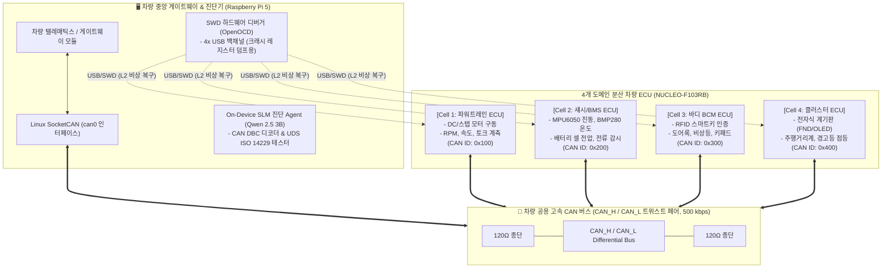

# [아키텍처/설계] 차량용 CAN 통신 도입 및 분산 ECU 진단 설계서

본 문서는 SSAFY 임베디드 프로젝트에서 **Raspberry Pi 5(차량 게이트웨이 & AI 진단기)**와 **4대의 STM32 Nucleo 보드(분산 도메인 ECU)** 간의 통신을 차량 표준인 **CAN 2.0B(Controller Area Network, 500 kbps)** 기반으로 전환하기 위한 **하드웨어 결선, 레지스터/CubeMX 설정, 펌웨어 HAL 코드, 리눅스 SocketCAN 및 진단 에이전트 연동 설계서**입니다.

---

## 1. 차량 도메인 시스템 아키텍처 개요

기존 단순 USB/UART 통신 구조를 실제 자동차 전장 아키텍처(Automotive E/E Architecture)로 개편합니다:



> **하이브리드 진단(Dual-Channel) 전략**:
> 1. **1차 런타임 진단 (CAN Bus)**: 주행 중 실시간 센서 스트림 및 **DTC(Diagnostic Trouble Code, 차량 고장코드)**, UDS 질의를 통해 고장을 실시간 탐지.
> 2. **2차 심층 하드웨어 진단 (SWD Debug)**: MCU가 HardFault에 빠지거나 CAN 통신이 Bus-Off 상태로 죽었을 때, RPi 5가 SWD 경로로 CPU 코어 레지스터와 스택 메모리를 강제 덤프.

---

## 2. 하드웨어 결선 가이드

### 2-1. 필요 하드웨어 부품 목록
1. **STM32용 CAN 트랜시버**: **SN65HVD230 모듈 (3.3V 구동)** 4개 (보드당 1개)
   * *주의: 아두이노용 5V TJA1050/MCP2551은 전압 불일치 문제가 있으므로 반드시 3.3V 전용인 SN65HVD230(또는 VP230) 사용*
2. **RPi 5용 CAN 어댑터**: **USB-to-CAN 어댑터 (Canable / candleLight 펌웨어 기반)** 1개
   * *또는 SPI 기반 MCP2515 모듈도 가능하나, 플러그앤플레이가 지원되는 USB Canable을 적극 권장*
3. **배선재**: 120Ω 저항 2개 (트랜시버 기판에 점퍼로 내장된 경우 저항 불필요), 꼬임선(Twisted Pair)

### 2-2. STM32 ↔ SN65HVD230 트랜시버 핀맵
NUCLEO-F103RB 보드의 bxCAN 기본 핀맵과 트랜시버를 1:1로 연결합니다:

| SN65HVD230 핀 | NUCLEO-F103RB 핀 | 설명 |
|:---|:---|:---|
| **3V3 (VCC)** | **3V3** | 3.3V 전원 공급 |
| **GND** | **GND** | 공통 접지 (RPi와도 공통 GND 권장) |
| **CTX (TXD)** | **PA12** (`CAN_TX`) | MCU CAN 송신 로직 핀 |
| **CRX (RXD)** | **PA11** (`CAN_RX`) | MCU CAN 수신 로직 핀 |
| **CAN_H** | 공용 CAN_H 버스 라인 | 차동 High 신호 (트위스트 페어) |
| **CAN_L** | 공용 CAN_L 버스 라인 | 차동 Low 신호 (트위스트 페어) |

> [!IMPORTANT]
> **종단 저항(Termination Resistor 120Ω) 설정**:
> CAN 버스 양쪽 끝에 위치한 2개 노드의 모듈(예: RPi 5와 가장 먼 Cell 4)에만 120Ω 종단 저항 점퍼를 꽂고, 중간에 물리는 보드들은 종단 저항 점퍼를 제거해야 신호 왜곡이 발생하지 않습니다.

---

## 3. STM32CubeMX bxCAN 설정 (500 kbps 차량 표준)

STM32F103의 APB1 클록은 보통 **36 MHz**입니다. 500 kbps 통신 속도를 만들기 위한 정밀 타이밍 설정값입니다:

### 3-1. 클록 및 타이밍 계산식
$$\text{Bit Rate} = \frac{f_{\text{APB1}}}{\text{Prescaler} \times (1 + \text{BS1} + \text{BS2})}$$
* $f_{\text{APB1}} = 36\,\text{MHz}$
* $\text{Prescaler} = 4$
* $1\,\text{TQ (Sync)} + 12\,\text{TQ (BS1)} + 5\,\text{TQ (BS2)} = 18\,\text{TQ}$
* $\text{Bit Rate} = \frac{36{,}000{,}000}{4 \times 18} = 500{,}000\,\text{bps (500 kbps)}$
* **샘플 포인트**: $\frac{1 + 12}{18} = 72.2\%$ (차량 표준 70\~80% 범위 충족)

### 3-2. CubeMX GUI 파라미터 입력
1. `Connectivity` ➡️ `CAN` 활성화
2. **Parameter Settings**:
   * **Prescaler**: `4`
   * **Time Quanta in Bit Segment 1 (BS1)**: `12 Times`
   * **Time Quanta in Bit Segment 2 (BS2)**: `5 Times`
   * **ReSynchronization Jump Width (SJW)**: `1 Time`
   * **Operating Mode**: `Normal`
   * **Automatic Bus-Off Management**: `Enable` (버스 오류 시 자동 복구)
   * **Automatic Wake-Up**: `Enable`
   * **Automatic Retransmission**: `Enable` (수신 응답 없을 시 재전송)
3. **NVIC Settings**:
   * `USB low priority or CAN RX0 interrupts` ➡️ **Enabled (체크)**

---

## 4. STM32 HAL C 펌웨어 구현 코드

### 4-1. 필수 수신 필터(Filter Bank) 설정
> **주의**: STM32 bxCAN은 필터를 등록하지 않으면 **수신된 모든 프레임을 하드웨어에서 폐기**합니다. 모든 CAN ID를 통과시키는 기본 필터를 반드시 활성화해야 합니다.

`Core/Src/can.c` 또는 `main.c`에 추가:
```c
/* USER CODE BEGIN 2 */
CAN_FilterTypeDef sFilterConfig;

sFilterConfig.FilterBank = 0;
sFilterConfig.FilterMode = CAN_FILTERMODE_IDMASK;
sFilterConfig.FilterScale = CAN_FILTERSCALE_32BIT;
sFilterConfig.FilterIdHigh = 0x0000;
sFilterConfig.FilterIdLow = 0x0000;
sFilterConfig.FilterMaskIdHigh = 0x0000;
sFilterConfig.FilterMaskIdLow = 0x0000;
sFilterConfig.FilterFIFOAssignment = CAN_RX_FIFO0;
sFilterConfig.FilterActivation = ENABLE;
sFilterConfig.SlaveStartFilterBank = 14;

if (HAL_CAN_ConfigFilter(&hcan, &sFilterConfig) != HAL_OK) {
    Error_Handler();
}

// CAN 시작 및 수신 인터럽트 활성화
if (HAL_CAN_Start(&hcan) != HAL_OK) {
    Error_Handler();
}
if (HAL_CAN_ActivateNotification(&hcan, CAN_IT_RX_FIFO0_MSG_PENDING) != HAL_OK) {
    Error_Handler();
}
/* USER CODE END 2 */
```

### 4-2. CAN 프레임 송신 함수 예시 (Cell 1: 파워트레인 RPM 송신)
```c
void Send_ECU1_Status(uint16_t rpm, uint8_t speed_kmh, int8_t motor_temp) {
    CAN_TxHeaderTypeDef txHeader;
    uint8_t txData[8] = {0};
    uint32_t txMailbox;

    txHeader.StdId = 0x100;          // Cell 1 파워트레인 CAN ID
    txHeader.ExtId = 0x01;
    txHeader.RTR = CAN_RTR_DATA;
    txHeader.IDE = CAN_ID_STD;
    txHeader.DLC = 8;
    txHeader.TransmitGlobalTime = DISABLE;

    // 데이터 패킹 (빅엔디언 / 차량 표준)
    txData[0] = (uint8_t)(rpm >> 8);
    txData[1] = (uint8_t)(rpm & 0xFF);
    txData[2] = speed_kmh;
    txData[3] = (uint8_t)motor_temp;
    txData[4] = 0x00; // 정상 상태 (0: OK, 1: DTC Warning)

    HAL_CAN_AddTxMessage(&hcan, &txHeader, txData, &txMailbox);
}
```

### 4-3. CAN 프레임 인터럽트 수신 콜백
```c
void HAL_CAN_RxFifo0MsgPendingCallback(CAN_HandleTypeDef *hcan) {
    CAN_RxHeaderTypeDef rxHeader;
    uint8_t rxData[8];

    if (HAL_CAN_GetRxMessage(hcan, CAN_RX_FIFO0, &rxHeader, rxData) == HAL_OK) {
        // 긴급 제어 명령 수신 (0x010: 중앙 진단기 긴급 정지 명령)
        if (rxHeader.StdId == 0x010 && rxData[0] == 0xFF) {
            HAL_GPIO_WritePin(GPIOA, GPIO_PIN_5, GPIO_PIN_RESET); // 모터 즉시 차단
        }
    }
}
```

---

## 5. Raspberry Pi 5 Linux SocketCAN 환경 구축

RPi 5에 USB Canable 어댑터를 꽂으면 커널이 즉시 `can0`를 생성합니다.

### 5-1. 필수 패키지 설치
```bash
sudo apt-get update
sudo apt-get install -y can-utils
sudo pip3 install --break-system-packages python-can cantools
```

### 5-2. `can0` 인터페이스 활성화 스크립트
```bash
# 500 kbps 속도로 인터페이스 활성화
sudo ip link set can0 type can bitrate 500000 restart-ms 100
sudo ip link set can0 up

# 인터페이스 상태 확인
ip -details link show can0
```

### 5-3. 버스 모니터링 CLI
```bash
# 버스 트래픽 실시간 스니핑
candump -tz can0

# 테스트 패킷 수동 송신 (ID: 0x100, 8바이트)
cansend can0 100#0BB8321900000000
```

---

## 6. 차량 CAN ID 매트릭스 및 DTC 고장 규약

| CAN ID | 송신 노드 | 메시지명 | 주기 | 주요 신호 (Signals) |
|:---|:---|:---|:---:|:---|
| **`0x010`** | **RPi 5 (Gateway)** | `CMD_EMERGENCY` | 이벤트 | 비상 정지(E-Stop), 파라미터 리셋 명령 |
| **`0x100`** | **Cell 1 (파워트레인)** | `STATUS_POWERTRAIN` | 20 ms | RPM(0\~6000), 속도(0\~150km/h), 모터온도, 결함코드 |
| **`0x200`** | **Cell 2 (섀시/BMS)** | `STATUS_CHASSIS_BMS`| 50 ms | 배터리 전압(mV), 잔량(SOC %), 진동 센서 G값 |
| **`0x300`** | **Cell 3 (바디 BCM)** | `STATUS_BODY_KEY` | 100 ms | 스마트키 인증상태, 도어 락/언락, 비상등 플래그 |
| **`0x400`** | **Cell 4 (클러스터)** | `STATUS_CLUSTER` | 100 ms | 총 주행거리(km), 계기판 경고등 점등 상태 |
| **`0x7DF`** | **RPi 5 (진단기)** | `OBD2_BROADCAST_REQ`| 이벤트 | 표준 OBD-II / UDS 서비스 요청 |
| **`0x7E8`** | **Cell 1\~4 (응답)** | `UDS_DIAG_RESP` | 이벤트 | Freeze Frame 덤프, DTC 고장코드 상세 응답 |

### DTC 고장코드 예시
* `0xE101`: 모터 과전류 / 드라이버 발열 경고
* `0xE202`: BMS 배터리 저전압 (Low Voltage Cutoff)
* `0xE203`: I2C 센서 통신 두절
* `0xE301`: RFID 스마트키 인증 실패 (Immobilizer Lock)

---

## 7. Python AI 진단 에이전트 연동 (`tool_can.py` 프로토타입)

진단 Agent가 CAN 버스를 실시간 모니터링하다가 DTC 고장코드가 발생하면 자연어로 즉시 분석하는 파이썬 도구입니다:

```python
import can
import time

def monitor_can_bus_and_diagnose():
    bus = can.interface.Bus(channel='can0', bustype='socketcan')
    print("[INFO] 차량 CAN 버스 모니터링 시작 (500 kbps)...")

    for msg in bus:
        # Cell 1 (0x100) 파워트레인 데이터 수신
        if msg.arbitration_id == 0x100:
            rpm = (msg.data[0] << 8) | msg.data[1]
            temp = msg.data[3]
            fault_flag = msg.data[4]

            if fault_flag != 0:
                print(f"🚨 [DTC 경고 포착] Cell 1 이상 감지! RPM: {rpm}, 온도: {temp}°C")
                # AI 진단 에이전트로 이벤트 전달 및 리포트 요청 트리거
                return {
                    "ecu": "Cell 1 Powertrain",
                    "can_id": hex(msg.arbitration_id),
                    "error_code": f"DTC_0x{fault_flag:02X}",
                    "telemetry": {"rpm": rpm, "temp": temp}
                }

if __name__ == "__main__":
    monitor_can_bus_and_diagnose()
```

---

## 8. 기대 효과 및 포트폴리오 차별화 포인트

1. **실제 차량 네트워크 구조(E/E Architecture) 완벽 재현**:
   * 단순 학부 수준의 UART 통신을 탈피하여, 현대차/모비스/보쉬 등 전장 기업의 표준인 **CAN 버스 + 분산 ECU** 토폴로지를 직접 설계하고 실물 구현.
2. **UDS(ISO 14229) 기반 고장코드(DTC) 시스템 구축**:
   * 차량 고장 시 경고등 점등 및 Freeze Frame 데이터를 로깅하는 실제 차량 진단 프로토콜 연계.
3. **CAN + SWD 하이브리드 진단 기술 특화**:
   * 버스 통신 레벨(CAN)과 실리콘 코어 레벨(SWD)을 결합하여, **"CAN 버스 통신이 끊기더라도 SWD로 들어가 CPU 레지스터를 털어내어 근본 원인을 밝혀내는 세계 유일의 온디바이스 AI 차량 진단 벤치"**로 압도적인 프로젝트 포트폴리오 완성.
