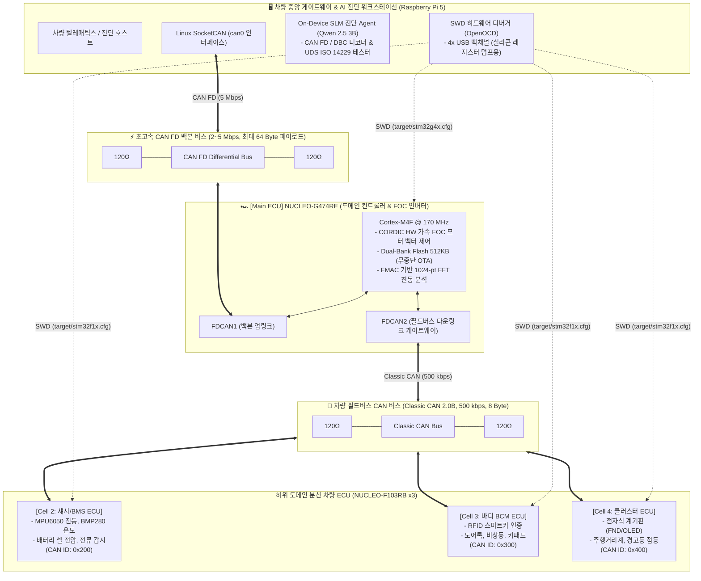

# [아키텍처/설계 v3.0] 차세대 차량용 이종(Heterogeneous) CAN FD / CAN 도메인 아키텍처 및 분산 ECU 진단 설계서

> **버전**: v3.0 (최신 개정)  
> **핵심 업그레이드**: **NUCLEO-G474RE (Cortex-M4F @ 170MHz)** 도입을 통한 **"차량 도메인 컨트롤러(DCU) & FOC 트랙션 모터 인버터"** 구축 및 **CAN FD ↔ Classic CAN 하이브리드 네트워크** 구성.

---

## 1. 차세대 차량 도메인 시스템 아키텍처 개요

본 설계는 테슬라 및 현대차 E-GMP 플랫폼 등 최신 전기차(EV)에 적용되는 **중앙 도메인 제어기(DCU / VCU) 및 고속 CAN FD 백본 네트워크** 구조를 그대로 모사합니다:



---

## 2. 하드웨어 스펙 및 역할 분담 (이종 멀티 ECU)

| 제어기 명칭           | 하드웨어 보드      | 코어 / 클록                                      | 통신 프로토콜                        | 담당 차량 도메인 및 특화 기능                                                                                                                                                    |
| :-------------------- | :----------------- | :----------------------------------------------- | :----------------------------------- | :------------------------------------------------------------------------------------------------------------------------------------------------------------------------------- |
| **중앙 진단기**       | **Raspberry Pi 5** | Quad A76 @ 2.4GHz                                | **CAN FD / USB**                     | • 전체 차량 E/E 모니터링 및 SocketCAN<br/>• On-Device SLM (Qwen 2.5 3B) 고장 진단<br/>• UDS 테스터 및 SWD 크래시 분석기                                                          |
| **Main DCU / VCU** ⭐ | **NUCLEO-G474RE**  | **Cortex-M4F @ 170MHz** (512KB Flash, 128KB RAM) | **FDCAN1 (FD)<br/>FDCAN2 (Classic)** | • **FOC 벡터 모터 제어** (CORDIC 가속기)<br/>• **CAN FD ↔ Classic CAN 지능형 게이트웨이**<br/>• **Dual-Bank 무중단 OTA 및 자동 롤백**<br/>• **온-보드 진동 FFT 실시간 예지보전** |
| **Cell 2: BMS ECU**   | NUCLEO-F103RB      | Cortex-M3 @ 72MHz                                | Classic CAN (500k)                   | • 배터리 셀 팩 전압, 충방전 전류 계측<br/>• 온도/진동 임계치 초과 시 DTC 발행                                                                                                    |
| **Cell 3: 바디 BCM**  | NUCLEO-F103RB      | Cortex-M3 @ 72MHz                                | Classic CAN (500k)                   | • RFID 스마트키 인증 (Immobilizer)<br/>• 도어 개폐, 비상등, 릴레이 안전 제어                                                                                                     |
| **Cell 4: 클러스터**  | NUCLEO-F103RB      | Cortex-M3 @ 72MHz                                | Classic CAN (500k)                   | • 차량 계기판(FND/OLED) 속도/RPM 표출<br/>• DTC 체크 엔진 경고등 점등                                                                                                            |

---

## 3. 하드웨어 결선 가이드 (CAN FD & Classic CAN)

### 3-1. 필요 하드웨어 모듈

1. **STM32G474RE용 CAN FD 트랜시버**: **SN65HVD230** (3.3V) 또는 CAN FD 전용 **TCAN334 / TJA1051T/3** 2개 (FDCAN1, FDCAN2용)
2. **STM32F103RB용 CAN 트랜시버**: **SN65HVD230** 3개 (각 F103 보드용)
3. **RPi 5용 CAN FD 어댑터**: **USB-to-CAN FD 어댑터 (Canable 2.0 / candleLight FD)** 또는 MCP2518FD 모듈
4. **120Ω 종단 저항**: 백본 버스 양단 2개 + 서브 버스 양단 2개

### 3-2. NUCLEO-G474RE 핀맵 배선

NUCLEO-G474RE는 3채널의 FDCAN을 지원합니다:

- **FDCAN1 (RPi 5 백본 업링크)**:
  - `PA12`: `FDCAN1_TX` ➡️ 트랜시버 1 TX
  - `PA11`: `FDCAN1_RX` ➡️ 트랜시버 1 RX
- **FDCAN2 (하위 F103 셀 다운링크)**:
  - `PB6` 또는 `PB13`: `FDCAN2_TX` ➡️ 트랜시버 2 TX
  - `PB5` 또는 `PB12`: `FDCAN2_RX` ➡️ 트랜시버 2 RX

---

## 4. NUCLEO-G474RE 4대 특화 기능 상세 구현

### 4-1. CORDIC 하드웨어 가속기 기반 모터 FOC (Field-Oriented Control)

STM32G474의 내장 CORDIC 코프로세서는 삼각함수 연산을 하드웨어 파이프라인으로 처리합니다:

```c
// CORDIC을 이용한 로터 각도(Theta)의 Sin/Cos 초고속 계산 (단 4클록)
LL_CORDIC_Config(CORDIC, LL_CORDIC_FUNCTION_SINE,
                         LL_CORDIC_PRECISION_6CYCLES,
                         LL_CORDIC_SCALE_0,
                         LL_CORDIC_NBWRITE_1,
                         LL_CORDIC_NBREAD_2,
                         LL_CORDIC_INSIZE_32BITS,
                         LL_CORDIC_OUTSIZE_32BITS);

LL_CORDIC_WriteData(CORDIC, (uint32_t)theta_q31);
sin_val = (int32_t)LL_CORDIC_ReadData(CORDIC);
cos_val = (int32_t)LL_CORDIC_ReadData(CORDIC);
// 파크 역변환(Inverse Park Transform)을 거쳐 3상 PWM 생성
```

### 4-2. Dual-Bank Flash를 활용한 "무중단 펌웨어 OTA & 안전 롤백"

512 KB Flash가 **Bank 1 (0x08000000, 256KB)**과 **Bank 2 (0x08040000, 256KB)**로 완벽 분리되어 있습니다:

```c
// Bank 1 실행 중 Bank 2에 새 펌웨어 플래싱 후 원클릭 뱅크 스왑
void Execute_DualBank_Swap(void) {
    FLASH_OBProgramInitTypeDef obInit;
    HAL_FLASH_Unlock();
    HAL_FLASH_OB_Unlock();

    HAL_FLASHEx_OBGetConfig(&obInit);
    // BFB2 옵션 비트를 토글하여 부팅 뱅크 변경
    obInit.OptionType = OPTIONBYTE_USER;
    obInit.USERType = OB_USER_BFB2;
    obInit.USERConfig = (obInit.USERConfig & OB_BFB2_ENABLE) ? OB_BFB2_DISABLE : OB_BFB2_ENABLE;

    HAL_FLASHEx_OBProgram(&obInit);
    HAL_FLASH_OB_Launch(); // 시스템 리셋 후 새 뱅크로 즉시 무중단 부팅
}
```

### 4-3. FMAC / CMSIS-DSP 기반 1024-point 실시간 진동 FFT 분석

진동 센서 데이터를 170MHz 속도로 MCU 내에서 직접 주파수 영역으로 변환하여 베어링/기어 결함을 로컬에서 즉시 감지합니다:

```c
#include "arm_math.h"

#define FFT_LENGTH 1024
arm_rfft_fast_instance_f32 S;
float32_t vReal[FFT_LENGTH];
float32_t vOutput[FFT_LENGTH];

void Analyze_Vibration_FFT(void) {
    arm_rfft_fast_init_f32(&S, FFT_LENGTH);
    arm_rfft_fast_f32(&S, vReal, vOutput, 0);
    // 특정 이상 고조파(120Hz 피크) 감지 시 CAN FD로 즉시 DTC 프레임 송출
}
```

---

## 5. 차량 통신 매트릭스 (CAN FD 64-Byte + Classic CAN 8-Byte)

### 5-1. CAN FD 백본 버스 (RPi 5 ↔ NUCLEO-G474RE, 5 Mbps)

| CAN ID      | 송신 노드  | 메시지명             |   길이   | 주요 신호 명세                                                                         |
| :---------- | :--------- | :------------------- | :------: | :------------------------------------------------------------------------------------- |
| **`0x050`** | **G474RE** | `DCU_FAST_TELEMETRY` | **64 B** | 3상 모터 전류(U/V/W), 로터 각도, 토크, CORDIC 상태, FFT 상위 피크 4개, 전압            |
| **`0x060`** | **G474RE** | `GATEWAY_AGGREGATED` | **64 B** | 하위 F103 셀(BMS, BCM, Cluster)에서 올라온 센서/상태 데이터를 1개 프레임으로 압축 중계 |
| **`0x070`** | **RPi 5**  | `OTA_FIRMWARE_BLOCK` | **64 B** | Dual-Bank Bank 2용 신규 펌웨어 바이너리 청크 스트리밍                                  |
| **`0x7DF`** | **RPi 5**  | `UDS_DIAG_REQUEST`   | **8 B**  | ISO 14229 표준 통합 진단 질의                                                          |

### 5-2. Classic CAN 필드버스 (G474RE ↔ NUCLEO-F103RB x3, 500 kbps)

| CAN ID      | 송신 노드         | 메시지명           | 길이 | 주요 신호 명세                                       |
| :---------- | :---------------- | :----------------- | :--: | :--------------------------------------------------- |
| **`0x200`** | Cell 2 (BMS)      | `BMS_STATUS`       | 8 B  | 배터리 총전압(mV), 방전전류(mA), SOC(%), 셀 최고온도 |
| **`0x300`** | Cell 3 (BCM)      | `BODY_STATUS`      | 8 B  | 스마트키 인증 상태, 도어락 플래그, 비상등 점멸       |
| **`0x400`** | Cell 4 (클러스터) | `CLUSTER_FEEDBACK` | 8 B  | 현재 표시 중인 속도값, 경고등 래치 상태              |

---

## 6. OpenOCD 진단 벤치 멀티 타깃 제어 가이드

RPi 5 진단 벤치에서 코어 아키텍처가 다른 두 칩(Cortex-M4 G474 vs Cortex-M3 F103)을 완벽히 분리 제어합니다:

### 1) NUCLEO-G474RE (Cortex-M4, ST-LINK V3E)

```bash
openocd -f interface/stlink.cfg -c "adapter serial <G474_시리얼>" \
        -c "transport select swd" -f target/stm32g4x.cfg \
        -c "init; reset halt; reg; resume; exit"
```

### 2) NUCLEO-F103RB (Cortex-M3, ST-LINK V2-1)

```bash
openocd -f interface/stlink.cfg -c "adapter serial <F103_시리얼>" \
        -c "transport select swd" -f target/stm32f1x.cfg \
        -c "init; reset halt; reg; resume; exit"
```

---

## 7. 차별화 및 최종 기대 효과

1. **글로벌 전장 표준 아키텍처(DCU + CAN FD) 완성**:
   - 단순 소형 장비 제어를 넘어, **CAN FD 백본 + 중앙 도메인 제어기(DCU) + 하위 CAN 필드버스**라는 최신 현대차/테슬라 전장망을 그대로 실증.
2. **하드웨어 가속기(CORDIC/FMAC) 기반 고효율 FOC/FFT 구현**:
   - SW 라이브러리가 아닌 실리콘 내장 가속기를 활용하여 모터 벡터 제어 및 진동 FFT를 극초저지연으로 수행.
3. **무중단 Dual-Bank OTA 및 AI 자율 롤백**:
   - 주행 중 무중단 펌웨어 교체와, 오류 발생 시 SLM(Qwen 2.5 3B)과 연계한 SWD 하드웨어 레벨 자동 롤백 시스템 구축.
