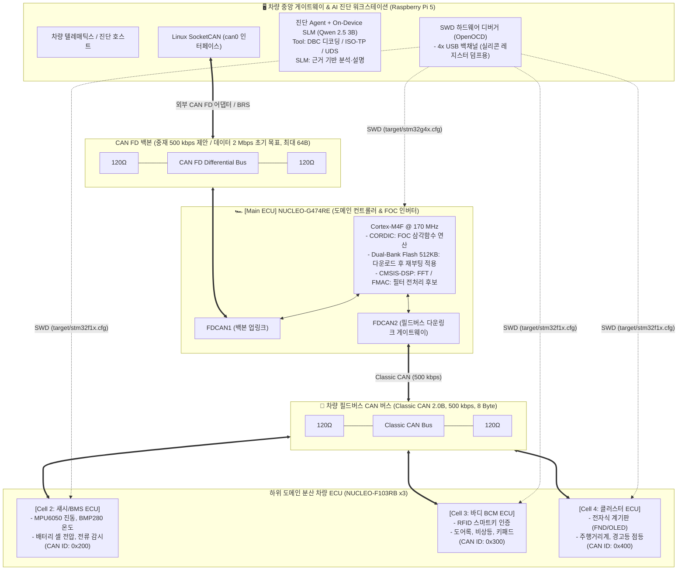

# [아키텍처/설계 v3.1] 차량용 CAN FD / Classic CAN 도메인 아키텍처 및 분산 ECU 진단 벤치

> **버전**: v3.1 (2026-11-03 기술 검토 반영)
>
> **핵심 업그레이드**: **NUCLEO-G474RE (Cortex-M4F @ 170MHz)** 도입을 통한 **"차량 도메인 컨트롤러(DCU) & FOC 트랙션 모터 인버터"** 구축 및 **CAN FD ↔ Classic CAN 하이브리드 네트워크** 구성.
>
> **문서 상태**: 구현 전 설계. MCU 기능과 프로젝트 목표를 구분하며, 통신 속도·실시간 성능·복구 시간은 실측 전까지 보장하지 않는다. 바이트 배치·주기·진단 주소 등 미확정 항목은 5-3절에서 관리한다.

---

## 1. 차세대 차량 도메인 시스템 아키텍처 개요

본 설계는 **상위 CAN FD 백본과 하위 Classic CAN 필드버스를 연결하는 도메인 게이트웨이**를 실습 벤치로 구현합니다. 특정 완성차 플랫폼의 실제 네트워크·진단 규격을 재현하거나 차량용 인증을 충족한다는 의미는 아닙니다. FOC 구동에는 Nucleo 보드 외에 모터 전력단, 게이트 드라이버, 전류·위치 계측 및 보호 회로가 필요합니다.



---

## 2. 하드웨어 스펙 및 역할 분담 (이종 멀티 ECU)

| 제어기 명칭           | 하드웨어 보드      | 코어 / 클록                                                                       | 통신 프로토콜                        | 담당 차량 도메인 및 특화 기능                                                                                                                                                  |
| :-------------------- | :----------------- | :-------------------------------------------------------------------------------- | :----------------------------------- | :----------------------------------------------------------------------------------------------------------------------------------------------------------------------------- |
| **중앙 진단기**       | **Raspberry Pi 5** | Quad A76 @ 2.4GHz                                                                 | **CAN FD / USB**                     | • 전체 차량 E/E 모니터링 및 SocketCAN<br/>• On-Device SLM (Qwen 2.5 3B) 고장 진단<br/>• UDS 테스터 및 SWD 크래시 분석기                                                        |
| **Main DCU / VCU** ⭐ | **NUCLEO-G474RE**  | **Cortex-M4F @ 최대 170MHz** (512KB Flash, 128KB SRAM: 96KB SRAM + 32KB CCM SRAM) | **FDCAN1 (FD)<br/>FDCAN2 (Classic)** | • CORDIC 기반 FOC 연산 및 외부 전력단 제어<br/>• CAN FD ↔ Classic CAN 게이트웨이<br/>• Dual-Bank 다운로드·재부팅 적용·부트로더 복구<br/>• CMSIS-DSP 진동 FFT 및 이상 징후 분석 |
| **Cell 2: BMS ECU**   | NUCLEO-F103RB      | Cortex-M3 @ 72MHz                                                                 | Classic CAN (500k)                   | • 배터리 셀 팩 전압, 충방전 전류 계측<br/>• 온도/진동 임계치 초과 시 DTC 발행                                                                                                  |
| **Cell 3: 바디 BCM**  | NUCLEO-F103RB      | Cortex-M3 @ 72MHz                                                                 | Classic CAN (500k)                   | • RFID 스마트키 인증 (Immobilizer)<br/>• 도어 개폐, 비상등, 릴레이 안전 제어                                                                                                   |
| **Cell 4: 클러스터**  | NUCLEO-F103RB      | Cortex-M3 @ 72MHz                                                                 | Classic CAN (500k)                   | • 차량 계기판(FND/OLED) 속도/RPM 표출<br/>• DTC 체크 엔진 경고등 점등                                                                                                          |

---

## 3. 하드웨어 결선 가이드 (CAN FD & Classic CAN)

### 3-1. 필요 하드웨어 모듈

1. **G474 FDCAN1용 CAN FD 트랜시버 1개**: 예를 들어 **TCAN334G**(3.3V 단일 전원) 또는 **TJA1051T/3**(VCC 5V, VIO 3.3V). 목표 데이터 전송률에 대한 제조사 보증을 정확한 부품 번호로 확인한다. **SN65HVD230과 TCAN334 일반형은 최대 1 Mbps이므로 2~5 Mbps 백본 후보에서 제외**한다. TCAN334와 TCAN334G는 구분해야 한다. [TI SN65HVD230](https://www.ti.com/product/SN65HVD230), [TI TCAN33x 사양](https://www.ti.com/product/TCAN334), [NXP TJA1051 데이터시트](https://www.nxp.com/docs/en/data-sheet/TJA1051.pdf)
2. **Classic CAN용 트랜시버 4개**: G474 FDCAN2용 1개 + F103용 3개. SN65HVD230(3.3V, 최대 1 Mbps)을 500 kbps 필드버스에 사용할 수 있다. 각 모듈의 모드 핀·전원·내장 종단저항도 확인한다.
3. **RPi 5용 CAN FD 어댑터 1개**: Linux SocketCAN에서 CAN FD와 BRS를 지원하는 USB 어댑터, 또는 **MCP2518FD 컨트롤러 + CAN FD 트랜시버**가 포함된 SPI 모듈. RPi GPIO나 트랜시버만으로 CAN 인터페이스가 구성되지는 않는다. CANable 계열은 제품명만으로 판단하지 않고 보드·트랜시버·펌웨어·드라이버의 FD 지원을 확인한다.
4. **120Ω 종단저항**: 각 물리 버스의 양 끝에 1개씩, 총 4개. 모듈에 내장된 저항을 포함한 수량이다. CANH/CANL과 기준 GND를 연결하고 두 버스의 CANH/CANL을 직접 연결하지 않는다.

**속도 설정 초안**: 백본은 중재 구간 `500 kbps`, BRS 사용 시 데이터 구간 `2 Mbps`를 초기 목표로 제안한다. `5 Mbps`는 배선·트랜시버·어댑터·비트 타이밍 검증 후 확장 목표이며, 버스 전체가 항상 5 Mbps로 동작한다는 의미가 아니다. 필드버스는 `500 kbps` Classic CAN 전용으로 구성하고 FD 프레임을 보내지 않는다. [Linux SocketCAN 설정 문서](https://docs.kernel.org/networking/can.html)

### 3-2. NUCLEO-G474RE 핀맵 배선

STM32G474RE는 FDCAN 3개를 지원하며, 이 벤치에서는 2개를 사용합니다. 아래 MCU 핀을 실제 Nucleo 커넥터에 연결할 때는 보드 회로도와 다른 주변장치의 핀 충돌을 확인합니다. [STM32G474RE 데이터시트](https://www.st.com/resource/en/datasheet/stm32g474re.pdf), [NUCLEO-G4 사용자 매뉴얼](https://www.st.com/resource/en/user_manual/dm00556337-stm32g4-nucleo64-boards-mb1367-stmicroelectronics.pdf)

- **FDCAN1 (RPi 5 백본 업링크)**:
  - `PA12` (AF9): `FDCAN1_TX` ➡️ 트랜시버 1 `TXD`
  - `PA11` (AF9): `FDCAN1_RX` ⬅️ 트랜시버 1 `RXD`
- **FDCAN2 (하위 F103 셀 다운링크)**:
  - `PB6` 또는 `PB13` (AF9): `FDCAN2_TX` ➡️ 트랜시버 2 `TXD`
  - `PB5` 또는 `PB12` (AF9): `FDCAN2_RX` ⬅️ 트랜시버 2 `RXD`

---

## 4. NUCLEO-G474RE 4대 특화 기능 상세 구현

### 4-1. CORDIC 하드웨어 가속기 기반 모터 FOC (Field-Oriented Control)

STM32G474의 내장 CORDIC 코프로세서는 삼각함수 연산을 하드웨어 파이프라인으로 처리합니다:

```c
// 개념 예제: CORDIC 클록 활성화 및 리셋 후 사용한다.
// theta_q31은 angle / pi를 Q1.31로 표현한 값이다.
// NBWRITE_1은 리셋 후 기본 modulus=1을 사용하는 경우이다.
// 다른 연산에서 modulus를 변경했다면 재설정하거나 NBWRITE_2를 사용한다.
LL_CORDIC_Config(CORDIC, LL_CORDIC_FUNCTION_SINE,
                         LL_CORDIC_PRECISION_6CYCLES,
                         LL_CORDIC_SCALE_0,
                         LL_CORDIC_NBWRITE_1,
                         LL_CORDIC_NBREAD_2,
                         LL_CORDIC_INSIZE_32BITS,
                         LL_CORDIC_OUTSIZE_32BITS);

LL_CORDIC_WriteData(CORDIC, (uint32_t)theta_q31);
sin_val = (int32_t)LL_CORDIC_ReadData(CORDIC);
cos_val = (int32_t)LL_CORDIC_ReadData(CORDIC);
// 이 결과는 Park/Inverse Park 변환의 일부이다.
// 전류 제어기, 위치 추정, SVPWM, 데드타임·과전류 보호는 별도로 구현한다.
```

`LL_CORDIC_PRECISION_6CYCLES`를 사용하면서 전체 처리를 "4클록"으로 단정할 수는 없습니다. 정밀도 설정과 레지스터 입출력을 포함한 지연을 측정합니다. CORDIC 자체가 저소음·고토크를 보장하지는 않습니다. [ST CORDIC 공식 예제](https://github.com/STMicroelectronics/STM32CubeG4/blob/master/Projects/NUCLEO-G474RE/Examples_LL/CORDIC/CORDIC_CosSin/Src/main.c)

### 4-2. Dual-Bank Flash를 활용한 펌웨어 다운로드와 재부팅 기반 복구

512KB Flash는 **DBANK 옵션이 Dual-Bank로 설정된 경우** 256KB씩 두 뱅크로 구성됩니다. 기본 매핑에서 시작 주소는 Bank 1 `0x08000000`, Bank 2 `0x08040000`입니다. Read-While-Write는 다른 뱅크의 코드 실행과 기록을 지원하지만, 부트로더·메타데이터 영역을 제외한 이미지 크기와 실행 중 접근 경로를 따로 검토해야 합니다.

```text
출력 안전 상태·업데이트 승인 확인
  → 비활성 슬롯에 다운로드 (전송 순서·재전송·이미지 길이 확인)
  → 이미지 무결성·타깃·버전·벡터 테이블 검증
  → 시험 부팅 상태를 영속 기록
  → 검증된 부트로더 정책으로 재부팅
  → 자체진단 성공 시 새 이미지 확정
  → 실패·확정 타임아웃 시 정상 이미지로 복구
```

**BFB2는 부팅 선택 옵션이며, 단순 토글이 완전한 OTA·롤백을 구현하지는 않습니다.** 옵션 바이트 재로드에는 리셋이 수반되므로 펌웨어 적용은 무중단이 아닙니다. 부팅 매핑·링커 주소·벡터 재배치·전원 차단 복구를 포함한 부트로더 설계가 필요합니다. CAN FD는 전송 경로일 뿐이며, Bus-Off 중에는 같은 경로로 다운로드할 수 없습니다. 복구 시간은 다운로드·검증·재부팅·자체진단을 구분해 실측하고 "1초"를 보장하지 않습니다. [ST RM0440, Flash 및 Boot configuration](https://www.st.com/resource/en/reference_manual/dm00355726-stm32g4-series-advanced-armbased-32bit-mcus-stmicroelectronics.pdf)

### 4-3. CMSIS-DSP 기반 1024-point 진동 FFT와 FMAC 필터 전처리

**FFT는 Cortex-M4F에서 CMSIS-DSP로 수행합니다. FMAC은 FIR/IIR 등 필터 연산용 가속기이며 FFT 전용 하드웨어가 아닙니다.** FMAC 전처리 적용은 별도 구현·검증 항목입니다. [ST STM32G474RE 기능 설명](https://www.st.com/en/microcontrollers-microprocessors/stm32g474re.html)

```c
#include "arm_math.h"

#define FFT_LENGTH 1024
arm_rfft_fast_instance_f32 S;
float32_t vReal[FFT_LENGTH];
float32_t vOutput[FFT_LENGTH];

// 부팅 시 한 번 실행하고 반환 상태를 확인한다.
arm_status Init_Vibration_FFT(void) {
    return arm_rfft_fast_init_f32(&S, FFT_LENGTH);
}

// S 초기화 성공 및 1024개 샘플 확보 후 호출한다.
// vReal에는 DC 제거·윈도 처리를 끝낸 데이터를 넣는다.
void Analyze_Vibration_FFT(void) {
    arm_rfft_fast_f32(&S, vReal, vOutput, 0);
    // 실수 FFT의 DC/Nyquist 패킹을 구분하여 크기 스펙트럼을 계산한다.
    // 주파수 변환: f[k] = k * sample_rate_hz / FFT_LENGTH
}
```

전체 스펙트럼은 64바이트 한 프레임에 들어가지 않으므로 `0x050`에는 피크 요약만 전송합니다. 샘플링 주파수·윈도·진폭 단위·축·샘플 시각을 함께 정의해야 합니다. 특정 120Hz 피크만으로 베어링 결함을 확정하지 않고 회전수·센서 대역폭·정상 기준과 비교합니다. 현재 센서는 Cell 2에 있으므로 **원시 진동 샘플을 G474로 전달할 경로·대역폭 또는 G474 직접 연결 여부는 미확정**입니다. RMS 값만으로 원래의 FFT를 복원할 수 없습니다. [Arm CMSIS-DSP RFFT 구현·설명](https://github.com/ARM-software/CMSIS-DSP/blob/main/Source/TransformFunctions/arm_rfft_fast_f32.c)

---

## 5. 차량 통신 매트릭스 (ID 할당 초안)

### 5-1. CAN FD 백본 버스 (RPi 5 ↔ NUCLEO-G474RE)

| CAN ID  | 송신 노드 | 메시지명                  | 프레임 / 데이터 길이 | 의미와 미확정 사항                                                                               |
| :------ | :-------- | :------------------------ | :------------------- | :----------------------------------------------------------------------------------------------- |
| `0x010` | RPi 5     | `EMERGENCY_STOP`          | Classic / 8B         | 벤치 정지 요청. 데이터 배치·수신 확인·중복 처리 미확정. 통신 장애 시 동작할 독립 보호 경로 필요  |
| `0x050` | G474RE    | `DCU_FAST_TELEMETRY`      | FD / 64B             | 전류·로터 각도·토크·CORDIC 상태·FFT 피크 4개·전압의 요약. 바이트 배치 미확정                     |
| `0x060` | G474RE    | `GATEWAY_AGGREGATED`      | FD / 64B             | BMS·BCM·Cluster 상태를 취합. 셀별 유효 여부·원본 Sequence·수신 후 경과시간을 포함하도록 설계     |
| `0x070` | RPi 5     | `OTA_FIRMWARE_BLOCK`      | FD / 64B             | 프로젝트 전용 전송안. 헤더·순서·재전송·완료 응답 규약이 필요하며 64B 전체가 이미지 데이터는 아님 |
| `0x7E0` | RPi 5     | `UDS_PHYSICAL_REQUEST`    | Classic / 8B 전송안  | G474 진단 요청 주소 후보. 다른 ECU의 주소·중계 방식은 별도 합의                                  |
| `0x7E8` | G474RE    | `UDS_PHYSICAL_RESPONSE`   | Classic / 8B 전송안  | 위 요청에 대한 ISO-TP 응답 주소 후보. 긴 응답은 여러 프레임으로 분할                             |
| `0x7DF` | RPi 5     | `DIAG_FUNCTIONAL_REQUEST` | Classic / 8B 전송안  | 기능 주소 후보로 예약. 초기 구현에서는 ECU별 요청을 우선하고 지원 서비스·응답 정책을 별도 정의   |

**표기**: 데이터 길이와 DLC 코드는 다릅니다. 8B는 DLC 코드 8, CAN FD 64B는 DLC 코드 15입니다. FD 길이는 0~8, 12, 16, 20, 24, 32, 48, 64B이며, SocketCAN의 `len`은 실제 바이트 수를 나타냅니다. [Linux CAN FD 프레임 설명](https://docs.kernel.org/networking/can.html)

**진단 계층**: CAN ID는 프로젝트가 정하는 주소이며, `0x7DF` 자체가 UDS 표준을 의미하지 않습니다. OBD 기능 요청과 UDS 서비스 의미를 혼용하지 않습니다. CAN 위 UDS는 `CAN → ISO-TP → UDS`로 처리하고, DTC는 `ReadDTCInformation (0x19)` 및 snapshot 조회로 수집합니다. 사용자 정의 주기 고장 알림을 추가한다면 별도 ID·스키마가 필요합니다. [Linux ISO-TP 주소·전송 계층](https://kernel.org/doc/html/latest/networking/iso15765-2.html), [udsoncan DTC 조회](https://udsoncan.readthedocs.io/en/latest/udsoncan/client.html)

### 5-2. Classic CAN 필드버스 (G474RE ↔ NUCLEO-F103RB x3, 500 kbps)

| CAN ID      | 송신 노드         | 메시지명           | 길이 | 주요 신호 명세                                                           |
| :---------- | :---------------- | :----------------- | :--: | :----------------------------------------------------------------------- |
| **`0x200`** | Cell 2 (BMS)      | `BMS_STATUS`       | 8 B  | 배터리 전압·충방전 전류·SOC·셀 최고온도. 전송 단위·배율·부호 규약 미확정 |
| **`0x300`** | Cell 3 (BCM)      | `BODY_STATUS`      | 8 B  | 스마트키 인증 상태, 도어락 플래그, 비상등 점멸                           |
| **`0x400`** | Cell 4 (클러스터) | `CLUSTER_FEEDBACK` | 8 B  | 현재 표시 중인 속도값, 경고등 래치 상태                                  |

Cell 2~4의 `0x200/0x300/0x400`은 필드버스 메시지입니다. RPi는 기본적으로 `0x060` 집계 데이터를 받으며 원본 ID가 자동으로 백본에 나타나지는 않습니다. G474는 FD 프레임을 그대로 F103에 전달하지 않고 정의된 신호 단위로 재구성해야 합니다. G474에서 클러스터로 보내는 속도/RPM·경고등 명령과 BCM 제어 메시지의 ID·페이로드는 아직 미정입니다.

### 5-3. 구현 전 합의해야 할 통신 규약

회의 진행과 항목별 결정 기록에는 [CAN 통신 규약 합의 회의 템플릿](CAN_통신규약_합의_회의_템플릿.md)을 사용합니다. BMS 메시지·집계 영역부터 합의하고 확정 범위만 구현 산출물에 반영합니다.

| 항목        | 확정할 내용                                                                      |
| :---------- | :------------------------------------------------------------------------------- |
| 공통 형식   | 프로토콜 버전, 11/29비트 ID, Classic/FD 구분, BRS, 바이트 순서, signed 표현      |
| 신호 배치   | 시작 비트·길이·배율·오프셋·단위·유효 범위·측정 불가 값·예약 비트                 |
| 시간·신뢰도 | 주기·타임아웃·최초 수신 전 UNKNOWN·만료 후 STALE·Sequence·재부팅 구분            |
| 집계 정책   | 셀별 원본 데이터 수신 시각·유효 상태·오래된 데이터 처리·갱신 방식                |
| 진단 경로   | ECU별 요청/응답 ID, G474의 중계/대리 응답 여부, ISO-TP 및 UDS 응답 시간·NRC 처리 |
| DTC         | 전송용 코드·표시 이름·상태 비트·발생/해제 조건·snapshot·영속 보존 정책           |
| 제어·OTA    | 허용 명령·파라미터·ACK·중복/재시도·승인·실패 시 동작·이미지 검증                 |
| 검증 자료   | DBC·진단 설정·정답 프레임을 함께 버전 관리하고 C/Python 양쪽에서 교차 검증       |

이 문서는 위 항목의 최종 값을 확정하지 않습니다. 합의 전 바이트 배치·주기·시간 제한을 시뮬레이터에 사용한다면 임시 설정으로 표시하고 정식 규약과 구분합니다.

---

## 6. OpenOCD 진단 벤치 멀티 타깃 제어 가이드

RPi 5에서 G474/F103별 설정 파일과 ST-LINK 시리얼을 명시해 타깃을 선택합니다. 동시 실행 시 프로세스별 GDB/Tcl/Telnet 포트도 분리하거나 사용하지 않는 포트를 비활성화해야 합니다. 아래 명령은 **출력을 안전 상태로 전환하고 halt 승인을 받은 뒤 실행하는 증거 수집 예시**입니다. 자동 `resume`은 수행하지 않습니다.

### 1) NUCLEO-G474RE (Cortex-M4, ST-LINK V3E)

```bash
openocd -f interface/stlink.cfg -c "adapter serial <G474_시리얼>" \
        -f target/stm32g4x.cfg \
        -c "init; halt; reg; mdw 0xE000ED28 6; shutdown"
```

### 2) NUCLEO-F103RB (Cortex-M3, ST-LINK V2-1)

```bash
openocd -f interface/stlink.cfg -c "adapter serial <F103_시리얼>" \
        -f target/stm32f1x.cfg \
        -c "init; halt; reg; mdw 0xE000ED28 6; shutdown"
```

`interface/stlink.cfg`의 지원 transport는 OpenOCD 버전에 따라 `hla_swd` 또는 `dapdirect_swd` 등으로 달라질 수 있어 위에서는 설정 파일의 기본 선택을 사용합니다. 설치된 설정과 기동 로그에서 확인하고, 연결 과정에서 reset을 수행하는 설정도 피합니다. [OpenOCD ST-LINK 설정](https://github.com/openocd-org/openocd/blob/master/tcl/interface/stlink.cfg)

크래시 덤프 **전에 `reset halt`를 실행하면 고장 당시 증거가 사라질 수 있습니다.** 읽은 현재 PC가 Fault 핸들러 내부라면 원인 명령 주소는 예외 진입 시 저장된 stacked PC에서 찾아야 합니다. 펌웨어가 보관한 예외 프레임·EXC_RETURN을 우선 활용하고, CFSR의 주소 유효 비트에 따라 BFAR/MMFAR를 해석합니다. ELF/build ID도 함께 저장합니다. `reset_halt`와 `resume`은 수집 완료 후 별도 승인된 조치로 분리합니다. [OpenOCD halt/reset 명령](https://www.openocd.org/doc/html/General-Commands.html)

stacked PC도 항상 원인 명령을 가리키지는 않습니다. 비정밀 BusFault(`IMPRECISERR`)나 예외 진입 중 스택 저장 오류가 있으면 주소·프레임의 신뢰도를 낮춰 해석합니다. [ST PM0214, Fault status 및 예외 문맥](https://www.st.com/resource/en/programming_manual/pm0214-stm32-cortexm4-mcus-and-mpus-programming-manual-stmicroelectronics.pdf)

`can.bus_state`에서 관측하는 것은 RPi 어댑터의 상태입니다. G474/F103의 TEC/REC·Bus-Off는 별도 텔레메트리나 해당 ECU의 SWD 진단으로 확인해야 합니다. 어댑터·드라이버가 오류 카운터를 제공하지 않으면 미지원으로 표시하고 0으로 간주하지 않습니다.

---

## 7. 차별화 및 최종 기대 효과

1. **도메인 게이트웨이 실습**: CAN FD 백본과 Classic CAN 필드버스의 데이터 취합·진단 중계를 검증한다.
2. **MCU 연산 특성 검증**: CORDIC 기반 FOC 연산, CMSIS-DSP FFT, 필요 시 FMAC 필터를 구현하고 주기·지연·부하를 측정한다.
3. **근거 기반 진단·복구**: SLM은 원인 후보와 점검 순서를 설명하며, 플레이북과 Safety Gate가 증거 수집·승인·재부팅 복구·재검증을 관리한다. Bus-Off만으로 펌웨어 롤백을 선택하지 않는다.
